# Phase 7: Security Architecture & Threat Model

**Document Version:** 1.0.0  
**Phase:** 07 — Admin Authentication, Session Management & Role-Based Access Control  
**Status:** Completed & Proposed (Milestone 7.0)  
**Date:** 2026-11-12  

---

## 1. Threat Model (STRIDE Methodology)

| Threat Category | Potential Attack Vector | Impact | Mitigation Strategy Implemented |
|---|---|---|---|
| **Spoofing Identity** | • Credential stuffing / brute-force password guessing<br>• Session token forgery or prediction<br>• Account enumeration | High | • Pre-scrypt token-bucket rate limiting (max 5 failed attempts per 15 min per IP/email)<br>• Constant-time scrypt password verification with 16-byte random salt<br>• Generic error responses (*"Invalid email or password"*) for both missing accounts and bad passwords<br>• 256-bit cryptographically secure pseudorandom session tokens (`crypto.randomBytes(32)`). |
| **Tampering with Data** | • Client-side cookie payload manipulation<br>• Forging admin roles inside cookies<br>• Intercepting and altering requests | High | • **Dual-Layer Session Architecture:** Client cookie contains only an opaque signed session token. User role and active status are ALWAYS resolved server-side from PostgreSQL.<br>• HMAC-SHA256 signature using `AUTH_SECRET` verified in Edge middleware prior to routing.<br>• Next.js Server Action POST-only origin validation. |
| **Repudiation** | • Administrator modifies pricing, deletes records, or changes user roles and denies action | Medium | • Mandatory `AuditLog` generation on all authentication milestones (login success, login failure, logout, role change, admin creation).<br>• Records `actorId`, `actorEmail`, `ipAddress`, `userAgent`, timestamp, and sanitized details JSON. |
| **Information Disclosure** | • Leaking password hashes or database credentials<br>• Exposing session tokens in client JavaScript / XSS<br>• Leaking admin data in server errors | High | • `HttpOnly: true` cookies (completely inaccessible to client-side JavaScript).<br>• `Secure: true` in production (enforcing HTTPS transport).<br>• Database stores ONLY the SHA-256 hash of the session token; stolen database dumps cannot be used to forge live sessions.<br>• Sanitized error wrappers: stack traces and connection strings are never returned to the client. |
| **Denial of Service** | • Spammed massive payload strings to exhaust CPU via expensive scrypt computations<br>• Flooding database connection pools | Medium | • Zod payload schema validation enforces `email` max 255 chars and `password` max 128 chars.<br>• Memory rate limiting intercepts requests before invoking scrypt hashing.<br>• Pooled database connections with explicit timeouts. |
| **Elevation of Privilege** | • Low-privileged user (`EDITOR`) directly calling admin-only Server Actions or APIs (`manage_admins`, `change_user_roles`) | Critical | • Server-side permission guards (`requirePermission("manage_admins")`) verified inside Server Actions and Route Handlers.<br>• Authorization is never entrusted to UI visibility toggles alone. |

---

## 2. Authentication Flow Diagram

```mermaid
sequenceDiagram
    autonumber
    actor Admin as Administrator
    participant Browser as Browser Client
    participant MW as Edge Middleware
    participant Action as Login Server Action
    participant Scrypt as Scrypt Verifier
    participant DB as PostgreSQL Database
    participant Audit as Audit Logger

    Admin->>Browser: Enters email and password on /admin/login
    Browser->>Action: POST submitAdminLoginAction(credentials)
    
    rect rgb(20, 20, 30)
        Note over Action: Step 1: Input & Rate Limiting
        Action->>Action: Validate schema with Zod (email, password)
        Action->>Action: Check Rate Limiter (max 5 fails / 15 min)
    end

    rect rgb(20, 30, 20)
        Note over Action,DB: Step 2: Account Lookup & Scrypt Verification
        Action->>DB: AdminUser.findFirst(email, isActive: true)
        alt Account Missing or Inactive
            Action->>Audit: createAuditLog("AUTH_LOGIN_FAILED", "Unknown or inactive account")
            Action-->>Browser: Return generic error: "Invalid email or password"
        else Account Found
            Action->>Scrypt: verifyPassword(password, user.passwordHash)
            alt Password Mismatch
                Action->>Audit: createAuditLog("AUTH_LOGIN_FAILED", user.id)
                Action-->>Browser: Return generic error: "Invalid email or password"
            end
        end
    end

    rect rgb(30, 20, 30)
        Note over Action,DB: Step 3: Session Creation & Token Storage
        Action->>Action: Generate raw 32-byte cryptosecure token
        Action->>Action: Compute SHA-256 hash of raw token
        Action->>DB: AdminSession.create(userId, sessionHash, expiresAt: now + 8h)
        Action->>Action: Sign cookie payload with AUTH_SECRET (HMAC-SHA256)
        Action->>Audit: createAuditLog("AUTH_LOGIN_SUCCESS", user.id)
        Action-->>Browser: Set-Cookie: vts_session (HttpOnly, Secure, SameSite=Lax, MaxAge=28800s)
    end

    Browser->>MW: Request GET /admin/dashboard
    MW->>MW: Verify HMAC signature of vts_session
    alt Invalid or Expired Cookie
        MW-->>Browser: Redirect 302 to /admin/login?callbackUrl=/admin/dashboard
    else Valid Cookie Signature
        MW->>Browser: Allow route rendering (Pass to Server Component)
    end
```



---

## 3. Role-Based Access Control (RBAC) Matrix

VOIDTECH SOLUTION defines 3 administrative roles in `UserRole`:
1. **`SUPER_ADMIN`**: Ultimate system owner. Full authority over administrators, security configurations, and commercial records.
2. **`ADMIN`**: Technical and operations manager. Full authority over services, pricing, enquiries, portfolio, and FAQs. Cannot provision or alter administrators.
3. **`EDITOR`**: Content curator. Can edit public marketing content (services, portfolio, FAQs) and triage inbound leads. Cannot modify pricing packages, delete enquiries, or alter system settings.

### Granular Permission Mapping

| Permission Key | Description | SUPER_ADMIN | ADMIN | EDITOR |
|---|---|:---:|:---:|:---:|
| `dashboard:view` | Access admin dashboard shell and summary telemetry | ✅ | ✅ | ✅ |
| `enquiries:view` | Inspect inbound client enquiries and project briefs | ✅ | ✅ | ✅ |
| `enquiries:update_status` | Update enquiry lifecycle status (New -> Contacted -> Converted) | ✅ | ✅ | ❌ |
| `enquiries:delete` | Purge or permanently delete enquiry records | ✅ | ❌ | ❌ |
| `services:manage` | Create, update, or reorder agency service offerings | ✅ | ✅ | ✅ |
| `pricing:manage` | Modify package pricing, deliverables, or INR tiers | ✅ | ✅ | ❌ |
| `portfolio:manage` | Create, update, or edit case studies and concept prototypes | ✅ | ✅ | ✅ |
| `faqs:manage` | Create, update, or reorder agency FAQ items | ✅ | ✅ | ✅ |
| `settings:manage` | Modify global site settings, maintenance mode, contact email | ✅ | ❌ | ❌ |
| `audit_logs:view` | Inspect immutable security audit log trail | ✅ | ✅ | ❌ |
| `admins:manage` | Provision, deactivate, or reset administrative accounts | ✅ | ❌ | ❌ |
| `admins:change_role` | Promote or demote user access roles | ✅ | ❌ | ❌ |

---

## 4. Session Engine Architecture & Lifecycle

### Dual-Layer Session Verification
To reconcile Next.js Edge runtime constraints with database-backed revocable sessions:
1. **Layer 1 — Edge Middleware Guard (`src/middleware.ts`):**
   - The cookie `vts_session` contains a signed token string: `<sessionId>.<token>.<hmacSignature>`.
   - The Edge middleware uses standard Web Crypto API (`crypto.subtle`) to verify the HMAC signature against `AUTH_SECRET` in sub-millisecond time.
   - If the signature is forged, tampered, or expired, the request is immediately rejected at the network edge with zero database load.
2. **Layer 2 — Server-Side Revocation & RBAC Guard (`src/server/security/session.ts`):**
   - Inside Server Components and Server Actions, `getAuthenticatedAdmin()` queries `AdminSession` in PostgreSQL:
     ```typescript
     const sessionHash = hashSessionToken(rawToken);
     const session = await prisma.adminSession.findUnique({
       where: { sessionToken: sessionHash },
       include: { user: true },
     });
     ```
   - Verifies:
     - Session exists in database.
     - `expiresAt > new Date()`.
     - `user.isActive === true`.
   - Updates `lastActiveAt` to enable idle timeout detection (idle limit: 2 hours).

### Session Revocation Protocols
- **Explicit Logout:** Deletes the specific `sessionToken` record from `admin_sessions` and clears the cookie.
- **Global Logout (Revoke All Sessions):** `DELETE FROM admin_sessions WHERE userId = ?` — immediately kicks out all active devices.
- **Account Deactivation:** Setting `AdminUser.isActive = false` immediately invalidates all active sessions upon their next server request.

---

## 5. Database Change Proposal: `AdminSession` Model

### Proposed Schema Addition in `prisma/schema.prisma`
```prisma
model AdminSession {
  id           String    @id @default(cuid())
  userId       String
  user         AdminUser @relation(fields: [userId], references: [id], onDelete: Cascade)
  sessionToken String    @unique // Cryptographic SHA-256 hash of the client cookie token
  ipAddress    String?
  userAgent    String?
  expiresAt    DateTime
  lastActiveAt DateTime  @default(now())
  createdAt    DateTime  @default(now())

  @@index([userId])
  @@index([expiresAt])
  @@map("admin_sessions")
}
```

### Updates to Existing `AdminUser` Model
```prisma
model AdminUser {
  ...
  sessions     AdminSession[]
  ...
}
```

### Incremental Migration Strategy (`20261112000001_add_admin_sessions`)
- DDL statements:
  ```sql
  CREATE TABLE "admin_sessions" (
      "id" TEXT NOT NULL,
      "userId" TEXT NOT NULL,
      "sessionToken" TEXT NOT NULL,
      "ipAddress" TEXT,
      "userAgent" TEXT,
      "expiresAt" TIMESTAMP(3) NOT NULL,
      "lastActiveAt" TIMESTAMP(3) NOT NULL DEFAULT CURRENT_TIMESTAMP,
      "createdAt" TIMESTAMP(3) NOT NULL DEFAULT CURRENT_TIMESTAMP,

      CONSTRAINT "admin_sessions_pkey" PRIMARY KEY ("id")
  );

  CREATE UNIQUE INDEX "admin_sessions_sessionToken_key" ON "admin_sessions"("sessionToken");
  CREATE INDEX "admin_sessions_userId_idx" ON "admin_sessions"("userId");
  CREATE INDEX "admin_sessions_expiresAt_idx" ON "admin_sessions"("expiresAt");

  ALTER TABLE "admin_sessions" ADD CONSTRAINT "admin_sessions_userId_fkey" 
      FOREIGN KEY ("userId") REFERENCES "admin_users"("id") ON DELETE CASCADE ON UPDATE CASCADE;
  ```
- **Reversible Teardown (`down.sql`):**
  ```sql
  DROP TABLE IF EXISTS "admin_sessions" CASCADE;
  ```
- **Execution Constraint:** This migration will be staged locally and validated with `prisma validate`. It will **NOT** be executed against the Neon production database without explicit owner authorization.

---

## 6. MFA Architectural Evaluation

The existing OTP infrastructure (`src/server/security/otp.service.ts`) provides full support for email-based 6-digit OTP verification.
* **Architectural Decision for Phase 7:**
  - Standard primary authentication uses **Email + Scrypt Password**.
  - OTP verification infrastructure is prepared for **Step-Up Authentication** on sensitive actions (e.g. promoting a user to `SUPER_ADMIN` or resetting credentials).
  - MFA is **optional / phased**, rather than blocking Phase 7 login, to avoid lockouts while establishing baseline administration.
