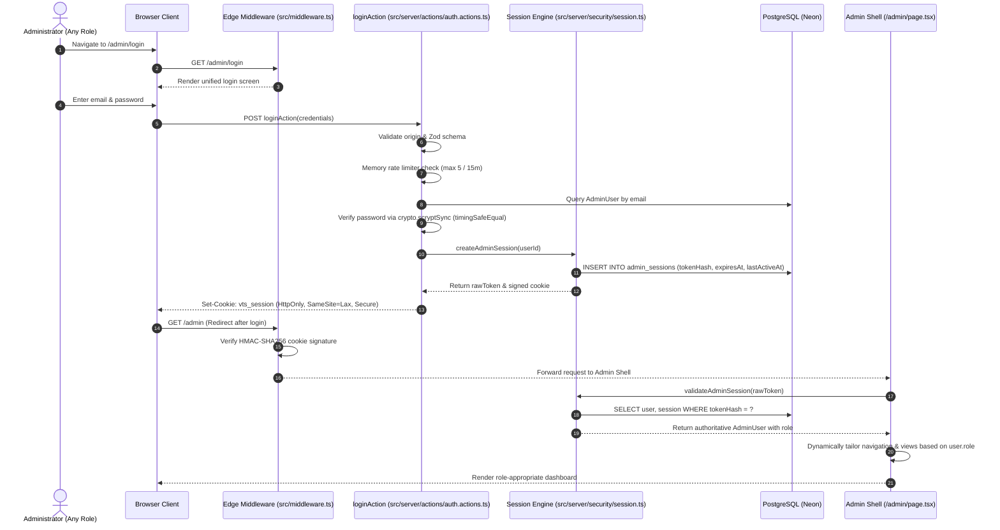

# Phase 7: Security Architecture & Threat Model

**Document Version:** 1.2.0 (Owner-Approved: Single SUPER_ADMIN Governance & Shared Login Architecture)  
**Phase:** 07 — Admin Authentication, Session Management & Role-Based Access Control  
**Status:** Approved for Implementation (Milestones 7.1 & 7.2 Complete; Architecture Updated for 7.3+)  
**Date:** 2026-11-12  

---

## 1. Threat Model & Security Controls (STRIDE Methodology)

| Threat Category | Potential Attack Vector | Impact | Mitigation Strategy Implemented |
|---|---|---|---|
| **Spoofing Identity** | • Credential stuffing / brute-force password guessing<br>• Session token forgery or prediction<br>• Account enumeration | High | • Pre-scrypt memory token-bucket rate limiting (max 5 failed attempts per 15 min per IP/email)<br>• Constant-time scrypt password verification with 16-byte random salt<br>• Generic error responses (*"Invalid email or password"*) for both missing accounts and bad passwords<br>• 256-bit cryptographically secure pseudorandom session tokens (`crypto.randomBytes(32)`). |
| **Tampering with Data** | • Client-side cookie payload manipulation<br>• Forging admin roles inside cookies<br>• Intercepting and altering requests | High | • **Dual-Layer Session Architecture:** Client cookie contains only an opaque signed session token. User role and active status are ALWAYS resolved server-side from PostgreSQL.<br>• HMAC-SHA256 signature using `AUTH_SECRET` verified in Edge middleware as an early rejection filter.<br>• Next.js Server Action POST-only origin validation. |
| **Repudiation** | • Administrator modifies pricing, deletes records, or changes user roles and denies action | Medium | • Mandatory `AuditLog` generation on all authentication milestones (login success, login failure, logout, role change, admin creation, lead deletion).<br>• Records `actorId`, `actorEmail`, `ipAddress`, `userAgent`, timestamp, and sanitized details JSON. |
| **Information Disclosure** | • Leaking password hashes or database credentials<br>• Exposing session tokens in client JavaScript / XSS<br>• Leaking admin data in server errors | High | • `HttpOnly: true` cookies (inaccessible to client JavaScript).<br>• `Secure: true` in production (enforcing HTTPS transport).<br>• Database stores ONLY the SHA-256 hash of the session token; stolen database dumps cannot be used to forge live sessions.<br>• Sanitized error wrappers: stack traces and connection strings are never returned to the client. |
| **Denial of Service** | • Spammed massive payload strings to exhaust CPU via expensive scrypt computations<br>• Flooding database connection pools | Medium | • Zod payload schema validation enforces `email` max 255 chars and `password` max 128 chars.<br>• Memory rate limiting intercepts requests before invoking scrypt hashing.<br>• Pooled database connections with explicit timeouts. |
| **Elevation of Privilege** | • Low-privileged user (`EDITOR`) calling admin-only Server Actions or APIs (`manage_admins`, `change_user_roles`, `delete_enquiry`) | Critical | • Server-side permission guards (`requirePermission`) verified inside Server Actions and Route Handlers.<br>• Role fields strictly controlled server-side (user-supplied payload role values rejected).<br>• Authorization is never entrusted to UI visibility toggles alone. |

---

## 2. Cookie Security, XSS Defense & Output Encoding

### Clarification on `HttpOnly` and XSS Limits
> [!IMPORTANT]
> While the `HttpOnly` cookie attribute completely prevents client-side JavaScript (`document.cookie`) from reading or extracting the raw session token, **`HttpOnly` does NOT eliminate Cross-Site Scripting (XSS)**. An injected script executing in the victim's authenticated browser context can still dispatch authenticated requests (ambient authority / request hijacking) without reading the cookie.

### Multi-Layered XSS Defense Architecture
1. **Context-Aware Output Encoding:** React 19 / Next.js JSX automatically escapes all dynamic content before injecting it into the DOM, neutralizing standard injection payloads (`<script>`, `onerror`, etc.).
2. **Strict Zod Input Sanitization:** All incoming text (names, emails, notes, briefs) is validated and type-constrained by Zod before processing.
3. **Content Security Policy (CSP):** Strict CSP headers configured to disallow inline script execution (`script-src 'self'`), forbid unauthorized object embeds (`object-src 'none'`), and prevent clickjacking framing (`frame-ancestors 'none'`).
4. **Server-Side Authorization Boundaries:** Sensitive operations require explicit confirmation or step-up verification, limiting the blast radius of any automated client-side request hijacking.

---

## 3. Comprehensive CSRF Protection Strategy

### Limitations of `SameSite=Lax`
> [!WARNING]
> `SameSite=Lax` provides strong default protection against cross-site POST requests from third-party sites. However, `SameSite=Lax` is **NOT a complete CSRF defense on its own**: it still permits top-level cross-site GET navigations (window open, link clicks) and offers incomplete protection in environments with sibling subdomains or legacy clients.

### CSRF Mitigation Architecture
1. **Zero State-Changing GET Endpoints:** All administrative mutations (login, logout, status updates, settings changes, account creation) are strictly implemented as HTTP `POST` requests or Next.js Server Actions. Any `GET` request attempting a mutation is rejected.
2. **Strict Origin & Host Validation:** State-changing requests verify that the incoming `Origin` (or `Referer` fallback) header matches the authoritative application `Host`:
   ```typescript
   export function validateRequestOrigin(request: Request): boolean {
     const origin = request.headers.get("origin");
     const host = request.headers.get("host");
     if (!origin) {
       // Referer fallback if origin header is omitted by browser
       const referer = request.headers.get("referer");
       if (!referer) return false;
       const refererHost = new URL(referer).host;
       return refererHost === host;
     }
     const originHost = new URL(origin).host;
     return originHost === host;
   }
   ```
3. **Next.js Server Action Protection:** Next.js Server Actions use non-guessable, cryptographically signed Action IDs and enforce origin validation by default.

---

## 4. Edge and Server-Side Session Validation

### Dual-Layer Validation Architecture
1. **Layer 1 — Edge Middleware Guard (`src/middleware.ts`):**
   - **Role:** Early rejection mechanism only.
   - **Mechanism:** Inspects `vts_session` cookie; validates that the HMAC-SHA256 signature matches `AUTH_SECRET` using Web Crypto API (`crypto.subtle`).
   - **Explicit Boundary:** **Edge HMAC verification is NOT proof of current authorization.** An Edge check merely confirms that the token was signed by the server and has not expired cryptographically. It cannot detect database session revocation, user deactivation, or role changes.
   - **Performance:** Sub-millisecond rejection of forged, tampered, or expired tokens with zero database load.
2. **Layer 2 — Server-Side Authoritative Database Guard (`src/server/security/session.ts`):**
   - **Role:** Authoritative validation, active state verification, and RBAC enforcement.
   - **Mechanism:** Queries `admin_sessions` in PostgreSQL by hashing the raw token with SHA-256:
     ```typescript
     const session = await prisma.adminSession.findUnique({
       where: { sessionToken: hashSessionToken(rawToken) },
       include: { user: true },
     });
     ```
   - **Authoritative Checks:**
     1. Session row exists in database (has not been revoked).
     2. `session.expiresAt > new Date()` (absolute 8-hour limit).
     3. `Date.now() - session.lastActiveAt.getTime() <= 30 * 60 * 1000` (idle timeout: 30 minutes).
     4. `session.user.isActive === true` (account is currently enabled).
     5. Loads the user's current authoritative role directly from the database row.
   - **Idle Touch:** Updates `session.lastActiveAt` to the current timestamp on active requests.

### HMAC Secret Management & Key Rotation
- `AUTH_SECRET` must be a high-entropy string (>= 32 characters), stored strictly in server-side environment variables.
- In key rotation scenarios, the system supports dual-key verification (`AUTH_SECRET` current and `AUTH_SECRET_PREVIOUS`) to prevent immediate mass logout of active sessions during a secret rollover.

---

## 5. Session Lifecycle & Timing Constraints

```
[Login] ──(New Token & SHA-256 DB Row)──> [Active Session]
                                              │
              ┌───────────────────────────────┴───────────────────────────────┐
              ▼                                                               ▼
   [Idle Timeout > 30 Mins]                                      [Absolute Expiry > 8 Hours]
   (Enforced via DB lastActiveAt)                                (Enforced via DB expiresAt)
              │                                                               │
              └───────────────────────────────┬───────────────────────────────┘
                                              ▼
                                      [Session Revoked]
                                  (Deleted from DB & Cookie Cleared)
```

| Lifecycle Event | Behavior & Security Action |
|---|---|
| **Absolute Session Lifetime** | **8 hours** (28,800 seconds). After 8 hours, the session expires unconditionally and cannot be extended. |
| **Idle Timeout** | **30 minutes** (1,800 seconds). If `now - lastActiveAt > 30 min`, the session is rejected as expired and purged from the database. |
| **Authentication Rotation** | Upon successful login, any previous session token is destroyed; a new random token and database record are generated. |
| **Explicit Logout** | Current session is deleted from `admin_sessions` table and `vts_session` cookie is cleared (`Max-Age=0`). |
| **Password Change** | All active sessions for the user (`userId`) are immediately revoked (`DELETE FROM admin_sessions WHERE userId = ?`). |
| **Account Deactivation** | Setting `AdminUser.isActive = false` immediately blocks all active sessions on their next server request. |
| **Role Change** | Roles are loaded fresh from the database on every authenticated server request; privilege changes apply immediately. |

---

## 6. Role-Based Access Control (RBAC) Matrix & Audit Protection

### Roles Defined in `UserRole`
1. **`SUPER_ADMIN`**: Full administrative authority.
2. **`ADMIN`**: Technical and operations manager.
3. **`EDITOR`**: Content curator.

### Authorization Matrix

| Permission Key | Description | SUPER_ADMIN | ADMIN | EDITOR |
|---|---|:---:|:---:|:---:|
| `dashboard:view` | Access admin dashboard shell & telemetry | ✅ | ✅ | ✅ |
| `enquiries:view` | View inbound project enquiries & leads | ✅ | ✅ | ✅ |
| `enquiries:update_status` | Advance enquiry lifecycle | ✅ | ✅ | ❌ |
| `enquiries:delete` | Permanent lead deletion (**SUPER_ADMIN only**) | ✅ | ❌ | ❌ |
| `services:manage` | Edit agency service catalog | ✅ | ✅ | ✅ |
| `pricing:manage` | Modify INR pricing tiers & packages | ✅ | ✅ | ❌ |
| `portfolio:manage` | Edit case studies & concept prototypes | ✅ | ✅ | ✅ |
| `faqs:manage` | Edit agency FAQs | ✅ | ✅ | ✅ |
| `settings:manage` | Modify site configurations & contact email | ✅ | ❌ | ❌ |
| `audit_logs:view` | Inspect audit logs (**SUPER_ADMIN only** for sensitive logs) | ✅ | ❌ | ❌ |
| `admins:manage` | Provision or deactivate admin accounts | ✅ | ❌ | ❌ |
| `admins:change_role` | Promote or demote user roles | ✅ | ❌ | ❌ |

### Special Audit & Destruction Safeguards
- **Permanent Enquiry Deletion:** Strictly guarded by `requirePermission("enquiries:delete")`. Any lead deletion automatically records an immutable `AuditLog` entry capturing `actorId`, `actorEmail`, `entityId`, `ipAddress`, and timestamp.
- **Sensitive Audit Logs:** Viewing administrative audit trails is restricted to `SUPER_ADMIN` to prevent lower-tier operators from inspecting security monitoring details.

### SUPER_ADMIN Authority & Governance Model
1. **Exclusive Administrative Governance:**
   - **Account Provisioning:** Only `SUPER_ADMIN` can create new `ADMIN` and `EDITOR` accounts.
   - **Role Assignment:** Only `SUPER_ADMIN` can promote, demote, or modify account roles.
   - **Account Lifecycle:** Only `SUPER_ADMIN` can activate or deactivate administrator accounts.
   - **Session Revocation:** Only `SUPER_ADMIN` can trigger global session revocation for other administrators.
   - **Password Resets:** Only `SUPER_ADMIN` can initiate administrative password reset flows.
   - **Lead Deletion:** Only `SUPER_ADMIN` can permanently purge inbound project enquiries.
   - **Audit Inspection:** Only `SUPER_ADMIN` can access sensitive administrative audit trails.

2. **Non-Escalation & Least-Privilege Guarantees:**
   - **Non-Super-Admin Prohibition:** Neither `ADMIN` nor `EDITOR` accounts possess any permissions to create accounts, modify user roles, activate/deactivate users, or delete data.
   - **Self-Role Modification Block:** No administrator (including `SUPER_ADMIN`) can modify their own role. Role demotions or elevations require independent administrative action.
   - **Privilege Ceiling:** An administrator can never assign a role equal to or higher than their own authority.
   - **Server-Side Enforcement:** Role and permission validation is executed strictly on the server inside repository calls and Server Actions; client-side payload tampering is impossible.

3. **Business Invariant: Exactly One SUPER_ADMIN Account:**
   - **System Invariant:** The system strictly permits **EXACTLY ONE SUPER_ADMIN account**. Not merely at least one, but strictly a single master administrator.
   - **Bootstrap-Only Creation:** Only the initial controlled provisioning script (`scripts/create-admin.ts`) holding `isBootstrap: true` may create the `SUPER_ADMIN` account. It verifies that `count(role = 'SUPER_ADMIN') === 0` inside a locked transaction.
   - **Standard Provisioning Prohibition:** The `SUPER_ADMIN` can create `ADMIN` and `EDITOR` accounts only. No account-management API, Server Action, dashboard form, or provisioning workflow may create another `SUPER_ADMIN`. Standard user creation rejecting `SUPER_ADMIN` with `ExactlyOneSuperAdminError`.
   - **Zero Promotion to Master:** No `ADMIN` or `EDITOR` can promote themselves or any other account to `SUPER_ADMIN` (`ExactlyOneSuperAdminError`).
   - **Master Account Immutability:** The `SUPER_ADMIN` cannot change their own role, deactivate their own account, or delete their own master account (`SelfModificationError`).
   - **Complete Code Path Protection:** Deletion, demotion, or deactivation of the master `SUPER_ADMIN` is strictly prevented across every available repository, Server Action, and Route Handler code path (`SoleSuperAdminProtectionError`).

4. **Concurrency-Safe PostgreSQL Advisory Locking & Transaction Isolation:**
   - **Explicit Serialization:** Count-then-update logic without concurrency protection is vulnerable to race conditions under simultaneous requests. All sensitive administrator account lifecycle operations (`createAdminUser`, `updateAdminRole`, `setAdminActiveStatus`, `deleteAdminUser`) acquire a dedicated PostgreSQL transactional advisory lock inside `prisma.$transaction`:
     ```sql
     SELECT pg_advisory_xact_lock(hashtext('super_admin_lifecycle_lock'));
     ```
   - **Automatic Scope & Release:** The advisory lock is held exclusively by the active transaction and automatically released upon commit or rollback.
   - **Recheck Inside Locked Transaction:** The target user's current role, status, and system-wide `SUPER_ADMIN` counts are re-queried and validated inside the locked transaction.
   - **Simultaneous Race Rejection & Total Rollback:** Concurrent attempts to demote, deactivate, or provision conflicting accounts are serialized and rejected sequentially. Failed operations abort the transaction, rolling back 100% of mutations without leaving partial state.

---

## 7. Single Shared Login System & Authentication Flow

### Single Unified Portal Architecture
- **Unified Route:** Exactly ONE shared authentication portal exists: `/admin/login`.
- **Zero Role Bifurcation:** `SUPER_ADMIN`, `ADMIN`, and `EDITOR` all access this identical login interface. No separate login pages, alternative URLs, or partitioned authentication endpoints exist.
- **Unified Credentials Processing:** All roles authenticate using email and password via the single `loginAction` Server Action.

### Authentication & Authorization Sequence Flow



### Authoritative Server-Side RBAC Enforcement
- **Ergonomic Client Presentation:** The dashboard presentation adapts based on the user's role:
  - `SUPER_ADMIN`: Displays full management suite (Admins, Settings, Audit Logs, Enquiries with Delete, Services, Pricing, Portfolio, FAQs).
  - `ADMIN`: Displays operational management (Enquiries status updates, Services, Pricing, Portfolio, FAQs). User management and audit logs are hidden.
  - `EDITOR`: Displays content management (Portfolio, FAQs, Services copywriting, Read-only enquiries). Pricing, Admin management, Settings, and Audit logs are hidden.
- **Zero Trust in Client UI:** Client-side visual toggles are strictly for user experience. Every Server Action, Route Handler, and mutation independently verifies `requirePermission(user, permission)` against the authoritative user record retrieved from PostgreSQL.

---

## 8. Initial SUPER_ADMIN Provisioning & Bootstrap Protocol

### Controlled Provisioning Requirements
1. **Zero Public Registration:** No public-facing sign-up, self-registration, or invitation forms exist.
2. **Zero Seed Provisioning:** `prisma/seed.ts` is strictly prohibited from inserting administrator accounts. Seeds populate only static public catalogs (services, pricing, FAQs, site settings).
3. **Zero Hardcoded Credentials:** No default passwords, static tokens, or repository-committed credentials.

### Dedicated CLI Provisioning Script (`scripts/create-admin.ts`)
- Initial administrator bootstrapping is performed strictly through an interactive CLI utility:
  ```bash
  npx tsx scripts/create-admin.ts
  ```
- **CLI Workflow & Safeguards:**
  1. Prompts the owner interactively for admin `name`, `email`, and `password` (or accepts secure environment overrides during headless automation).
  2. Validates inputs using strict Zod schemas:
     - Email: Valid format, max 255 chars, unique in database.
     - Password: Minimum 12 characters, requiring uppercase, lowercase, numbers, and symbols.
  3. Hashes the password using constant-time `hashPassword` (scrypt with 16-byte cryptographically secure random salt).
  4. Sets `role: "SUPER_ADMIN"` and `isActive: true`.
  5. Inserts the record into `admin_users` table in PostgreSQL.
  6. Creates an immutable `AuditLog` entry (`action: "ADMIN_BOOTSTRAP_SUCCESS"`).
  7. Prompts for mandatory initial password change on first login.

---

## 9. Database Model: `AdminSession` Model

### Prisma Schema Definition (`prisma/schema.prisma`)
```prisma
model AdminUser {
  id           String         @id @default(cuid())
  email        String         @unique
  passwordHash String
  name         String
  role         UserRole       @default(ADMIN)
  isActive     Boolean        @default(true)
  lastLoginAt  DateTime?
  sessions     AdminSession[]
  createdAt    DateTime       @default(now())
  updatedAt    DateTime       @updatedAt

  @@map("admin_users")
}

model AdminSession {
  id           String    @id @default(cuid())
  userId       String
  user         AdminUser @relation(fields: [userId], references: [id], onDelete: Cascade)
  sessionToken String    @unique // SHA-256 hash of the client cookie token
  ipAddress    String?
  userAgent    String?
  expiresAt    DateTime
  lastActiveAt DateTime  @default(now())
  createdAt    DateTime  @default(now())

  @@index([userId])
  @@index([expiresAt])
  @@map("admin_sessions")
}
```

### Staged Migration Script (`prisma/migrations/20261112000001_add_admin_sessions/migration.sql`)
```sql
-- CreateTable
CREATE TABLE "admin_sessions" (
    "id" TEXT NOT NULL,
    "userId" TEXT NOT NULL,
    "sessionToken" TEXT NOT NULL,
    "ipAddress" TEXT,
    "userAgent" TEXT,
    "expiresAt" TIMESTAMP(3) NOT NULL,
    "lastActiveAt" TIMESTAMP(3) NOT NULL DEFAULT CURRENT_TIMESTAMP,
    "createdAt" TIMESTAMP(3) NOT NULL DEFAULT CURRENT_TIMESTAMP,

    CONSTRAINT "admin_sessions_pkey" PRIMARY KEY ("id")
);

-- CreateIndex
CREATE UNIQUE INDEX "admin_sessions_sessionToken_key" ON "admin_sessions"("sessionToken");
CREATE INDEX "admin_sessions_userId_idx" ON "admin_sessions"("userId");
CREATE INDEX "admin_sessions_expiresAt_idx" ON "admin_sessions"("expiresAt");

-- AddForeignKey
ALTER TABLE "admin_sessions" ADD CONSTRAINT "admin_sessions_userId_fkey" 
    FOREIGN KEY ("userId") REFERENCES "admin_users"("id") ON DELETE CASCADE ON UPDATE CASCADE;
```

### Reversible Teardown (`prisma/migrations/20261112000001_add_admin_sessions/down.sql`)
```sql
DROP TABLE IF EXISTS "admin_sessions" CASCADE;
```

> [!CAUTION]
> **Production Boundary:**
> This migration is staged and validated locally with `prisma validate`. It will **NOT** be executed against the Neon production database without explicit owner authorization.
