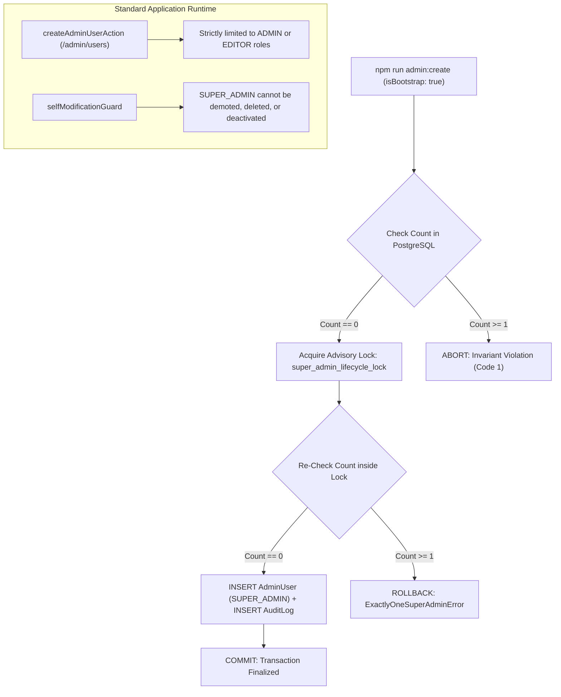

# VOIDTECH SOLUTION — Initial SUPER_ADMIN Provisioning Runbook

**Document Version:** 1.0.0  
**Target Milestone:** Milestone 7.5 — Secure SUPER_ADMIN Bootstrap CLI & Audit Logging Engine  
**Execution Command:** `npm run admin:create`  
**Security Classification:** RESTRICTED // INTERNAL ENGINEERING PROCEDURES  

---

## 1. Overview & Objective

This runbook documents the controlled, interactive procedure for provisioning the initial **SUPER_ADMIN** master account for VOIDTECH SOLUTION.

### Fundamental Security Invariants
* **Strictly EXACTLY ONE SUPER_ADMIN:** The platform enforces a hard business and cryptographic invariant permitting strictly one `SUPER_ADMIN` account across the entire lifecycle of the system.
* **Controlled Manual Execution:** The bootstrap utility must be deliberately executed by the project owner or authorized systems operator. It is **never** executed automatically during package installation, project builds, container deployment, or database seeding.
* **Zero Hardcoded Credentials:** Default administrator accounts, passwords, or fallback credentials are strictly prohibited in repository source code, environment templates, and automated seeds.
* **Append-Only Immutable Audit Trail:** Successful bootstrap provisioning records an atomic, tamper-resistant audit event (`action: "ADMIN_BOOTSTRAP_SUCCESS"`) in PostgreSQL.

---

## 2. Prerequisites & Environment Configuration

Before executing the bootstrap CLI, verify that the following prerequisites are fulfilled:

1. **Node.js Runtime:** Node.js v20.x or v22.x LTS installed.
2. **Database Migration Applied:** Ensure the PostgreSQL schema migration containing `admin_users`, `admin_sessions`, and `audit_logs` has been deployed:
   ```powershell
   npm run db:migrate:status
   ```
3. **Environment Configuration (`.env`):**
   * `DATABASE_URL`: Valid PostgreSQL connection string (pooler endpoint).
   * `DIRECT_URL`: Direct unpooled connection string (required for transactional advisory locks).
   * `AUTH_SECRET`: Minimum 32-character high-entropy secret string used for session cookie signing.

> [!WARNING]
> **Production Safety Distinction:**
> - In local development and testing, verify the CLI against an isolated or local database.
> - **Executing against the production Neon PostgreSQL database requires explicit, separate authorization from the project owner.**
> - Do not execute `npm run admin:create` against production without confirmed maintenance window approval.

---

## 3. Database Connectivity Verification

Before initiating account creation, test database connectivity using the diagnostic script:

```powershell
npm run db:verify
```

Expected diagnostic output:
```text
Database connection: READY
AdminUser table: DETECTED
Existing SUPER_ADMIN count: 0
```

If the database is unreachable, check your `.env` connection parameters and network access. The bootstrap utility will safely abort if connectivity cannot be established, displaying sanitized error messages that strip out database credentials and secrets.

---

## 4. Interactive Execution Guide

To provision the master account, run the dedicated npm script:

```powershell
npm run admin:create
```

### Interactive Console Flow

```text
=================================================
          VOIDTECH SOLUTION
       INITIAL ADMIN PROVISIONING
=================================================

Checking database connection...

Database connection: READY

Checking SUPER_ADMIN invariant...

No existing SUPER_ADMIN found.

Enter initial administrator details:

Full Name: [Owner Name]
Email Address: [owner@voidtechsolution.com]

Password: [Invisibly Typed - No Echo]
Confirm Password: [Invisibly Typed - No Echo]

Validating credentials...

Creating SUPER_ADMIN account...

Recording bootstrap audit event...

=================================================
       SUPER_ADMIN CREATED SUCCESSFULLY
=================================================

Administrator ID: cm3...
Name:             Owner Name
Email:            owner@voidtechsolution.com
Role:             SUPER_ADMIN
Status:           ACTIVE

You can now sign in at:

/admin/login

=================================================
```

---

## 5. Password Security & Input Guidelines

### Hidden Terminal Input & Strict TTY Enforcement
The CLI uses raw terminal input mode (`process.stdin.setRawMode(true)`) to ensure master passwords are typed **invisibly**:
* **Strict Interactive TTY Requirement:** Hidden password entry strictly requires a supported interactive TTY terminal. If hidden input cannot be guaranteed (e.g., stdin is piped, redirected from a file, or running in a headless non-TTY CI environment), the CLI immediately aborts with exit code 1 (`NonInteractiveTerminalError`) **before** accepting any credentials.
* **Zero Visible Fallback:** Visible `readline` input is **never** used as a fallback for password entry.
* **Terminal Mode Restoration:** Terminal raw mode and echo settings are reliably restored upon Enter, Backspace, Ctrl+C (`\u0003`), unhandled exceptions, and process termination via a registered exit handler and `finally` semantics.
* **No Screen or History Leaks:** No characters or asterisks (`*`) are echoed to the console screen. Passwords are never written to shell history files (`.bash_history`, PowerShell PSReadLine).
* **Zero Process & Environment Exposure:** Passwords are not accepted as CLI arguments (`--password`) or environment variables, eliminating `/proc` inspection risks and process environment leaks. Memory references are cleared immediately after hash derivation.

### Master Password Complexity Requirements
The Zod validation schema (`bootstrapInputSchema`) strictly requires:
* **Minimum Length:** At least 12 characters (maximum 128 characters).
* **Uppercase Letter:** At least one `[A-Z]` character.
* **Lowercase Letter:** At least one `[a-z]` character.
* **Numerical Digit:** At least one `[0-9]` character.
* **Special Character / Symbol:** At least one symbol `[^A-Za-z0-9]` (e.g. `!@#$%^&*`).
* **Confirmation Match:** `confirmPassword` must match `password` identically.

### Scrypt Key Derivation
Upon validation, the CLI derives the password hash using Node.js native `crypto.scryptSync`:
* **Salt:** 16 bytes (128-bit) cryptographically secure pseudorandom salt generated via `crypto.randomBytes(16)`.
* **Key Length:** 64 bytes (512-bit) derived key.
* **Storage Format:** `<hex_salt>:<hex_hash>`.
* **Verification:** Constant-time `crypto.timingSafeEqual` prevents side-channel timing attacks.

---

## 6. Accessing the Admin Console

Once provisioned, navigate to the unified administrative portal:

```
https://[domain]/admin/login
```
*(Or `http://localhost:3000/admin/login` in development)*

1. Enter the provisioned `email` and `password`.
2. Check "Remember session on this device" if on a secure workstation (establishes an 8-hour session).
3. Click **Authenticate**.
4. Upon successful authentication, you will be redirected to the **Role-Aware Admin Dashboard** (`/admin`).
5. As `SUPER_ADMIN`, you have complete visibility over lead enquiries, service offerings, pricing matrices, team accounts, and audit trails.

---

## 7. How the Exactly One SUPER_ADMIN Invariant Works

The platform enforces the Exactly One `SUPER_ADMIN` rule across all three layers of the architecture:



1. **Pre-Flight Invariant Check:** The CLI verifies `prisma.adminUser.count({ where: { role: 'SUPER_ADMIN' } }) === 0` before prompting for credentials.
2. **PostgreSQL Advisory Transaction Lock:** Creation executes inside `prisma.$transaction`, acquiring `SELECT pg_advisory_xact_lock(hashtext('super_admin_lifecycle_lock'))`.
3. **Double Invariant Check:** The lock fully serializes concurrent provisioning attempts. Even under race conditions, the second transaction rechecks the count inside the lock, discovers `count === 1`, and throws `ExactlyOneSuperAdminError`.
4. **Standard Creation Ceiling:** Active `SUPER_ADMIN` accounts can only provision `ADMIN` and `EDITOR` roles. Standard user creation unconditionally rejects assigning `SUPER_ADMIN`.
5. **Master Account Immutability:** Neither the `SUPER_ADMIN` nor any other role can delete, demote, or deactivate the master account (`SoleSuperAdminProtectionError`).

### Audit Log Integrity Taxonomy & Historical Record Preservation
The audit engine (`src/server/security/audit.ts`) operates under a strict three-tier integrity model:

1. **Application-Level Append-Only Enforcement:**
   - The application runtime exports exclusively append (`recordAuditEvent`, `createAuditLog`) and query (`getAuditHistory`, `getAuditLogById`) methods. Zero update, delete, or drop methods exist in code.
   - Recursive credential scrubbing (`sanitizeAuditDetails`) with a 6-level recursion depth cap prevents sensitive credentials from ever being stored in log payloads.
2. **Database-Level Protections & Historical Record Preservation:**
   - The PostgreSQL schema decouples `AuditLog` from `AdminUser`: `actorId` and `actorEmail` are scalar strings without cascading foreign key constraints (`onDelete: Cascade`).
   - When an administrator account is deactivated or deleted, **all historical audit records referencing that administrator remain 100% intact**.
   - In production database administration, engine-level immutability is reinforced by revoking destructive permissions from the application database role:
     `REVOKE UPDATE, DELETE, TRUNCATE ON TABLE "audit_logs" FROM voidtech_app_role;`
3. **Protection Against Unrestricted Database Administrators:**
   - Application-level and table-level permissions protect against software defects and compromised web sessions.
   - However, an unrestricted database administrator (e.g., PostgreSQL superuser, Neon console administrator, or cloud account owner) with direct SQL access can bypass table rules and alter records directly.
   - Therefore, absolute tamper-proofing is **not** claimed at the application or database layer alone. True high-assurance tamper-evident immutability requires external forward-secure logging (e.g., WORM storage, AWS S3 Object Lock, external syslog forwarding to Datadog/CloudWatch, or cryptographic ledger chaining).

---

## 8. Provisioning Subsequent ADMIN and EDITOR Accounts

Once the `SUPER_ADMIN` account exists, all operational team accounts must be created through the authenticated web console:

1. Log in at `/admin/login` as the `SUPER_ADMIN`.
2. Navigate to **Team & Access** (`/admin/users`).
3. Click **Add Administrator**.
4. Enter the administrator's name, email, initial password, and select either:
   * **`ADMIN`:** Operational management (manage enquiries, services catalog, pricing tiers, portfolio). User management and audit logs are hidden.
   * **`EDITOR`:** Editorial management (portfolio showcase, FAQ knowledgebase, services copywriting, read-only enquiries). Pricing, user management, and audit logs are hidden.
5. Click **Create Administrator**.
6. The action is audited in `audit_logs` (`action: "ADMIN_USER_CREATED"`).

---

## 9. Failure Handling & Recovery Procedures

| Scenario | Symptom / Error | Root Cause & Remediation |
|---|---|---|
| **Database Unreachable** | `[DATABASE ERROR] Could not connect to database` | Check `DATABASE_URL` in `.env`. Verify internet connectivity and Neon database compute status. |
| **Existing SUPER_ADMIN** | `[INVARIANT VIOLATION] Existing SUPER_ADMIN account found` | The master account is already created. Log in at `/admin/login` or check `audit_logs` to identify when it was provisioned. |
| **Password Complexity** | `[VALIDATION FAILED] - Master password must be at least 12 characters...` | Ensure your password contains uppercase, lowercase, digit, and special character. Re-run `npm run admin:create`. |
| **Confirmation Mismatch** | `Password confirmation does not match the entered password` | Re-run `npm run admin:create` and re-enter both password fields carefully. |
| **Transaction Rollback** | `Audit logging failure: Operation aborted...` | PostgreSQL rejected the atomic audit write. The account creation was 100% rolled back. Verify disk space / connection pool and retry. |
| **User Abort (Ctrl+C)** | `[PROVISIONING ABORTED BY USER]` | The operation was cleanly cancelled before any database transaction commenced. No partial records were created. |
| **Non-TTY Environment** | `[SECURITY ERROR] Interactive TTY required for administrator provisioning` | Hidden input cannot be guaranteed over piped stdin or redirected input. Run interactively from an interactive terminal (Windows Terminal, PowerShell, cmd.exe, or bash). |

---

## 10. Security Checklist Before Provisioning

Before executing `npm run admin:create`:
- [x] Verify you are in a private terminal session where your screen is not being recorded or shared.
- [x] Verify `DATABASE_URL` points to the correct intended environment (local vs staging vs production).
- [x] Generate a strong password using an offline password manager (16+ characters recommended).
- [x] Confirm that `AUTH_SECRET` in `.env` is a high-entropy 32+ character random secret.
- [x] After creation, immediately verify successful login at `/admin/login`.

