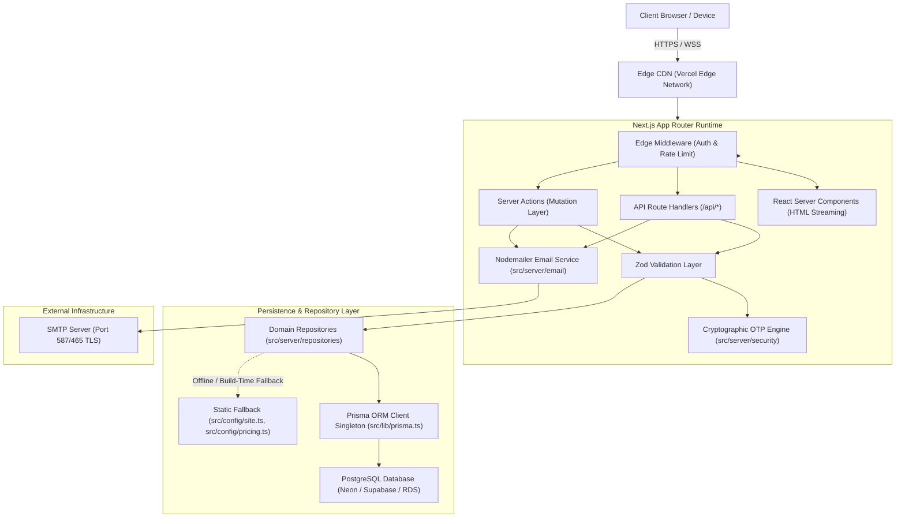

# ARCHITECTURE.md — System Architecture & Technology Blueprint

## 1. System Overview
**VOIDTECH SOLUTION** is built as a unified full-stack web platform on the **Next.js App Router** paradigm, combining React Server Components (RSC) for zero-client-bundle rendering, Next.js Route Handlers for RESTful API services, Server Actions for transactional mutations, a **Repository Pattern Abstraction Layer**, a dedicated **Nodemailer SMTP Transactional Email Subsystem**, a **Cryptographic OTP Verification Engine**, and **Prisma ORM** interacting with a hosted **PostgreSQL** database.



---

## 2. Directory Architecture & Layered Boundaries

```
src/
├── app/                  # Next.js App Router (pages, layouts, route handlers)
│   ├── api/health/       # System health check endpoint (/api/health)
│   ├── design-system/    # Internal Design System Preview (/design-system)
│   ├── globals.css       # Semantic tokens, CSS variables, reduced-motion rules
│   ├── layout.tsx        # Root HTML shell, Google fonts (Inter + JetBrains Mono)
│   └── page.tsx          # Homepage foundation entrypoint
├── components/           # Modular UI component library
│   ├── feedback/         # LoadingState, EmptyState, ErrorState
│   ├── layout/           # Container, Section, SectionHeading, Header, Footer
│   ├── sections/         # Feature blocks (scaffolded for future phases)
│   └── ui/               # Atomic primitives (Button, Card, Form, Badge)
├── config/               # Static configuration & catalogs
│   ├── env.ts            # Centralized Zod Environment Schema Validation
│   ├── pricing.ts        # Approved INR Pricing Packages (10 Tiers)
│   └── site.ts           # siteConfig, servicesRegistry, navigation
├── hooks/                # Custom client-side React hooks
├── lib/                  # Shared utilities (cn, formatters, prisma singleton)
│   ├── prisma.ts         # Resilient PrismaClient singleton & health check
│   └── utils.ts
├── server/               # Server-only business logic & subsystems
│   ├── email/            # Reusable Nodemailer + SMTP Transactional Service
│   │   ├── config.ts     # Zod-validated SMTP environment variables
│   │   ├── transporter.ts # Singleton connection pool & verifySmtpConnection
│   │   ├── email.service.ts # sendEmail with bounded retries & delivery tracking
│   │   └── templates/    # 6 Dark-styled HTML & plain-text email templates
│   ├── repositories/     # Type-safe domain repositories
│   │   ├── audit.repo.ts
│   │   ├── delivery.repo.ts
│   │   ├── enquiries.repo.ts
│   │   ├── faq.repo.ts
│   │   ├── portfolio.repo.ts
│   │   ├── pricing.repo.ts
│   │   ├── services.repo.ts
│   │   ├── settings.repo.ts
│   │   ├── users.repo.ts
│   │   └── index.ts      # Barrel export
│   └── security/         # Security operations & authentication helpers
│       ├── otp.service.ts # Cryptographic 6-digit OTP engine & rate limiting
│       ├── password.ts   # Cryptographic scrypt password hashing & verification
│       └── index.ts
├── types/                # Domain types, Prisma re-exports, API envelopes
└── validations/          # Zod validation schemas (enquiry, auth, content)

prisma/
├── schema.prisma         # Declarative PostgreSQL schema definitions (10 models)
└── seed.ts               # Programmatic seeder (18 services, 10 packages, FAQs, settings)

docs/                     # Architectural, system & operational documentation
tests/                    # Vitest unit/component tests & Playwright E2E suites
```

---

## 3. Data Access & Repository Layer

- **Decoupling from Direct ORM Calls:** Route Handlers and Server Actions never invoke Prisma directly. All access flows through domain repositories.
- **Offline & Build-Time Resilience:** Next.js static page generation runs deterministically without live PostgreSQL. Read queries catch connection errors and supply structured fallbacks.
- **Strict Write Error Guarantees:** Database write failures strictly throw observable, descriptive errors without leaking connection credentials.
- **Auditing & Delivery Logs:** Every transactional email and critical administrative action is recorded via `EmailDelivery` and `AuditLog` models.
