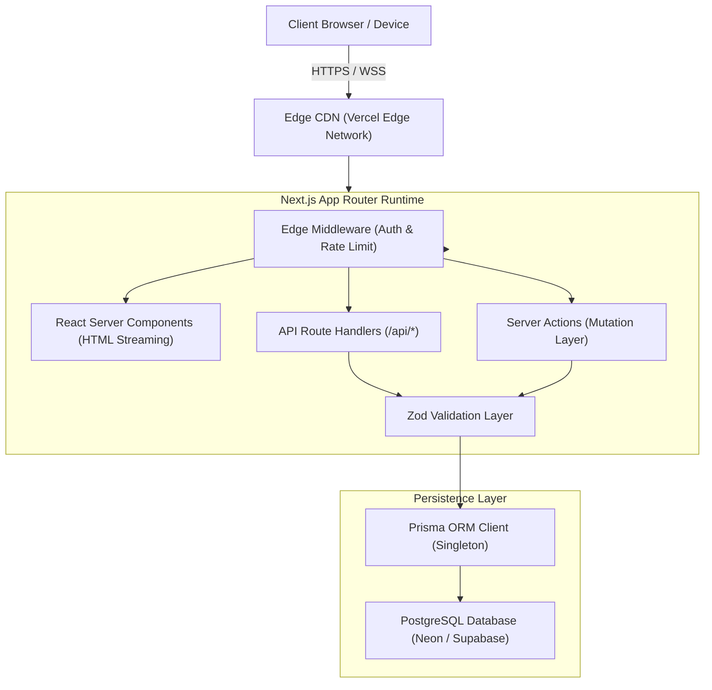

# ARCHITECTURE.md — System Architecture & Technology Blueprint

## 1. System Overview
**VOIDTECH SOLUTION** is built as a unified full-stack web application on the **Next.js App Router** paradigm, combining React Server Components (RSC) for zero-client-bundle rendering, Next.js Route Handlers for RESTful API services, Server Actions for transactional form processing, and **Prisma ORM** interacting with a hosted **PostgreSQL** database.



---

## 2. Directory Architecture & Layered Boundaries

```
src/
├── app/                  # Next.js App Router (pages, layouts, route handlers)
│   ├── (public)/         # Public marketing route group
│   ├── admin/            # Authenticated admin portal route group
│   ├── api/              # Backend Route Handlers (/api/health, /api/enquiries)
│   ├── globals.css       # Tailwind base styles and CSS variables
│   ├── layout.tsx        # Root HTML shell, fonts, accessibility skip links
│   └── page.tsx          # Homepage foundation entrypoint
├── components/           # Modular UI component library
│   ├── layout/           # Header, Footer, AdminSidebar, Navigation
│   ├── sections/         # Feature blocks (Hero, ServicesShowcase, Testimonials)
│   └── ui/               # Atomic primitives (Button, Card, Input, Modal, Badge)
├── config/               # Static configuration (siteConfig, servicesRegistry, nav)
├── hooks/                # Custom client-side React hooks (useScroll, useMediaQuery)
├── lib/                  # Shared utilities (cn, prisma singleton, formatters)
├── server/               # Server-only business logic, services, and repositories
├── types/                # Domain types, Prisma re-exports, API envelopes
└── validations/          # Zod validation schemas (enquiry, auth, content)

prisma/
└── schema.prisma         # Declarative PostgreSQL schema definitions

docs/                     # Mandatory architectural and operational documentation
tests/                    # Vitest unit/component tests & Playwright E2E suites
```

---

## 3. Key Technology Decisions

### Next.js App Router & React Server Components
- **Why:** Delivers fast page loads via server-side rendering, streaming HTML, and automatic code splitting. Eliminates client-side state overhead for static/marketing sections while keeping dynamic interactive islands for forms and admin tooling.
- **Trade-offs:** Stricter mental model around client vs. server boundaries (`"use client"` vs server components).

### Tailwind CSS & Custom Glassmorphism
- **Why:** Colocated atomic styling with zero runtime CSS-in-JS overhead. Built-in responsive modifiers (`sm:`, `md:`, `lg:`) and custom token extensions for the VOIDTECH brand (deep charcoal `#050507`, electric violet `#8b5cf6`, and controlled radial glows).

### PostgreSQL & Prisma ORM
- **Why:** PostgreSQL provides relational integrity, JSONB support for dynamic metadata, and transaction safety. Prisma ORM generates strictly-typed TypeScript client models, preventing runtime schema mismatches.
- **Phase 1 Status:** Schema defined; migrations and physical database provisioning deferred to Phase 3.

### Zod & React Hook Form
- **Why:** Unified schema definition that serves both client-side form validation (immediate user feedback) and server-side route validation (data integrity before database insertion).

