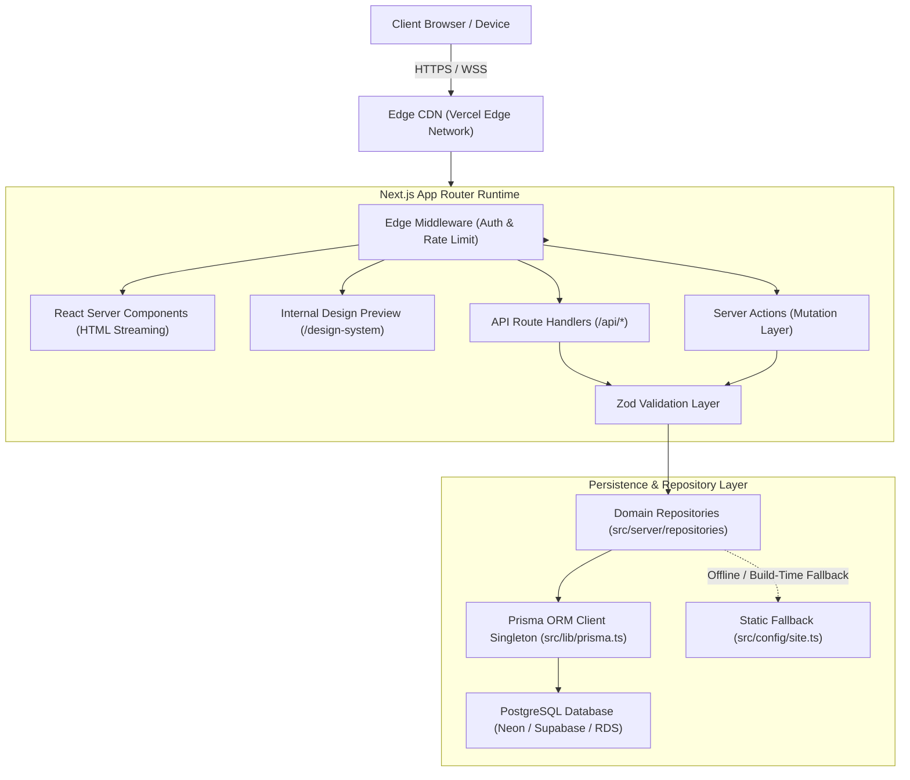

# ARCHITECTURE.md — System Architecture & Technology Blueprint

## 1. System Overview
**VOIDTECH SOLUTION** is built as a unified full-stack web application on the **Next.js App Router** paradigm, combining React Server Components (RSC) for zero-client-bundle rendering, Next.js Route Handlers for RESTful API services, Server Actions for transactional form processing, a **Repository Pattern Abstraction Layer**, and **Prisma ORM** interacting with a hosted **PostgreSQL** database.



---

## 2. Directory Architecture & Layered Boundaries

```
src/
├── app/                  # Next.js App Router (pages, layouts, route handlers)
│   ├── api/health/       # System health check endpoint (/api/health)
│   ├── design-system/    # Internal Design System Preview (/design-system)
│   ├── globals.css       # Semantic tokens, CSS variables, reduced-motion rules
│   ├── layout.tsx        # Root HTML shell, Google fonts (Inter + JetBrains Mono)
│   └── page.tsx          # Homepage foundation entrypoint
├── components/           # Modular UI component library
│   ├── feedback/         # LoadingState, EmptyState, ErrorState
│   ├── layout/           # Container, Section, SectionHeading, Header, Footer
│   ├── sections/         # Feature blocks (scaffolded for future phases)
│   └── ui/               # Atomic primitives (Button, Card, Form, Badge)
├── config/               # Static configuration (siteConfig, servicesRegistry, nav)
├── hooks/                # Custom client-side React hooks
├── lib/                  # Shared utilities (cn, formatters, prisma singleton)
│   ├── prisma.ts         # Resilient PrismaClient singleton & health check
│   └── utils.ts
├── server/               # Server-only business logic & repositories
│   └── repositories/     # Type-safe domain repositories
│       ├── enquiries.repo.ts
│       ├── services.repo.ts
│       ├── portfolio.repo.ts
│       ├── users.repo.ts
│       ├── settings.repo.ts
│       └── index.ts      # Barrel export
├── types/                # Domain types, Prisma re-exports, API envelopes
└── validations/          # Zod validation schemas (enquiry, auth, content)

prisma/
├── schema.prisma         # Declarative PostgreSQL schema definitions
└── seed.ts               # Programmatic seeder (18 services, settings, projects)

docs/                     # Architectural, system & operational documentation
tests/                    # Vitest unit/component tests & Playwright E2E suites
```

---

## 3. Data Access & Repository Layer (Phase 3 Additions)

- **Decoupling from Direct ORM Calls:** Route Handlers and Server Components never query `prisma` directly. They import domain repositories (`EnquiriesRepo`, `ServicesRepo`, `PortfolioRepo`, `UsersRepo`, `SettingsRepo`).
- **Offline & Build-Time Resilience:** Next.js static page generation (`next build`) runs deterministically even without live PostgreSQL credentials. Repositories catch initialization exceptions and seamlessly supply typed static fallback data.
- **Connection Pooling:** Datasource supports pooled connection strings via `DATABASE_URL` (PgBouncer/Prisma Accelerate) alongside direct migration connections via `DIRECT_URL`.
- **Seeding Engine:** `prisma/seed.ts` upserts all 18 business services, initial portfolio projects, and default system settings.
