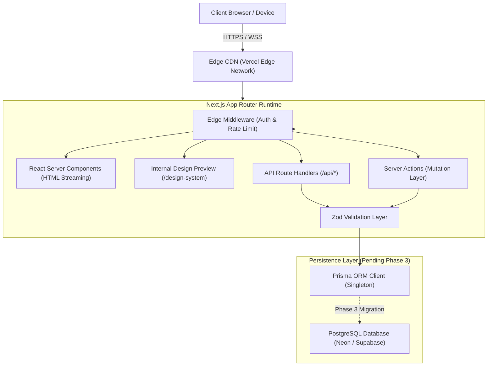

# ARCHITECTURE.md — System Architecture & Technology Blueprint

## 1. System Overview
**VOIDTECH SOLUTION** is built as a unified full-stack web application on the **Next.js App Router** paradigm, combining React Server Components (RSC) for zero-client-bundle rendering, Next.js Route Handlers for RESTful API services, Server Actions for transactional form processing, and **Prisma ORM** interacting with a hosted **PostgreSQL** database.



---

## 2. Directory Architecture & Layered Boundaries

```
src/
├── app/                  # Next.js App Router (pages, layouts, route handlers)
│   ├── api/health/       # System health check endpoint (/api/health)
│   ├── design-system/    # Internal Design System Preview (/design-system)
│   ├── globals.css       # Semantic tokens, CSS variables, reduced-motion rules
│   ├── layout.tsx        # Root HTML shell, Google fonts (Inter + JetBrains Mono)
│   └── page.tsx          # Homepage foundation entrypoint
├── components/           # Modular UI component library
│   ├── feedback/         # LoadingState, EmptyState, ErrorState
│   ├── layout/           # Container, Section, SectionHeading, Header, Footer
│   ├── sections/         # Feature blocks (scaffolded for future phases)
│   └── ui/               # Atomic primitives (Button, Card, Form, Badge)
├── config/               # Static configuration (siteConfig, servicesRegistry, nav)
├── hooks/                # Custom client-side React hooks
├── lib/                  # Shared utilities (cn, formatters, prisma singleton)
├── server/               # Server-only business logic & repositories (scaffolded)
├── types/                # Domain types, Prisma re-exports, API envelopes
└── validations/          # Zod validation schemas (enquiry, auth, content)

prisma/
└── schema.prisma         # Declarative PostgreSQL schema (Pending Phase 3)

docs/                     # Architectural, system & operational documentation
tests/                    # Vitest unit/component tests & Playwright E2E suites
```

---

## 3. UI Component Architecture (Phase 2 Additions)

### Button Architecture (`src/components/ui/button.tsx`)
- Common `Button` component supporting polymorphic variants: `primary`, `secondary`, `outline`, `ghost`, `glow`.
- Named forwardRef convenience wrappers: `PrimaryButton`, `SecondaryButton`, `OutlineButton`, `GhostButton`, `GlowButton`.
- Built-in loading state with accessible SVG spinner (`isLoading`), left and right icon slots, and active scale animations.

### Card Architecture (`src/components/ui/card.tsx`)
- `BaseCard`: Solid elevated charcoal surface.
- `GlassCard`: Frosted backdrop blur with hover glow.
- `ServiceCard`: Agency service presentation with category pill and deliverables.
- `PricingCard`: Tier selector with features checklist and popular highlight.
- `ProjectCard`: Case study presentation with client, industry, and quantified metrics.

### Form Architecture (`src/components/ui/form.tsx`)
- Unconditional `React.useId()` hooks generating linked input and error IDs.
- `aria-invalid` and `aria-describedby` accessibility bindings.
- Primitives: `Input`, `Textarea`, `Select`, `Checkbox`, `FormLabel`.

### Feedback Architecture (`src/components/feedback/index.tsx` & `src/components/ui/badge.tsx`)
- Semantic `Badge` variants (`default`, `purple`, `success`, `warning`, `error`, `outline`) with pulse dots.
- `LoadingState`, `EmptyState`, and `ErrorState` with retry callbacks.

---

## 4. Database Layer Status
- **PostgreSQL + Prisma:** Schemas exist in `prisma/schema.prisma` and client is generated in `node_modules/@prisma/client`.
- **Implementation Status:** Physical database connection, pooling, and migrations remain explicitly scheduled for **Phase 3: Database Design, Schema Setup & Data Layer**.
