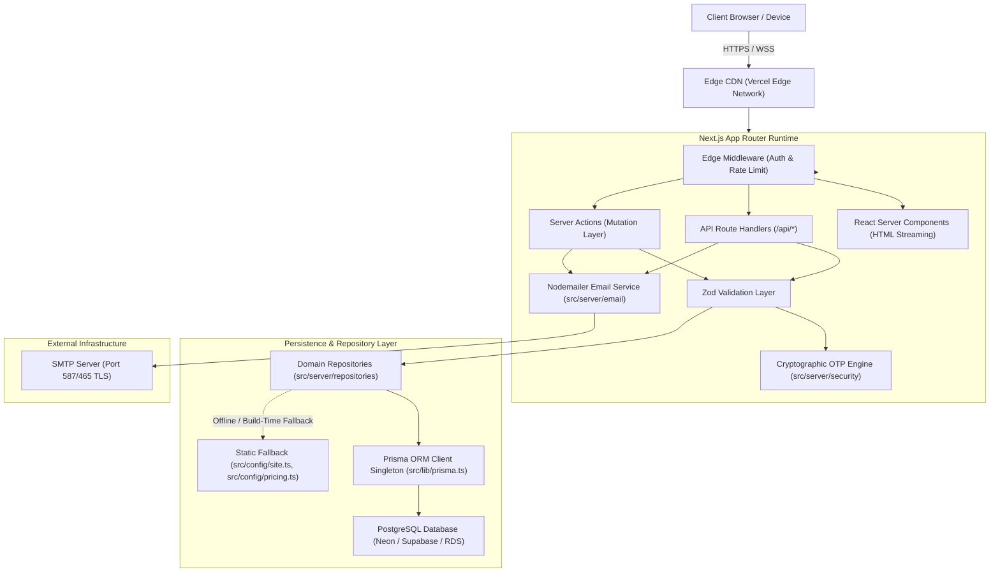
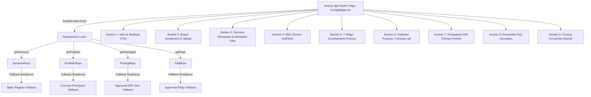
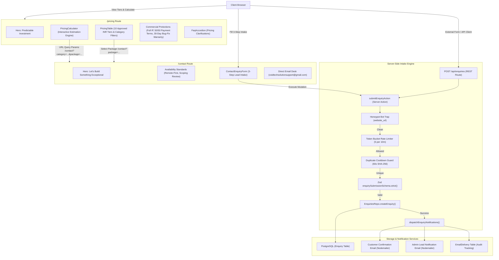
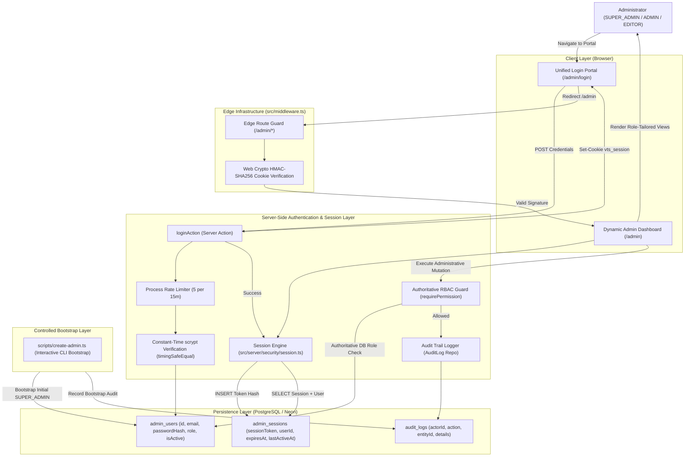
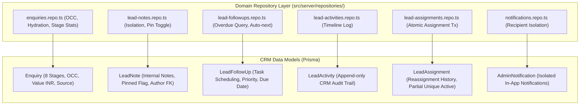
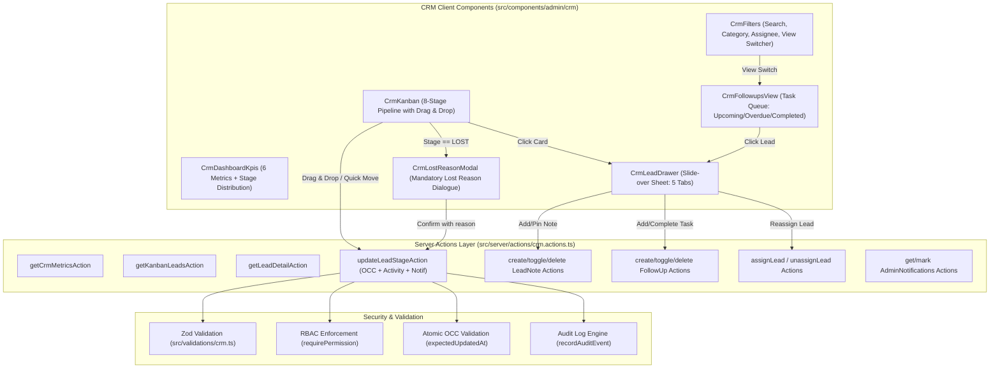
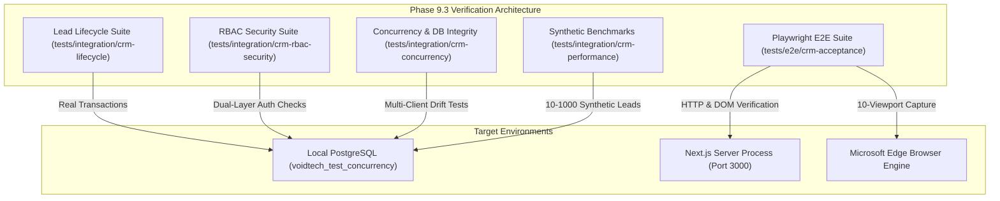

# ARCHITECTURE.md — System Architecture & Technology Blueprint

## 1. System Overview
**VOIDTECH SOLUTION** is built as a unified full-stack web platform on the **Next.js App Router** paradigm, combining React Server Components (RSC) for zero-client-bundle rendering, Next.js Route Handlers for RESTful API services, Server Actions for transactional mutations, a **Repository Pattern Abstraction Layer**, a dedicated **Nodemailer SMTP Transactional Email Subsystem**, a **Cryptographic OTP Verification Engine**, and **Prisma ORM** interacting with a hosted **PostgreSQL** database.



---

## 2. Directory Architecture & Layered Boundaries

```
src/
├── app/                  # Next.js App Router (pages, layouts, route handlers)
│   ├── api/health/       # System health check endpoint (/api/health)
│   ├── design-system/    # Internal Design System Preview (/design-system)
│   ├── globals.css       # Semantic tokens, CSS variables, reduced-motion rules
│   ├── layout.tsx        # Root HTML shell, Google fonts (Inter + JetBrains Mono)
│   └── page.tsx          # Homepage foundation entrypoint
├── components/           # Modular UI component library
│   ├── feedback/         # LoadingState, EmptyState, ErrorState
│   ├── layout/           # Container, Section, SectionHeading, Header, Footer
│   ├── sections/         # Feature blocks (scaffolded for future phases)
│   └── ui/               # Atomic primitives (Button, Card, Form, Badge)
├── config/               # Static configuration & catalogs
│   ├── env.ts            # Centralized Zod Environment Schema Validation
│   ├── pricing.ts        # Approved INR Pricing Packages (10 Tiers)
│   └── site.ts           # siteConfig, servicesRegistry, navigation
├── hooks/                # Custom client-side React hooks
├── lib/                  # Shared utilities (cn, formatters, prisma singleton)
│   ├── prisma.ts         # Resilient PrismaClient singleton & health check
│   └── utils.ts
├── server/               # Server-only business logic & subsystems
│   ├── email/            # Reusable Nodemailer + SMTP Transactional Service
│   │   ├── config.ts     # Zod-validated SMTP environment variables
│   │   ├── transporter.ts # Singleton connection pool & verifySmtpConnection
│   │   ├── email.service.ts # sendEmail with bounded retries & delivery tracking
│   │   └── templates/    # 6 Dark-styled HTML & plain-text email templates
│   ├── repositories/     # Type-safe domain repositories
│   │   ├── audit.repo.ts
│   │   ├── delivery.repo.ts
│   │   ├── enquiries.repo.ts
│   │   ├── faq.repo.ts
│   │   ├── portfolio.repo.ts
│   │   ├── pricing.repo.ts
│   │   ├── services.repo.ts
│   │   ├── settings.repo.ts
│   │   ├── users.repo.ts
│   │   └── index.ts      # Barrel export
│   └── security/         # Security operations & authentication helpers
│       ├── otp.service.ts # Cryptographic 6-digit OTP engine & rate limiting
│       ├── password.ts   # Cryptographic scrypt password hashing & verification
│       └── index.ts
├── types/                # Domain types, Prisma re-exports, API envelopes
└── validations/          # Zod validation schemas (enquiry, auth, content)

prisma/
├── schema.prisma         # Declarative PostgreSQL schema definitions (10 models)
└── seed.ts               # Programmatic seeder (18 services, 10 packages, FAQs, settings)

docs/                     # Architectural, system & operational documentation
tests/                    # Vitest unit/component tests & Playwright E2E suites
```

---

## 3. Data Access & Repository Layer

- **Decoupling from Direct ORM Calls:** Route Handlers and Server Actions never invoke Prisma directly. All access flows through domain repositories.
- **Offline & Build-Time Resilience:** Next.js static page generation runs deterministically without live PostgreSQL. Read queries catch connection errors and supply structured fallbacks.
- **Strict Write Error Guarantees:** Database write failures strictly throw observable, descriptive errors without leaking connection credentials.
- **Auditing & Delivery Logs:** Every transactional email and critical administrative action is recorded via `EmailDelivery` and `AuditLog` models.


---

## 7. Phase 4: Public Marketing Homepage Architecture

### Component Hierarchy & Data Flow



### Key Public Architecture Invariants:
1. **Server Component Pre-rendering:** `src/app/page.tsx` runs as an async Server Component, fetching data on the server with zero client database exposure.
2. **Safe Fallback Resilience:** When database tables do not exist or are unpopulated, repositories catch query errors and immediately return static baseline configurations without crashing or throwing 500 errors.
3. **Interactive Client Boundary Isolation:** Only interactive elements (`ServicesFilter`, `FaqAccordion`, `QuickInquiry`) are marked with `"use client"`. They receive plain JSON props from the server component.
4. **Authenticity & Concept Isolation:** Internal prototypes are strictly tagged with `CONCEPT` badges to avoid misleading claims.

---

## 8. Phase 5: About, Portfolio & Dynamic Case Study Architecture

### Page Structure & Routing
- **`/about` (Server Component):** 7 structured sections: Hero, Who We Are narrative, Mission & Vision, 6 Core Values, 6-Stage Engineering Approach, 7-Domain Tech Stack Matrix, and Collaboration CTA.
- **`/portfolio` (Server Component + Client Boundary):** Server component fetching all projects via `PortfolioRepo.getAllProjects()`, passing data into `PortfolioFilter` client component for interactive client-side category filtering, full-text search, and empty state rendering.
- **`/portfolio/[slug]` (Dynamic Route):** Next.js 15 async route with `generateStaticParams()` and `generateMetadata()`, resolving `await params`, handling 404s via `notFound()`, and rendering 11 structured case study sections.

### Architecture Topology

```mermaid
graph TD
    P1["/about Page"] --> A1["Hero Section"]
    P1 --> A2["Who We Are Narrative"]
    P1 --> A3["Mission & Vision Cards"]
    P1 --> A4["6 Core Values Grid"]
    P1 --> A5["6-Stage Approach"]
    P1 --> A6["Tech Stack Matrix (7 Domains)"]
    P1 --> A7["Collaboration CTA"]

    P2["/portfolio Page"] --> Repo["PortfolioRepo.getAllProjects()"]
    Repo --> PF["PortfolioFilter (Client Boundary)"]
    PF --> C1["Category Pills Filter"]
    PF --> C2["Live Keyword Search"]
    PF --> C3["Project Cards Grid (CONCEPT Badges & Metrics)"]
    PF --> C4["Empty State"]

    P3["/portfolio/[slug] Dynamic Route"] --> Static["generateStaticParams()"]
    P3 --> Meta["generateMetadata()"]
    P3 --> S1["Breadcrumbs"]
    P3 --> S2["Hero Header & Quick Metadata"]
    P3 --> S3["Concept Transparency Notice"]
    P3 --> S4["Problem & Solution Cards"]
    P3 --> S5["Architecture Blueprint Schematic"]
    P3 --> S6["Simulated Benchmark Metrics"]
    P3 --> S7["Tech Stack & Code Access Brief"]
    P3 --> S8["Related Projects Grid"]
    P3 --> S9["Conversion CTA"]
```




---

## 9. Phase 6: Interactive Pricing Calculator, Contact System & Enquiry Pipeline Architecture

### System Topology



### Architectural Principles
1. **Dynamic Parameter Passing:** The calculator packages selected attributes (`category`, `package`, `addons`, `timeline`) into clean URL query params, seamlessly transferring context to `/contact` without client-side global state overhead.
2. **Resilient Data Preservation:** Form submissions catch server errors and preserve 100% of the prospect's entered data, displaying an accessible retry button and direct email alternative.
3. **Multi-Layer Bot & Spam Protection:**
   - Honeypot trap: Empty field check rejects bots before schema validation.
   - Token bucket rate limiter: Enforces a cap of 5 submissions per 10 minutes per IP/email.
   - SHA-256 fingerprinting: Rejects identical submissions within a 60-second cooldown window.
4. **Decoupled Notification Pipeline:** Confirmation and admin alert emails are dispatched asynchronously; email transit interruptions never abort database persistence or falsify client failure.

---

## 10. Phase 7: Administrative Architecture — Single SUPER_ADMIN Governance & Shared Login Pipeline

### System Topology & Unified Login Flow



### Architectural Principles
1. **Single Unified Authentication Portal:**
   - Exactly ONE authentication endpoint exists: `/admin/login`.
   - `SUPER_ADMIN`, `ADMIN`, and `EDITOR` authenticate through this single unified portal using identical credentials processing.
   - Zero separate login routes or role-specific URL pathways exist.
2. **Authoritative Server-Side Governance:**
   - Client-side navigation adaptions are strictly ergonomic. Security is enforced authoritatively on the server inside Server Components, Server Actions, and Route Handlers via `requirePermission(user, permission)` and `getCurrentAdmin()`.
3. **Edge Route Protection & Rejection Filter (`src/middleware.ts`):**
   - Edge-compatible Web Crypto HMAC-SHA256 signature verification in isolated module (`src/server/security/cookie.ts`) with zero database dependencies.
   - Unauthenticated UI requests are redirected to `/admin/login?callbackUrl=...` with strict open-redirect sanitization (`sanitizeCallbackUrl`).
   - Unauthenticated API calls to `/api/admin/*` receive HTTP 401 Unauthorized (`UNAUTHORIZED_ADMIN_SESSION`).
   - Authenticated administrators visiting `/admin/login` are redirected away to destination or `/admin`.
4. **Single SUPER_ADMIN Account Governance & Exactly One Invariant:**
   - The platform enforces strictly **EXACTLY ONE SUPER_ADMIN** account across the system lifecycle.
   - Only `SUPER_ADMIN` can provision `ADMIN` and `EDITOR` accounts, modify roles, activate/deactivate accounts, revoke active sessions, and view sensitive audit logs.
   - Concurrency safety is guaranteed using PostgreSQL advisory transaction locks (`SELECT pg_advisory_xact_lock(hashtext('super_admin_lifecycle_lock'))`).
   - Non-super admins have zero administrative user management capabilities.
5. **Sole Active SUPER_ADMIN Invariant Protection:**
   - The platform strictly rejects any action that would deactivate, delete, or demote the master `SUPER_ADMIN`, eliminating total administrative lockout risks.
6. **Controlled Initial Bootstrap (`scripts/create-admin.ts`):**
   - Initial `SUPER_ADMIN` account is provisioned exclusively through an interactive CLI script (`scripts/create-admin.ts`).
   - Run via `npm run admin:create` with hidden password inputs and database pre-flight checks.
   - Zero database seed provisioning; zero public user registration; zero hardcoded passwords.
7. **Centralized Append-Only Audit Logging Engine (`src/server/security/audit.ts`):**
   - Tamper-resistant, immutable audit trail capturing lifecycle events (`AUTH_LOGIN_SUCCESS`, `AUTH_LOGIN_FAILED`, `AUTH_LOGOUT`, `ADMIN_BOOTSTRAP_SUCCESS`, `ADMIN_CREATED`, `ADMIN_ROLE_UPDATED`, `ADMIN_STATUS_UPDATED`, `ADMIN_DELETED`).
   - Automated credential redaction removes passwords, hashes, raw tokens, and connection strings from metadata payloads.
   - Preserved upon user deletion through decoupled scalar foreign keys.
   - Transactional participation ensures state mutations and audit records commit or roll back together atomically.

---

## 11. Phase 9: Admin Lead Management & CRM Pipeline Architecture

### Data Architecture & Relationship Topology
Phase 9 transforms the administrative dashboard into an enterprise CRM pipeline. Phase 9.1 implements the complete database schema foundation and repository layer:



### Key Phase 9 Architectural Invariants:
1. **Optimistic Concurrency Control (OCC):**
   - `updateEnquiryStatus` enforces `expectedUpdatedAt` timestamps, rejecting conflicting concurrent edits with `ConcurrencyConflictError`.
2. **Single Active Assignment Invariant:**
   - PostgreSQL partial unique index `lead_assignments_single_active_unique` on `(enquiryId) WHERE isActive = true` guarantees at most one active administrator per lead.
3. **Strict Recipient Isolation:**
   - Administrative notifications are strictly partitioned by `recipientId` at both the database query and mutation layers, preventing cross-admin data leakage.
4. **Safe Admin Projection:**
   - Relational hydration for `assignedAdmin` and `author` strictly selects `{ id, name, email, role, isActive }`, eliminating credential exposure (`passwordHash`).
5. **Internal Note Confidentiality:**
   - `LeadNote` queries are strictly server-side within authenticated admin contexts and are never serialized to public client APIs or notification emails.

## 9. Phase 9.2 CRM Dashboard UI & Interactive Workflows



### Phase 9.2 UI Architectural Principles:
1. **Optimistic UI with Rollback Safety:**
   - Kanban stage changes immediately update local column state and totals.
   - If the server rejects the update (e.g., OCC conflict or network failure), the board restores the pre-mutation column snapshot and prompts the user with an actionable refresh control.
2. **Mandatory Lost Reason Invariant:**
   - Leads cannot enter the `LOST` stage without an explicit non-empty `lostReason`, enforced both at the UI modal level and server-side Zod validation refine rule.
3. **5-Tab Lead Inspection Drawer:**
   - Single source of truth slide-over allowing complete lead management (Overview, Notes, Activity, Follow-ups, and Assignments) without leaving the Kanban context.
4. **Header Bell Notification Popover:**
   - Real-time unread badge isolated by `recipientId` with instant popover action items for high-priority leads, assignment notices, and overdue follow-up alerts.

---

## 11. Phase 9.3 CRM Validation & Performance Blueprint



### Key Performance Specifications
- **1,000 Lead Metric Aggregation:** Completed in < 10 ms (benchmarked at 5.87 ms).
- **1,000 Lead Kanban 8-Stage Load:** Completed in < 50 ms (benchmarked at 26.67 ms).
- **Lead Detail Hydration:** Single relational query with zero N+1 overhead (benchmarked at 7.54 ms).
- **Responsive Layout Matrix:** Verified from 320px ultra-compact mobile up to 1920px widescreen desktop.
