# DATABASE_DESIGN.md — PostgreSQL Entity-Relationship Specification & Data Layer

> **Implementation Status:** `VERIFIED & AUDITED (ALL 10 MODELS IMPLEMENTED)`
>
> ⚠️ **Database Migration Readiness:** The database schema has been verified with Prisma (`npx prisma validate`), Prisma Client generated (`npx prisma generate`), domain repository abstractions built in `src/server/repositories/`, and an automated seed script authored in `prisma/seed.ts`. When connecting a live hosted PostgreSQL instance (e.g. Neon, Supabase, AWS RDS), execute `npx prisma migrate dev --name init` or `npx prisma db push` followed by `npm run db:seed`.

---

## 1. Entity-Relationship Model (ERD)

```mermaid
erDiagram
    ENQUIRY {
        string id PK
        string name
        string email
        string phone
        string companyName
        enum serviceCategory
        string budgetRange
        string timeline
        text message
        string selectedPackage
        json additionalConfig
        string referenceUrl
        boolean consentGiven
        enum status
        text internalNotes
        string ipHash
        string userAgent
        datetime createdAt
        datetime updatedAt
    }

    SERVICE {
        string id PK
        string slug UK
        string title
        string shortDesc
        text fullDesc
        string icon
        enum category
        string[] deliverables
        string[] technologies
        int startingPriceInr
        string currency
        boolean isFeatured
        boolean isActive
        int orderIndex
        datetime createdAt
        datetime updatedAt
    }

    PORTFOLIO_PROJECT {
        string id PK
        string slug UK
        string title
        string clientName
        string industry
        string summary
        text challenge
        text solution
        text results
        string[] techStack
        json metrics
        string heroImage
        string liveUrl
        string githubUrl
        string projectType
        boolean isFeatured
        int orderIndex
        datetime createdAt
        datetime updatedAt
    }

    ADMIN_USER {
        string id PK
        string email UK
        string passwordHash
        string name
        enum role
        boolean isActive
        datetime lastLoginAt
        datetime createdAt
        datetime updatedAt
    }

    PRICING_PACKAGE {
        string id PK
        string slug UK
        string name
        enum category
        int priceInr
        string currency
        boolean isStartingPrice
        string billingPeriod
        string[] features
        boolean popular
        int orderIndex
        boolean isActive
        datetime createdAt
        datetime updatedAt
    }

    FAQ {
        string id PK
        string question
        text answer
        string category
        int orderIndex
        boolean isActive
        datetime createdAt
        datetime updatedAt
    }

    SITE_SETTING {
        string id PK
        string key UK
        text value
        string description
        datetime updatedAt
    }

    AUDIT_LOG {
        string id PK
        string action
        string entity
        string entityId
        string actorId
        string actorEmail
        string ipAddress
        string userAgent
        json details
        datetime createdAt
    }

    OTP_VERIFICATION {
        string id PK
        string identifier
        string codeHash
        enum purpose
        datetime expiresAt
        int attempts
        int maxAttempts
        datetime resendAvailableAt
        boolean isUsed
        datetime verifiedAt
        datetime createdAt
        datetime updatedAt
    }

    EMAIL_DELIVERY {
        string id PK
        string recipient
        string subject
        string template
        enum status
        string providerMessageId
        string failureCode
        text errorMessage
        int retryCount
        datetime sentAt
        datetime createdAt
        datetime updatedAt
    }
```

---

## 2. Approved INR Pricing Structure (10 Tiers)

All VoidTech Solution packages are strictly stored and presented in **INR (₹)**. Starting prices represent base kickoff tiers:

| Package Slug | Name | Track | Starting Price (INR) | Billing Model | Highlights |
| :--- | :--- | :--- | :-: | :--- | :--- |
| `basic-static` | Basic Static | Web Development | **₹999** | One-time | 1-3 Pages, Mobile-first, Contact form, Fast LCP |
| `standard-business` | Standard Business | Web Development | **₹2,999** | One-time | Up to 5 Pages, Charcoal/Neon UI, Maps, 30d Support |
| `professional` | Professional | Web Development | **₹5,999** | One-time | Up to 10 Pages, CMS, Email alerts, 90+ Lighthouse |
| `premium-custom` | Premium Custom | Enterprise Systems | **₹12,999+** | Starting | Custom Next.js Web App, Client portal, Custom APIs |
| `e-commerce` | E-commerce | Web Development | **₹19,999+** | Starting | Full catalog, Razorpay/UPI intent checkout, Invoicing |
| `saas` | SaaS | Enterprise Systems | **₹24,999+** | Starting | Multi-tenant architecture, Subscriptions, RBAC |
| `lms` | LMS | Enterprise Systems | **₹29,999+** | Starting | Course builder, Video DRM streaming, Certificates |
| `marketplace` | Marketplace | Enterprise Systems | **₹34,999+** | Starting | Multi-vendor storefronts, Split payouts, Escrow |
| `erp-crm` | ERP & CRM | Enterprise Systems | **₹49,999+** | Starting | Custom business pipelines, Inventory, Audit logs |
| `ai-powered` | AI-Powered | AI & Automation | **₹59,999+** | Starting | Autonomous multi-agent pipelines, Enterprise RAG |

---

## 3. Portfolio Data Integrity

Seeded portfolio items are explicitly designated as internal **DEMO / CONCEPT** architectural prototypes (`projectType: "CONCEPT"`). Fabricated client names and unverified production metrics have been completely eradicated:
- `algorithmic-liquidity-engine`: Client designated as `"VoidTech Concept Lab (Architecture Prototype)"` with simulated latency benchmarks (`< 2ms`).
- `autonomous-ai-ops-agent`: Client designated as `"VoidTech Concept Lab (Research Prototype)"` with simulated MTTR evaluation benchmarks.

---

## 4. Repository Pattern Abstraction Layer

All database queries are encapsulated in strongly-typed repository modules in `src/server/repositories/`:

| Repository | Path | Core Functions | Resilient Fallback |
|---|---|---|---|
| **`EnquiriesRepo`** | `src/server/repositories/enquiries.repo.ts` | `createEnquiry`, `getEnquiries`, `getEnquiryById`, `updateEnquiryStatus`, `appendEnquiryNote`, `deleteEnquiry`, `getEnquiryStats` | Write ops strictly throw descriptive errors without leaking DB credentials |
| **`ServicesRepo`** | `src/server/repositories/services.repo.ts` | `getAllServices`, `getActiveServices`, `getServiceBySlug`, `getFeaturedServices`, `createService`, `updateService`, `deleteService` | Falls back to static `servicesRegistry` (INR) if DB is offline |
| **`PortfolioRepo`** | `src/server/repositories/portfolio.repo.ts` | `getAllProjects`, `getFeaturedProjects`, `getProjectBySlug`, `getProjectsByIndustry`, `upsertProject` | Falls back to verified internal concept prototypes |
| **`PricingRepo`** | `src/server/repositories/pricing.repo.ts` | `getAllPricingPackages`, `getActivePricingPackages`, `getPricingPackageBySlug`, `createPricingPackage` | Falls back to 10 approved INR packages |
| **`FaqRepo`** | `src/server/repositories/faq.repo.ts` | `getAllFaqs`, `getActiveFaqs`, `getFaqsByCategory`, `createFaq` | Falls back to baseline categorized FAQs |
| **`SettingsRepo`** | `src/server/repositories/settings.repo.ts` | `getSetting`, `setSetting`, `getAllSettings` | Falls back to default site configuration map |
| **`UsersRepo`** | `src/server/repositories/users.repo.ts` | `getAdminByEmail`, `getAdminById`, `createAdminUser`, `updateAdminRole`, `setAdminActiveStatus`, `deleteAdminUser`, `updateLastLogin` | Concurrency-safe advisory lock `super_admin_lifecycle_lock` & Exactly One SUPER_ADMIN invariant |
| **`AuditRepo`** | `src/server/repositories/audit.repo.ts` | `createAuditLog`, `getRecentAuditLogs`, `getAuditLogsByEntity` | Immutable append-only audit trail with automatic credential redaction |
| **`DeliveryRepo`** | `src/server/repositories/delivery.repo.ts` | `createEmailDelivery`, `updateEmailDeliveryStatus`, `getRecentEmailDeliveries` | Persistent delivery log |

---

## 5. Security & Write Safety Guardrails

- **No Credential Leakage:** Catch blocks sanitize error details so internal database hostnames, usernames, and connection strings are never exposed in user-facing exceptions.
- **Fail-Safe Fallbacks:** Read queries for public content gracefully return static registries if PostgreSQL is temporarily unreachable. Write operations throw explicit, observable errors rather than faking success.
