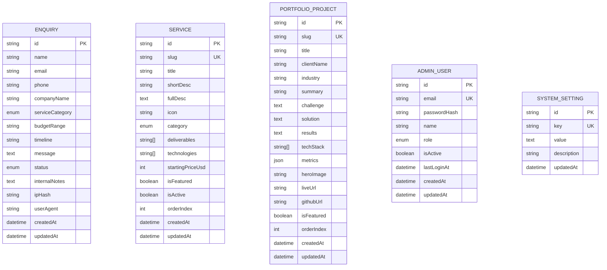

# DATABASE_DESIGN.md — PostgreSQL Entity-Relationship Specification

> **Implementation Status:** `PENDING PHASE 3`
>
> ⚠️ **Phase 1 Boundary Notice:** The database entities and schemas defined below have been modeled in `prisma/schema.prisma` and validated. Physical database provisioning, connection pools, and migration executions (`prisma migrate deploy`) are explicitly scheduled for **Phase 3: Database Design, Schema Setup & Data Layer**.

---

## 1. Entity-Relationship Model (ERD)

---

## 2. Entity Specifications

### Table: `enquiries`
Captures inbound prospective client leads from the `/contact` form and interactive service estimators.

| Column | Type | Constraints | Description |
|---|---|---|---|
| `id` | `VARCHAR(30)` | PRIMARY KEY (cuid) | Unique lead identifier |
| `name` | `VARCHAR(100)` | NOT NULL | Prospect full name |
| `email` | `VARCHAR(150)` | NOT NULL, INDEXED | Prospect business email |
| `phone` | `VARCHAR(30)` | NULLABLE | Phone / WhatsApp contact |
| `companyName` | `VARCHAR(100)` | NULLABLE | Organization or startup name |
| `serviceCategory`| `ENUM` | NOT NULL | Category of requested service |
| `budgetRange` | `VARCHAR(50)` | NULLABLE | Client budget tier |
| `timeline` | `VARCHAR(50)` | NULLABLE | Desired delivery window |
| `message` | `TEXT` | NOT NULL | Detailed project brief |
| `status` | `ENUM` | DEFAULT 'NEW', INDEXED | Status: `NEW`, `IN_REVIEW`, `CONTACTED`, `CONVERTED`, `ARCHIVED` |
| `internalNotes` | `TEXT` | NULLABLE | Private triage notes added by admin |
| `ipHash` | `VARCHAR(64)` | NULLABLE | Anonymized SHA-256 hash for abuse tracking |
| `userAgent` | `VARCHAR(255)`| NULLABLE | Client browser metadata |
| `createdAt` | `TIMESTAMPTZ` | DEFAULT NOW(), INDEXED| Ingestion timestamp |
| `updatedAt` | `TIMESTAMPTZ` | AUTO-UPDATE | Last modification timestamp |

---

### Table: `services`
Stores the official agency catalog of 18 business offerings.

| Column | Type | Constraints | Description |
|---|---|---|---|
| `id` | `VARCHAR(30)` | PRIMARY KEY (cuid) | Unique service identifier |
| `slug` | `VARCHAR(80)` | UNIQUE, NOT NULL | URL-safe slug (e.g. `ai-agents`) |
| `title` | `VARCHAR(100)` | NOT NULL | Display title |
| `shortDesc` | `VARCHAR(255)` | NOT NULL | One-sentence summary |
| `fullDesc` | `TEXT` | NOT NULL | In-depth technical description |
| `icon` | `VARCHAR(50)` | DEFAULT 'Code' | Lucide icon identifier |
| `category` | `ENUM` | NOT NULL, INDEXED | Grouping category |
| `deliverables` | `TEXT[]` | NOT NULL | Array of concrete client outputs |
| `technologies` | `TEXT[]` | NOT NULL | Array of tech stack badges |
| `startingPriceUsd`| `INTEGER` | NULLABLE | Base estimate price |
| `isFeatured` | `BOOLEAN` | DEFAULT FALSE | Highlighted on homepage |
| `isActive` | `BOOLEAN` | DEFAULT TRUE, INDEXED | Display toggle |
| `orderIndex` | `INTEGER` | DEFAULT 0 | Ordering weight |
| `createdAt` | `TIMESTAMPTZ` | DEFAULT NOW() | Creation timestamp |
| `updatedAt` | `TIMESTAMPTZ` | AUTO-UPDATE | Last updated timestamp |

---

### Table: `portfolio_projects`
Houses showcase case studies, client results, and verified production metrics.

| Column | Type | Constraints | Description |
|---|---|---|---|
| `id` | `VARCHAR(30)` | PRIMARY KEY (cuid) | Unique case study identifier |
| `slug` | `VARCHAR(100)`| UNIQUE, NOT NULL | URL-friendly identifier |
| `title` | `VARCHAR(150)`| NOT NULL | Case study headline |
| `clientName` | `VARCHAR(100)`| NOT NULL | Client organization name |
| `industry` | `VARCHAR(80)` | NOT NULL | Domain (Fintech, Health, AI, etc.) |
| `summary` | `VARCHAR(300)`| NOT NULL | High-level outcome summary |
| `challenge` | `TEXT` | NOT NULL | Problem statement |
| `solution` | `TEXT` | NOT NULL | Technical architecture implemented |
| `results` | `TEXT` | NOT NULL | Quantified business impact |
| `techStack` | `TEXT[]` | NOT NULL | Technologies leveraged |
| `metrics` | `JSONB` | NULLABLE | Structured metrics key-values |
| `heroImage` | `VARCHAR(255)`| NULLABLE | Cover image CDN link |
| `liveUrl` | `VARCHAR(255)`| NULLABLE | Verified live application URL |
| `githubUrl` | `VARCHAR(255)`| NULLABLE | Public repo link (if open-source) |
| `isFeatured` | `BOOLEAN` | DEFAULT FALSE | Featured project flag |
| `orderIndex` | `INTEGER` | DEFAULT 0 | Display sequence order |

---

### Table: `admin_users`
Stores authenticated administrators for the agency operations portal.

| Column | Type | Constraints | Description |
|---|---|---|---|
| `id` | `VARCHAR(30)` | PRIMARY KEY (cuid) | Unique user ID |
| `email` | `VARCHAR(150)`| UNIQUE, NOT NULL | Admin login address |
| `passwordHash` | `VARCHAR(255)`| NOT NULL | Argon2id / Bcrypt password hash |
| `name` | `VARCHAR(100)`| NOT NULL | Full name |
| `role` | `ENUM` | DEFAULT 'ADMIN' | Roles: `SUPER_ADMIN`, `ADMIN`, `EDITOR` |
| `isActive` | `BOOLEAN` | DEFAULT TRUE | Account state toggle |
| `lastLoginAt` | `TIMESTAMPTZ` | NULLABLE | Audit timestamp of last access |
| `createdAt` | `TIMESTAMPTZ` | DEFAULT NOW() | Account creation time |
| `updatedAt` | `TIMESTAMPTZ` | AUTO-UPDATE | Timestamp of modification |

---

## 3. Indexing & Optimization Strategy
- Index on `enquiries(status)` for fast pipeline filtering in the Admin Kanban.
- Index on `enquiries(createdAt DESC)` for chronological activity streams.
- Unique indexes on `services(slug)` and `portfolio_projects(slug)` for high-speed dynamic page lookups.
- Compound index on `services(isActive, orderIndex)` for pre-sorted catalog rendering.
