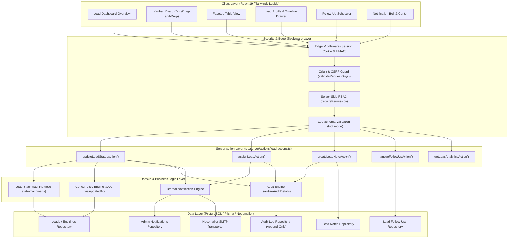
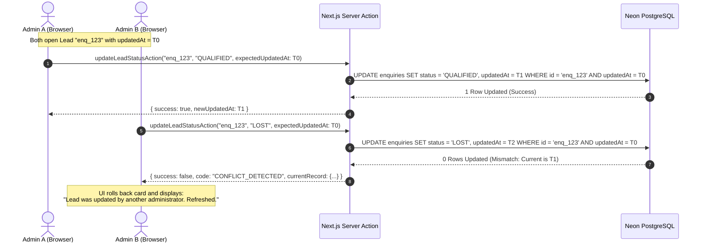
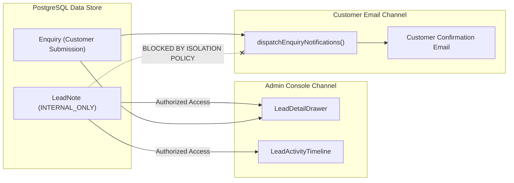

# VOIDTECH SOLUTION — Lead Management & CRM Architecture
## Phase 9.0 Technical Architecture & System Design

**Project:** VOIDTECH SOLUTION  
**Tagline:** Build. Launch. Grow Online.  
**Document:** Lead Management & CRM Architecture  
**Phase:** Phase 9 (Admin Lead Management & Enquiry Pipeline)  
**Milestone:** 9.0 — Discovery, Requirements & Architecture  
**Author:** Antigravity Architect  
**Status:** Approved Architecture (Discovery Complete)  

---

## 1. System Architecture Overview

The VOIDTECH SOLUTION CRM & Lead Management architecture extends the existing Next.js 15 App Router application with modular, layered services designed for maximum separation of concerns, transactional safety, and defense-in-depth security.



---

## 2. Component Hierarchy & Module Responsibilities

### 2.1 Presentation Components (`src/components/admin/leads/`)

| Component Name | Client/Server | Role & Responsibilities |
|---|---|---|
| `LeadManagementHub` | Client Component | Main container orchestrating view toggling (Kanban vs Table), search state, filter drawers, and active lead inspection. |
| `LeadDashboardMetrics` | Server/Client | Renders the 8 operational KPI summary cards (Total, New, In Progress, Qualified, Won, Lost, Overdue, Conversion Rate). |
| `LeadKanbanBoard` | Client Component | 8-column drag-and-drop board. Implements optimistic card dragging, column counters, and keyboard reassignment. |
| `LeadKanbanColumn` | Client Component | Renders column header, stage badge, count, and drop-target container with smooth CSS transitions. |
| `LeadKanbanCard` | Client Component | Individual lead card rendering prospect name, company, service category badge, budget tier, assigned admin avatar, and overdue indicators. |
| `LeadTableView` | Client Component | High-density data grid featuring multi-column sorting, pagination controls, inline status selector, and row selection. |
| `LeadDetailDrawer` | Client Component | Slide-over inspector panel containing full client brief, contact details, action toolbar, note composer, and unified timeline. |
| `LeadActivityTimeline` | Client Component | Chronologically renders internal notes, status transitions, follow-up events, and admin assignment records with author avatars. |
| `LeadFollowUpModal` | Client Component | Dialog for scheduling, editing, and marking follow-ups complete with date-picker and priority selector. |
| `AdminNotificationCenter` | Client Component | Top-bar bell icon with unread badge counter, slide-out notification drawer, and "mark all as read" control. |

---

## 3. Lead Lifecycle State Machine

To prevent invalid business transitions (such as jumping directly from an unreviewed `NEW` lead to `WON` without qualification), the CRM enforces a deterministic finite state machine (`LeadStateMachine`).

### 3.1 Allowed Transition Matrix

| Current State | Allowed Next States | Business Rule / Guard Condition |
|---|---|---|
| `NEW` | `CONTACTED`, `ON_HOLD`, `LOST` | Initial contact outreach initiated; or marked spam/unqualified (`LOST`). Direct transition to `WON` or `PROPOSAL_SENT` is blocked. |
| `CONTACTED` | `QUALIFIED`, `ON_HOLD`, `LOST` | Requires verified prospect communication before advancing to technical qualification. |
| `QUALIFIED` | `PROPOSAL_SENT`, `ON_HOLD`, `LOST` | Scope and budget feasibility approved by engineering team. |
| `PROPOSAL_SENT` | `NEGOTIATION`, `WON`, `ON_HOLD`, `LOST` | Formal proposal/quotation delivered. Can advance to negotiation or direct acceptance. |
| `NEGOTIATION` | `WON`, `ON_HOLD`, `LOST` | Scope or commercial adjustment under discussion. |
| `WON` | `ON_HOLD` | Deal closed and deposit confirmed. Reopening allowed only under exceptional administrative hold. |
| `LOST` | `CONTACTED`, `ON_HOLD` | Lead re-activated or re-opened for outreach. |
| `ON_HOLD` | `CONTACTED`, `QUALIFIED`, `LOST` | Paused lead resumed when prospect budget/timing aligns. |

### 3.2 State Machine Implementation Logic

```typescript
// src/server/services/lead-state-machine.ts
import { EnquiryStatus } from "@prisma/client";

export const ALLOWED_TRANSITIONS: Record<EnquiryStatus, readonly EnquiryStatus[]> = {
  NEW: ["CONTACTED", "ON_HOLD", "LOST"],
  CONTACTED: ["QUALIFIED", "ON_HOLD", "LOST"],
  QUALIFIED: ["PROPOSAL_SENT", "ON_HOLD", "LOST"],
  PROPOSAL_SENT: ["NEGOTIATION", "WON", "ON_HOLD", "LOST"],
  NEGOTIATION: ["WON", "ON_HOLD", "LOST"],
  WON: ["ON_HOLD"],
  LOST: ["CONTACTED", "ON_HOLD"],
  ON_HOLD: ["CONTACTED", "QUALIFIED", "LOST"],
};

export function canTransition(from: EnquiryStatus, to: EnquiryStatus): boolean {
  if (from === to) return true;
  const allowed = ALLOWED_TRANSITIONS[from];
  return allowed ? allowed.includes(to) : false;
}
```

---

## 4. Optimistic Concurrency Control (OCC) Architecture

When multiple administrators manage leads simultaneously, race conditions can occur (e.g. Admin A advances a lead to `QUALIFIED` while Admin B marks it `LOST`).

To guarantee data consistency without heavyweight table locking, the CRM implements **Optimistic Concurrency Control** via timestamp comparison:



### Protocol Invariants:
1. Every status or assignment action sends `expectedUpdatedAt: string (ISO)`.
2. The server compares `new Date(expectedUpdatedAt).getTime() === currentEnquiry.updatedAt.getTime()`.
3. If timestamps do not match, the transaction aborts with HTTP 409 Conflict.
4. The client rolls back the optimistic UI mutation and displays a notification prompting the user to review the updated state.

---

## 5. Security & Isolation Architecture

### 5.1 Internal Notes vs Customer Communication Boundary
A critical architectural boundary guarantees that internal notes, margin discussions, and administrative comments **never escape** to the prospect:



#### Enforcement Mechanisms:
1. **Repository Segregation:** `LeadNote` queries are only exported to admin-authorized server actions. The public `enquiry.actions.ts` has zero imports from `lead-notes.repo.ts`.
2. **Template Sanitization:** Customer email templates (`enquiry-confirmation.template.ts`, `enquiry-status-update.template.ts`) strictly omit internal note payloads. The existing `notes` parameter in `enquiry-status-update.template.ts` will be deprecated or converted to an explicit `customerMessage` field that must be explicitly authorized and typed separately from internal notes.

---

## 6. Real-time Synchronization & Cache Revalidation

1. **Server Actions Revalidation:** Every lead mutation calls `revalidatePath("/admin/enquiries")` and `revalidatePath("/admin")` to purge stale Next.js data cache entries.
2. **Optimistic Local Cache:** The client-side `LeadManagementHub` maintains React state initialized from server data. Drag-and-drop operations immediately mutate local state before the server response settles.
3. **Background SWR/Polling:** To keep multi-tab administrator sessions synchronized, the client performs background revalidation every 30 seconds (or immediately when the window regains focus via `visibilitychange`).

---

## 7. Performance & Indexing Architecture

To support instantaneous queries even with thousands of enquiries, database indexes are designed around typical access patterns:

1. **Kanban Status Aggregation:** Composite index on `enquiries(status, updatedAt DESC)` allows index-only scans for board columns.
2. **Administrator Triage:** Composite index on `enquiries(assignedAdminId, status)` enables sub-10ms queries for "My Assigned Leads".
3. **Overdue Task Evaluation:** Index on `lead_follow_ups(dueAt, isCompleted)` where `isCompleted = false` ensures instantaneous calculation of the overdue follow-up KPI.
4. **Timeline Rendering:** Composite index on `lead_activities(enquiryId, createdAt DESC)` renders comprehensive histories in a single indexed read.
