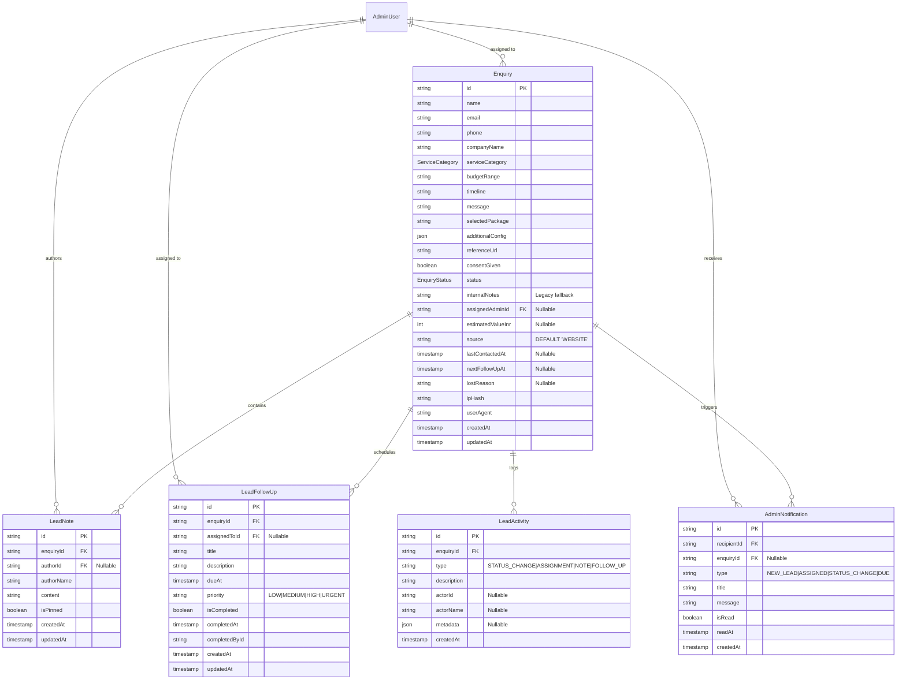

# VOIDTECH SOLUTION — Lead Management & CRM Database Design
## Phase 9.0 Relational Data Architecture & Migration Specification

**Project:** VOIDTECH SOLUTION  
**Tagline:** Build. Launch. Grow Online.  
**Document:** Lead Management & CRM Database Design  
**Phase:** Phase 9 (Admin Lead Management & Enquiry Pipeline)  
**Milestone:** 9.0 — Discovery, Requirements & Architecture  
**Author:** Antigravity Architect  
**Status:** Approved Specification (Discovery Complete)  

---

## 1. Existing Schema Analysis

The current database schema (`prisma/schema.prisma`) manages incoming prospects through the `enquiries` table:

```prisma
enum EnquiryStatus {
  NEW
  IN_REVIEW
  CONTACTED
  CONVERTED
  ARCHIVED
}

model Enquiry {
  id              String          @id @default(cuid())
  name            String
  email           String
  phone           String?
  companyName     String?
  serviceCategory ServiceCategory @default(WEB_DEVELOPMENT)
  budgetRange     String?
  timeline        String?
  message         String          @db.Text
  selectedPackage String?
  additionalConfig Json?
  referenceUrl    String?
  consentGiven    Boolean?
  status          EnquiryStatus   @default(NEW)
  internalNotes   String?         @db.Text
  ipHash          String?
  userAgent       String?
  createdAt       DateTime        @default(now())
  updatedAt       DateTime        @updatedAt

  @@index([status])
  @@index([email])
  @@index([createdAt])
  @@map("enquiries")
}
```

### Critical Architectural Limitations of the Existing Model:
1. **Monolithic Note Appending:** `internalNotes` is a single nullable text column. Appending notes parses string templates (`[Admin - Timestamp] Note text`), making it impossible to query by author, sort chronologically at the database level, or implement per-note permissions.
2. **Missing Ownership & Assignment:** No relational linkage exists between `Enquiry` and `AdminUser`. Enquiries cannot be assigned to specific team members or queried by assignee.
3. **Missing Follow-Up Governance:** No structured mechanism to schedule client calls, set deadlines, track completion, or compute overdue SLAs.
4. **Limited Pipeline Granularity:** The 5-stage status enum lacks essential sales milestones (`QUALIFIED`, `PROPOSAL_SENT`, `NEGOTIATION`, `WON`, `LOST`, `ON_HOLD`).
5. **Missing In-App Notifications:** No notification table exists to alert administrators of new assignments or overdue deadlines.

---

## 2. Target Relational Schema Design

To support a full-featured, scalable CRM pipeline without breaking existing enquiry records, the schema is upgraded with normalized child entities and extended metadata columns:



---

## 3. Detailed Entity Specifications

### 3.1 Extended `Enquiry` Model

```prisma
enum EnquiryStatus {
  NEW
  CONTACTED
  QUALIFIED
  PROPOSAL_SENT
  NEGOTIATION
  WON
  LOST
  ON_HOLD
}

// Added columns on model Enquiry:
model Enquiry {
  // ... existing fields ...
  
  // Extensions:
  assignedAdminId   String?
  assignedAdmin     AdminUser?        @relation("AssignedLeads", fields: [assignedAdminId], references: [id], onDelete: SetNull)
  
  estimatedValueInr Int?              // Confirmed project commercial value in INR
  source            String            @default("WEBSITE_CONTACT_FORM")
  lastContactedAt   DateTime?
  nextFollowUpAt    DateTime?
  lostReason        String?           // Mandatory when transitioned to LOST
  
  notes             LeadNote[]
  followUps         LeadFollowUp[]
  activities        LeadActivity[]
  notifications     AdminNotification[]

  @@index([status, createdAt(sort: Desc)])
  @@index([assignedAdminId, status])
  @@index([nextFollowUpAt])
  @@map("enquiries")
}
```

### 3.2 `LeadNote` Entity (Threaded Internal Notes)

```prisma
model LeadNote {
  id         String     @id @default(cuid())
  enquiryId  String
  enquiry    Enquiry    @relation(fields: [enquiryId], references: [id], onDelete: Cascade)
  authorId   String?
  author     AdminUser? @relation(fields: [authorId], references: [id], onDelete: SetNull)
  authorName String
  content    String     @db.Text
  isPinned   Boolean    @default(false)
  createdAt  DateTime   @default(now())
  updatedAt  DateTime   @updatedAt

  @@index([enquiryId, createdAt(sort: Desc)])
  @@index([authorId])
  @@map("lead_notes")
}
```

### 3.3 `LeadFollowUp` Entity (Task & SLA Reminders)

```prisma
model LeadFollowUp {
  id            String     @id @default(cuid())
  enquiryId     String
  enquiry       Enquiry    @relation(fields: [enquiryId], references: [id], onDelete: Cascade)
  assignedToId  String?
  assignedTo    AdminUser? @relation(fields: [assignedToId], references: [id], onDelete: SetNull)
  title         String
  description   String?    @db.Text
  dueAt         DateTime
  priority      String     @default("MEDIUM") // "LOW" | "MEDIUM" | "HIGH" | "URGENT"
  isCompleted   Boolean    @default(false)
  completedAt   DateTime?
  completedById String?
  createdAt     DateTime   @default(now())
  updatedAt     DateTime   @updatedAt

  @@index([enquiryId])
  @@index([assignedToId, isCompleted])
  @@index([dueAt, isCompleted])
  @@map("lead_follow_ups")
}
```

### 3.4 `LeadActivity` Entity (Unified Audit Timeline)

```prisma
model LeadActivity {
  id          String   @id @default(cuid())
  enquiryId   String
  enquiry     Enquiry  @relation(fields: [enquiryId], references: [id], onDelete: Cascade)
  type        String   // "STATUS_CHANGE" | "ASSIGNMENT" | "NOTE_ADDED" | "FOLLOWUP_CREATED" | "FOLLOWUP_COMPLETED"
  description String
  actorId     String?
  actorName   String?
  metadata    Json?    // Contextual payload (e.g. { from: "NEW", to: "QUALIFIED" })
  createdAt   DateTime @default(now())

  @@index([enquiryId, createdAt(sort: Desc)])
  @@index([type])
  @@map("lead_activities")
}
```

### 3.5 `AdminNotification` Entity (In-App Team Alerts)

```prisma
model AdminNotification {
  id          String     @id @default(cuid())
  recipientId String
  recipient   AdminUser  @relation(fields: [recipientId], references: [id], onDelete: Cascade)
  enquiryId   String?
  enquiry     Enquiry?   @relation(fields: [enquiryId], references: [id], onDelete: Cascade)
  type        String     // "NEW_LEAD" | "LEAD_ASSIGNED" | "STATUS_CHANGED" | "FOLLOWUP_DUE" | "LEAD_WON"
  title       String
  message     String
  isRead      Boolean    @default(false)
  readAt      DateTime?
  createdAt   DateTime   @default(now())

  @@index([recipientId, isRead, createdAt(sort: Desc)])
  @@index([enquiryId])
  @@map("admin_notifications")
}
```

---

## 4. Migration & Status Enum Evolution Strategy

### 4.1 Enum Compatibility Mapping
Existing PostgreSQL `EnquiryStatus` contains 5 values: `'NEW'`, `'IN_REVIEW'`, `'CONTACTED'`, `'CONVERTED'`, `'ARCHIVED'`.

The target pipeline requires 8 values: `'NEW'`, `'CONTACTED'`, `'QUALIFIED'`, `'PROPOSAL_SENT'`, `'NEGOTIATION'`, `'WON'`, `'LOST'`, `'ON_HOLD'`.

To migrate safely without data loss:
1. **`NEW`** maps directly to **`NEW`**.
2. **`CONTACTED`** maps directly to **`CONTACTED`**.
3. **`IN_REVIEW`** maps semantically to **`QUALIFIED`**.
4. **`CONVERTED`** maps semantically to **`WON`**.
5. **`ARCHIVED`** maps semantically to **`ON_HOLD`** (or `LOST`).

### 4.2 Proposed PostgreSQL Migration Script (Two-Phase Zero-Downtime)

```sql
-- ==============================================================================
-- VOIDTECH SOLUTION — Migration 20261113000000_crm_lead_pipeline
-- Provider: PostgreSQL 14+ / Neon Serverless
-- Status: ARCHITECTURE SPECIFICATION (DO NOT EXECUTE IN MILESTONE 9.0)
-- ==============================================================================

-- 1. ADD NEW ENUM VALUES TO EnquiryStatus
ALTER TYPE "EnquiryStatus" ADD VALUE IF NOT EXISTS 'QUALIFIED';
ALTER TYPE "EnquiryStatus" ADD VALUE IF NOT EXISTS 'PROPOSAL_SENT';
ALTER TYPE "EnquiryStatus" ADD VALUE IF NOT EXISTS 'NEGOTIATION';
ALTER TYPE "EnquiryStatus" ADD VALUE IF NOT EXISTS 'WON';
ALTER TYPE "EnquiryStatus" ADD VALUE IF NOT EXISTS 'LOST';
ALTER TYPE "EnquiryStatus" ADD VALUE IF NOT EXISTS 'ON_HOLD';

-- Commit enum changes so new values can be referenced in data updates
COMMIT;

-- 2. MIGRATE EXISTING ENQUIRY RECORDS TO NEW ENUM VALUES
UPDATE "enquiries" SET "status" = 'QUALIFIED' WHERE "status" = 'IN_REVIEW';
UPDATE "enquiries" SET "status" = 'WON' WHERE "status" = 'CONVERTED';
UPDATE "enquiries" SET "status" = 'ON_HOLD' WHERE "status" = 'ARCHIVED';

-- 3. EXTEND ENQUIRIES TABLE WITH CRM ATTRIBUTES
ALTER TABLE "enquiries"
  ADD COLUMN IF NOT EXISTS "assignedAdminId" TEXT,
  ADD COLUMN IF NOT EXISTS "estimatedValueInr" INTEGER,
  ADD COLUMN IF NOT EXISTS "source" TEXT NOT NULL DEFAULT 'WEBSITE_CONTACT_FORM',
  ADD COLUMN IF NOT EXISTS "lastContactedAt" TIMESTAMP(3),
  ADD COLUMN IF NOT EXISTS "nextFollowUpAt" TIMESTAMP(3),
  ADD COLUMN IF NOT EXISTS "lostReason" TEXT;

-- Foreign key for assigned administrator (SetNull on admin deletion)
ALTER TABLE "enquiries"
  ADD CONSTRAINT "enquiries_assignedAdminId_fkey"
  FOREIGN KEY ("assignedAdminId") REFERENCES "admin_users"("id")
  ON DELETE SET NULL ON UPDATE CASCADE;

-- 4. CREATE lead_notes TABLE
CREATE TABLE IF NOT EXISTS "lead_notes" (
  "id" TEXT NOT NULL,
  "enquiryId" TEXT NOT NULL,
  "authorId" TEXT,
  "authorName" TEXT NOT NULL,
  "content" TEXT NOT NULL,
  "isPinned" BOOLEAN NOT NULL DEFAULT false,
  "createdAt" TIMESTAMP(3) NOT NULL DEFAULT CURRENT_TIMESTAMP,
  "updatedAt" TIMESTAMP(3) NOT NULL DEFAULT CURRENT_TIMESTAMP,

  CONSTRAINT "lead_notes_pkey" PRIMARY KEY ("id"),
  CONSTRAINT "lead_notes_enquiryId_fkey" FOREIGN KEY ("enquiryId") REFERENCES "enquiries"("id") ON DELETE CASCADE ON UPDATE CASCADE,
  CONSTRAINT "lead_notes_authorId_fkey" FOREIGN KEY ("authorId") REFERENCES "admin_users"("id") ON DELETE SET NULL ON UPDATE CASCADE
);

-- 5. CREATE lead_follow_ups TABLE
CREATE TABLE IF NOT EXISTS "lead_follow_ups" (
  "id" TEXT NOT NULL,
  "enquiryId" TEXT NOT NULL,
  "assignedToId" TEXT,
  "title" TEXT NOT NULL,
  "description" TEXT,
  "dueAt" TIMESTAMP(3) NOT NULL,
  "priority" TEXT NOT NULL DEFAULT 'MEDIUM',
  "isCompleted" BOOLEAN NOT NULL DEFAULT false,
  "completedAt" TIMESTAMP(3),
  "completedById" TEXT,
  "createdAt" TIMESTAMP(3) NOT NULL DEFAULT CURRENT_TIMESTAMP,
  "updatedAt" TIMESTAMP(3) NOT NULL DEFAULT CURRENT_TIMESTAMP,

  CONSTRAINT "lead_follow_ups_pkey" PRIMARY KEY ("id"),
  CONSTRAINT "lead_follow_ups_enquiryId_fkey" FOREIGN KEY ("enquiryId") REFERENCES "enquiries"("id") ON DELETE CASCADE ON UPDATE CASCADE,
  CONSTRAINT "lead_follow_ups_assignedToId_fkey" FOREIGN KEY ("assignedToId") REFERENCES "admin_users"("id") ON DELETE SET NULL ON UPDATE CASCADE
);

-- 6. CREATE lead_activities TABLE
CREATE TABLE IF NOT EXISTS "lead_activities" (
  "id" TEXT NOT NULL,
  "enquiryId" TEXT NOT NULL,
  "type" TEXT NOT NULL,
  "description" TEXT NOT NULL,
  "actorId" TEXT,
  "actorName" TEXT,
  "metadata" JSONB,
  "createdAt" TIMESTAMP(3) NOT NULL DEFAULT CURRENT_TIMESTAMP,

  CONSTRAINT "lead_activities_pkey" PRIMARY KEY ("id"),
  CONSTRAINT "lead_activities_enquiryId_fkey" FOREIGN KEY ("enquiryId") REFERENCES "enquiries"("id") ON DELETE CASCADE ON UPDATE CASCADE
);

-- 7. CREATE admin_notifications TABLE
CREATE TABLE IF NOT EXISTS "admin_notifications" (
  "id" TEXT NOT NULL,
  "recipientId" TEXT NOT NULL,
  "enquiryId" TEXT,
  "type" TEXT NOT NULL,
  "title" TEXT NOT NULL,
  "message" TEXT NOT NULL,
  "isRead" BOOLEAN NOT NULL DEFAULT false,
  "readAt" TIMESTAMP(3),
  "createdAt" TIMESTAMP(3) NOT NULL DEFAULT CURRENT_TIMESTAMP,

  CONSTRAINT "admin_notifications_pkey" PRIMARY KEY ("id"),
  CONSTRAINT "admin_notifications_recipientId_fkey" FOREIGN KEY ("recipientId") REFERENCES "admin_users"("id") ON DELETE CASCADE ON UPDATE CASCADE,
  CONSTRAINT "admin_notifications_enquiryId_fkey" FOREIGN KEY ("enquiryId") REFERENCES "enquiries"("id") ON DELETE CASCADE ON UPDATE CASCADE
);

-- 8. CREATE PERFORMANCE INDEXES
CREATE INDEX IF NOT EXISTS "enquiries_status_createdAt_idx" ON "enquiries"("status", "createdAt" DESC);
CREATE INDEX IF NOT EXISTS "enquiries_assignedAdminId_status_idx" ON "enquiries"("assignedAdminId", "status");
CREATE INDEX IF NOT EXISTS "enquiries_nextFollowUpAt_idx" ON "enquiries"("nextFollowUpAt");

CREATE INDEX IF NOT EXISTS "lead_notes_enquiryId_createdAt_idx" ON "lead_notes"("enquiryId", "createdAt" DESC);
CREATE INDEX IF NOT EXISTS "lead_notes_authorId_idx" ON "lead_notes"("authorId");

CREATE INDEX IF NOT EXISTS "lead_follow_ups_enquiryId_idx" ON "lead_follow_ups"("enquiryId");
CREATE INDEX IF NOT EXISTS "lead_follow_ups_assignedToId_isCompleted_idx" ON "lead_follow_ups"("assignedToId", "isCompleted");
CREATE INDEX IF NOT EXISTS "lead_follow_ups_dueAt_isCompleted_idx" ON "lead_follow_ups"("dueAt", "isCompleted");

CREATE INDEX IF NOT EXISTS "lead_activities_enquiryId_createdAt_idx" ON "lead_activities"("enquiryId", "createdAt" DESC);
CREATE INDEX IF NOT EXISTS "lead_activities_type_idx" ON "lead_activities"("type");

CREATE INDEX IF NOT EXISTS "admin_notifications_recipientId_isRead_createdAt_idx" ON "admin_notifications"("recipientId", "isRead", "createdAt" DESC);
CREATE INDEX IF NOT EXISTS "admin_notifications_enquiryId_idx" ON "admin_notifications"("enquiryId");

-- 9. DATA BACKFILL: MIGRATE EXISTING internalNotes INTO lead_notes
INSERT INTO "lead_notes" ("id", "enquiryId", "authorName", "content", "createdAt", "updatedAt")
SELECT 
  'legacy_note_' || id,
  id,
  'System (Legacy Migration)',
  "internalNotes",
  "updatedAt",
  "updatedAt"
FROM "enquiries"
WHERE "internalNotes" IS NOT NULL AND length(trim("internalNotes")) > 0;
```

---

## 5. Rollback Strategy & Invariant Safety

If a deployment failure occurs during schema migration:
1. **Child Tables Drop:** Dropping `admin_notifications`, `lead_activities`, `lead_follow_ups`, and `lead_notes` will immediately restore original database footprint without affecting `enquiries`.
2. **Column Removal:** Dropping added columns (`assignedAdminId`, `estimatedValueInr`, `source`, `lastContactedAt`, `nextFollowUpAt`, `lostReason`) restores original `enquiries` table structure.
3. **Preservation of Core Data:** Public customer submissions continue uninterrupted throughout the migration because `name`, `email`, `message`, and `serviceCategory` are untouched.
