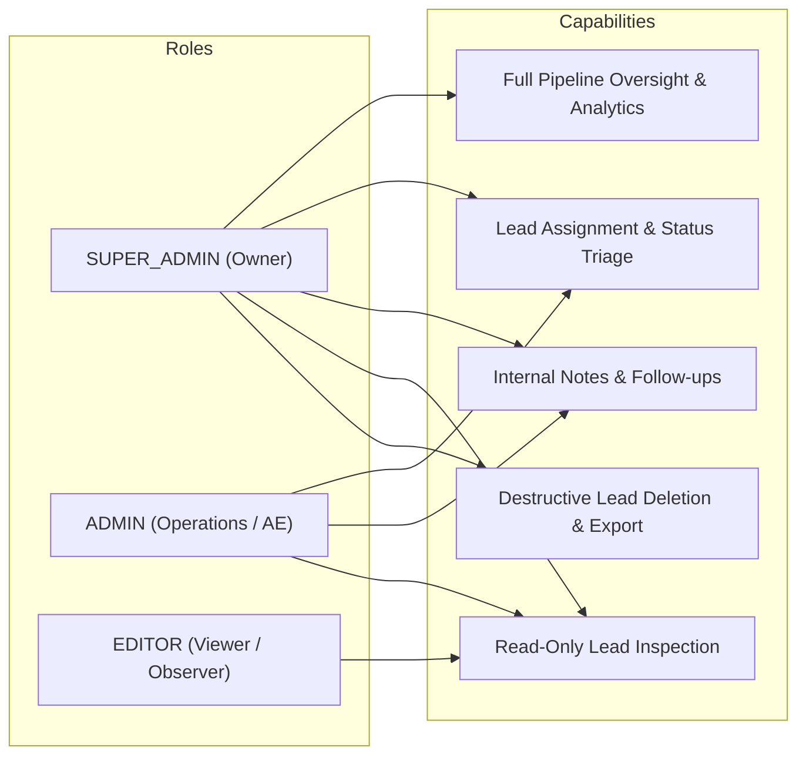
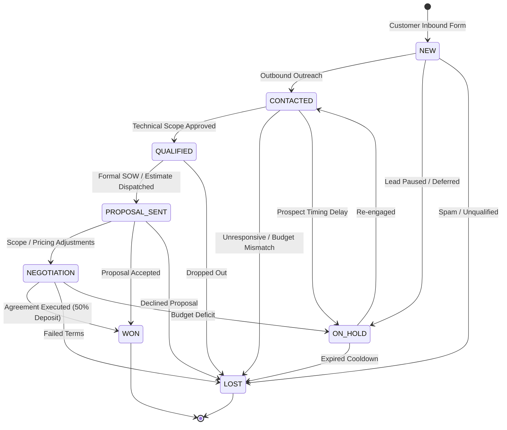

# VOIDTECH SOLUTION — Lead Management & CRM Pipeline Requirements
## Phase 9.0 Functional & Architectural Specification

**Project:** VOIDTECH SOLUTION  
**Tagline:** Build. Launch. Grow Online.  
**Document:** Lead Management & CRM Pipeline Requirements  
**Phase:** Phase 9 (Admin Lead Management & Enquiry Pipeline)  
**Milestone:** 9.0 — Discovery, Requirements & Architecture  
**Author:** Antigravity Architect  
**Status:** Approved Specification (Discovery Complete)  

---

## 1. Executive Summary & Vision

The VOIDTECH SOLUTION public platform captures high-intent technical software engineering enquiries across 18 distinct offerings and 10 starting pricing tiers. 

Currently, incoming enquiries are stored in the PostgreSQL database (`enquiries` table) and surfaced in a basic administrative table view with status filtering and a single free-text internal note string (`Enquiry.internalNotes`).

**Phase 9 transforms the administrative console into a comprehensive, high-velocity CRM and Sales Pipeline Engine.** The system enables the business owner (`SUPER_ADMIN`) and operations leads (`ADMIN`) to track prospect lifecycles from initial contact through qualification, technical proposal, negotiation, contract signing (`WON`), or loss/deferral (`LOST` / `ON_HOLD`).

### Core Design Principles
1. **Zero Fabricated Data:** All metrics, velocity analytics, and conversion rates derive exclusively from real PostgreSQL records. No mock counters or fake averages.
2. **Strict Internal vs External Boundary:** Internal architect notes, budget assessments, follow-up flags, and administrator comments **must never** leak into customer-facing confirmation emails or client notifications.
3. **Optimistic, Concurrent-Safe UI:** Instantaneous Kanban drag-and-drop interactions with server-side optimistic concurrency control (OCC) and automatic UI rollback on mutation conflict or network failure.
4. **Decoupled Relational Architecture:** Replace fragile monolithic text appending with first-class relational entities for notes, follow-up tasks, assignments, and audit timeline records.
5. **Preservation of Existing Invariants:** Full adherence to existing Next.js 15 App Router architecture, Prisma ORM, Nodemailer SMTP service, single `SUPER_ADMIN` governance, and three-tier RBAC (`SUPER_ADMIN`, `ADMIN`, `EDITOR`).

---

## 2. User Roles & Personas

The CRM system is governed by the platform's centralized three-tier Role-Based Access Control (RBAC) model:

### Persona 1: Business Owner (`SUPER_ADMIN`)
- **Primary Need:** Complete visibility into inbound pipeline health, conversion conversion ratios, administrator response latency, pipeline financial value, and team workload.
- **Authority:** Full read/write access across all leads, reassigning owners, editing any note, scheduling follow-ups, viewing financial analytics, exporting data, and permanently purging records.

### Persona 2: Operations Lead & Account Executive (`ADMIN`)
- **Primary Need:** Triaging new inbound requests, qualifying technical scope, advancing deals through Kanban stages, scheduling client follow-ups, and recording internal engineering assessment notes.
- **Authority:** Full read/write access to lead statuses, notes, and follow-ups. Can claim unassigned leads or reassign within team (per configuration). Cannot purge leads or modify platform-wide settings.

### Persona 3: Content Editor & Engineering Observer (`EDITOR`)
- **Primary Need:** Inspecting customer requirements and requested services to inform content creation, case study documentation, or technical capability planning.
- **Authority:** Strictly read-only access (`enquiries:view`). Cannot alter statuses, append internal notes, assign administrators, or trigger client notifications.

---

## 3. Functional Requirements (FR)

### FR-1: Lead Dashboard & Operational Metrics
The system shall render an executive operational dashboard displaying real-time metrics computed directly from PostgreSQL aggregation queries:
- **FR-1.1 Total Inbound Leads:** Total count of all non-deleted enquiries in the system.
- **FR-1.2 New / Unreviewed Leads:** Count of enquiries in `NEW` status requiring triage.
- **FR-1.3 Active In-Progress Pipeline:** Count of enquiries across active qualification stages (`CONTACTED`, `QUALIFIED`, `PROPOSAL_SENT`, `NEGOTIATION`).
- **FR-1.4 Qualified Pipeline:** Count and percentage of leads that successfully advanced past technical scoping.
- **FR-1.5 Closed Deals (Won):** Count of successful customer acquisitions in `WON` status.
- **FR-1.6 Lost / Dropped Deals:** Count of disqualified or non-closing enquiries in `LOST` or `ON_HOLD` status.
- **FR-1.7 Overdue Follow-ups:** Count of scheduled follow-up tasks whose `dueAt < NOW()` and `isCompleted = false`.
- **FR-1.8 Global Conversion Rate:** Ratio of `WON` deals to total non-active closed deals (`WON / (WON + LOST)`), formatted to 1 decimal place. When total closed deals equal 0, display `0.0%` with a "Pending Closed Data" note.
- **FR-1.9 Recent Activity Stream:** Chronological feed of the 10 most recent lead actions (status changes, notes added, assignments, new submissions).

### FR-2: 8-Stage Kanban Lead Pipeline
The system shall provide an interactive, visual Kanban board organizing leads into 8 distinct lifecycle columns:

- **FR-2.1 Lifecycle Statuses:**
  1. `NEW` — Inbound submission captured; awaiting initial administrator triage.
  2. `CONTACTED` — Initial outreach initiated via email or phone/WhatsApp.
  3. `QUALIFIED` — Technical feasibility confirmed; budget and scope verified against agency capability.
  4. `PROPOSAL_SENT` — Formal quotation, architecture brief, or Statement of Work delivered to client.
  5. `NEGOTIATION` — Scope, commercial terms, or timeline adjustments under active discussion.
  6. `WON` — Contract finalized, initial 50% mobilization deposit confirmed, project transitioning to delivery.
  7. `LOST` — Prospect withdrew, budget unqualified, non-responsive, or project declined.
  8. `ON_HOLD` — Project deferred by prospect for future quarter or temporarily stalled.
- **FR-2.2 Drag-and-Drop Interaction:** Administrators can drag lead cards between valid columns.
- **FR-2.3 Optimistic Updates & Rollback:** The UI immediately reflects column movement. If the server action rejects the change (e.g. concurrent mutation or RBAC denial), the card snaps back with an accessible toast alert explaining the error.
- **FR-2.4 Concurrency Conflict Prevention:** Every status mutation transmits the lead's current `updatedAt` timestamp. If the server record has a newer timestamp, the mutation aborts with `CONFLICT_DETECTED` and requests a refresh.
- **FR-2.5 Audit Logging:** Every status change emits an immutable `ENQUIRY_STATUS_UPDATED` audit record capturing `oldStatus`, `newStatus`, `actorId`, `actorEmail`, `ipAddress`, and `timestamp`.

### FR-3: Comprehensive Lead Profile & Inspection Drawer
Clicking any lead in the table or Kanban shall open a detailed slide-over inspector drawer:
- **FR-3.1 Prospect Contact Details:** Full Name, Business Email (with one-click mailto), Phone Number (with one-click tel/WhatsApp), Company Name, Reference URL (with external link and sanitization).
- **FR-3.2 Technical Requirements:** Requested Service Category, Selected Starting Package, Budget Range tier, Target Timeline, and Full Technical Brief Message.
- **FR-3.3 Metadata Telemetry:** Inbound Reference ID (`ENQ-...`), Submission Date/Time (UTC and browser local), IP Hash, User Agent summary, and Consultation Policy Consent confirmation.
- **FR-3.4 Assignment Banner:** Current assigned administrator avatar/name with an inline reassignment dropdown for authorized users.
- **FR-3.5 Quick Actions:** One-click Status Update dropdown, Schedule Follow-up button, Add Note button, and (for `SUPER_ADMIN`) Delete Lead button.

### FR-4: Multi-Author Internal Notes & Timeline
- **FR-4.1 Relational Note Threading:** Replace single-string `internalNotes` with dedicated `LeadNote` entities linked to `Enquiry`.
- **FR-4.2 Author Attribution:** Notes display the creating administrator's name, role badge, and ISO timestamp.
- **FR-4.3 Note Security Guarantee:** Notes are tagged `INTERNAL_ONLY`. Under no architectural circumstances shall note content be included in customer-facing emails.
- **FR-4.4 Unified Activity Feed:** Chronologically interleave:
  - Inbound submission creation.
  - Status transitions.
  - Administrator assignments.
  - Internal notes added.
  - Follow-up creation and completions.
  - Outbound email notifications dispatched.

### FR-5: Follow-Up Scheduling & Task Management
- **FR-5.1 Follow-Up Entity:** Dedicated `LeadFollowUp` record containing `title`, `description`, `dueAt`, `priority` (`LOW`, `MEDIUM`, `HIGH`, `URGENT`), `assignedToId`, and `isCompleted`.
- **FR-5.2 Due Date & Timezone Standards:** All timestamps stored in PostgreSQL as UTC (`TIMESTAMP(3)`). The frontend formats timestamps into the administrator's local browser timezone with relative human indicators (e.g. "Due in 2 hours", "Overdue by 1 day").
- **FR-5.3 Status Toggling:** One-click completion checkbox marking `isCompleted = true` and `completedAt = NOW()`.
- **FR-5.4 Overdue Detection:** Visual amber/red warning badges on cards and table rows where `dueAt < NOW()` and `isCompleted = false`.

### FR-6: Multi-Channel Internal Notifications
- **FR-6.1 Event Triggers:**
  - *New Lead Ingested:* Alert all active `SUPER_ADMIN` and `ADMIN` users.
  - *Lead Assigned:* Alert the newly assigned administrator.
  - *Status Changed to WON / LOST:* Alert `SUPER_ADMIN`.
  - *Follow-Up Due / Overdue:* Alert the assigned administrator.
- **FR-6.2 In-App Notification Center:** Unread notification badge in admin top navigation header (`<AdminHeader />`), slide-out drawer listing recent events, and "Mark all as read" capability.
- **FR-6.3 Asynchronous Email Alerts:** Dispatch formatted HTML/Text alert emails via the existing Nodemailer transporter service without blocking server action responses.

### FR-7: Advanced Search, Filtering, and Pagination
- **FR-7.1 Multi-Field Text Search:** Real-time search across `name`, `email`, `companyName`, and `message` using PostgreSQL case-insensitive matching (`mode: "insensitive"`).
- **FR-7.2 Faceted Filtering:** Filter simultaneously by:
  - Lifecycle Status (`EnquiryStatus`).
  - Service Category (`ServiceCategory`).
  - Assigned Administrator (`assignedAdminId`).
  - Budget Tier (`budgetRange`).
  - Overdue Follow-up flag (`hasOverdueFollowUp: true`).
  - Date Range (`from` and `to` ISO timestamps).
- **FR-7.3 Sorting & Pagination:** Server-side pagination (default 25 items per page, options for 50 or 100) and multi-column sorting (`createdAt`, `updatedAt`, `name`, `status`).

### FR-8: Lead Conversion Analytics & Sales Velocity
- **FR-8.1 Stage Conversion Funnel:** Visual drop-off funnel showing lead attrition across `NEW -> CONTACTED -> QUALIFIED -> PROPOSAL_SENT -> WON`.
- **FR-8.2 Service Demand Matrix:** Aggregation of enquiries per `ServiceCategory`, identifying top revenue opportunities.
- **FR-8.3 Average Response Time (SLA):** Elapsed duration between `enquiry.createdAt` and the first `CONTACTED` status transition or first internal note, computed strictly when verified timestamps exist.
- **FR-8.4 Pipeline Estimated Value:** Summation of project values. Because public enquiries capture budget ranges (e.g. `15K_TO_50K`), pipeline value must compute a conservative baseline (minimum threshold) and an aggressive baseline (maximum threshold), clearly labeled as *Estimated Pipeline Range (INR)*.

---

## 4. Non-Functional Requirements (NFR)

### NFR-1: Performance & Responsive Latency
- Server Action mutations (status change, note append, assignment) shall complete in `< 250ms` (P95).
- Aggregated dashboard queries shall execute in `< 150ms` using specialized composite database indexes on `[status, createdAt]` and `[assignedAdminId, status]`.
- Frontend Kanban transitions shall render at `60 FPS` using CSS GPU transforms (`transform: translate3d`) without layout thrashing.

### NFR-2: Security & Identity Boundary
- Strict enforcement of Server-Side RBAC on every Server Action and API Route via `requirePermission()`. Client-side role claims are completely untrusted.
- CSRF and Origin validation enforced via `validateRequestOrigin(headers)` on all mutating endpoints.
- Input payloads sanitized and strictly parsed via Zod schemas (`strict()` mode rejecting unexpected fields).
- Zero exposure of internal administrative comments or PII to unauthorized roles.

### NFR-3: Data Integrity & Concurrency Control
- All multi-table writes (e.g. status update + audit log + notification creation) must execute inside Prisma interactive transactions (`prisma.$transaction`).
- Optimistic Concurrency Control (OCC) using `updatedAt` version matching to eliminate race conditions between multiple administrators triaging the same prospect.

### NFR-4: Accessibility (WCAG 2.1 AA)
- Kanban board, data tables, and detail drawers must support complete keyboard navigation:
  - Tab indexing for interactive controls.
  - Arrow keys and Enter/Space for column reassignment in Kanban.
  - Escape key dismissal for modals and slide-over drawers with focus restoration.
- Color contrast ratios must exceed 4.5:1 across all status badges and metric cards against the `#050507` / `#121218` background.

### NFR-5: Architectural Continuity
- Zero replacement of foundational technologies:
  - Framework: Next.js 15 (App Router).
  - Runtime: Node.js 20+.
  - ORM: Prisma ORM.
  - Database: Neon PostgreSQL.
  - Email Engine: Nodemailer SMTP.
  - Styling: Tailwind CSS 3.4.

---

## 5. Acceptance Criteria Checklist

| ID | Criteria | Verification Method |
|---|---|---|
| AC-1 | Dashboard displays 8 live operational metrics computed directly from database queries. | Unit tests on aggregation queries; Playwright E2E inspection. |
| AC-2 | Kanban renders 8 columns; cards can be dragged or re-assigned via dropdown. | Playwright drag-and-drop test; keyboard accessibility test. |
| AC-3 | Status transitions enforce allowed state transitions; invalid transitions rejected. | Vitest unit tests on state machine service. |
| AC-4 | Concurrent mutations on stale data trigger automatic rollback and conflict notification. | Integration test simulating simultaneous updates. |
| AC-5 | Dedicated `LeadNote` records support multi-author threading with timestamps. | Integration test verifying author attribution and ordering. |
| AC-6 | Follow-ups display overdue warning indicators when `dueAt < NOW()`. | Vitest test mocking current system time. |
| AC-7 | In-app notifications created and displayed for newly assigned leads and won deals. | Integration test verifying `AdminNotification` records. |
| AC-8 | Outbound customer emails **never** contain internal notes or administrative metadata. | Vitest test inspecting generated HTML/Text email payloads. |
| AC-9 | EDITOR role is strictly read-only: status updates, note creation, and assignments return HTTP 403 Forbidden. | Playwright RBAC test mounting under EDITOR session. |
| AC-10 | Full regression suite passes: `tsc --noEmit`, ESLint, Vitest, and Playwright suites. | CI pipeline execution. |
