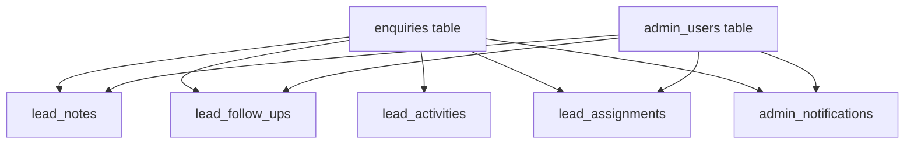

# VOIDTECH SOLUTION — CRM Lead Pipeline Migration Rollback Assessment
## Milestone 9.1 Database Safety & Recovery Specification

**Project:** VOIDTECH SOLUTION  
**Tagline:** Build. Launch. Grow Online.  
**Migration:** `20261113000000_crm_lead_pipeline`  
**Milestone:** Phase 9.1 (Database Schema Migration & Model Hydration)  
**Author:** Antigravity Architect  
**Status:** Approved Recovery Plan  

---

## 1. Safety & Execution Policy

> [!CAUTION]
> This rollback specification is for disaster recovery documentation and emergency architectural reversal only.
> **DO NOT automatically execute destructive rollback SQL.** Any rollback in a staging or production environment requires explicit owner approval.

### Operational Principles:
1. **Preservation of Core Data:** Public customer submissions (`enquiries` table: `name`, `email`, `phone`, `message`, etc.) are 100% additive and remain intact even if CRM child relations are dropped.
2. **Zero In-Flight Lock Contention:** Rollbacks must be executed during planned maintenance windows to avoid database table locks.
3. **Backup Requirement:** A full `pg_dump` snapshot must be verified before any manual rollback is applied.

---

## 2. Structural Dependencies & Cascade Graph



Because foreign keys on child tables reference `enquiries` with `ON DELETE CASCADE` and `admin_users` with `ON DELETE SET NULL / CASCADE`, child tables must be dropped in reverse dependency order before removing columns from `enquiries`.

---

## 3. Step-by-Step Rollback Execution Plan

If a catastrophic deployment failure occurs during or after applying `20261113000000_crm_lead_pipeline`, follow these steps:

### Phase 1: Drop Child Tables & Indexes
```sql
-- 1. Drop CRM child tables (removes foreign keys automatically)
DROP TABLE IF EXISTS "admin_notifications" CASCADE;
DROP TABLE IF EXISTS "lead_assignments" CASCADE;
DROP TABLE IF EXISTS "lead_activities" CASCADE;
DROP TABLE IF EXISTS "lead_follow_ups" CASCADE;
DROP TABLE IF EXISTS "lead_notes" CASCADE;
```

### Phase 2: Remove Extended Columns & Constraints from `enquiries`
```sql
-- 2. Drop foreign key constraint on enquiries.assignedAdminId
ALTER TABLE "enquiries" DROP CONSTRAINT IF EXISTS "enquiries_assignedAdminId_fkey";

-- 3. Drop CRM specific indexes
DROP INDEX IF EXISTS "enquiries_status_createdAt_idx";
DROP INDEX IF EXISTS "enquiries_assignedAdminId_status_idx";
DROP INDEX IF EXISTS "enquiries_nextFollowUpAt_idx";

-- 4. Remove CRM columns added to enquiries
ALTER TABLE "enquiries"
    DROP COLUMN IF EXISTS "assignedAdminId",
    DROP COLUMN IF EXISTS "estimatedValueInr",
    DROP COLUMN IF EXISTS "source",
    DROP COLUMN IF EXISTS "lastContactedAt",
    DROP COLUMN IF EXISTS "nextFollowUpAt",
    DROP COLUMN IF EXISTS "lostReason";
```

### Phase 3: Enum Recovery Considerations
PostgreSQL does not natively support `ALTER TYPE "EnquiryStatus" DROP VALUE`. If enum reversal is strictly required:
1. Re-map records:
   ```sql
   UPDATE "enquiries" SET "status" = 'IN_REVIEW' WHERE "status"::text = 'QUALIFIED';
   UPDATE "enquiries" SET "status" = 'CONVERTED' WHERE "status"::text = 'WON';
   UPDATE "enquiries" SET "status" = 'ARCHIVED' WHERE "status"::text = 'ON_HOLD';
   ```
2. In practice, leaving the additional enum values (`QUALIFIED`, `PROPOSAL_SENT`, `NEGOTIATION`, `WON`, `LOST`, `ON_HOLD`) in PostgreSQL is safe, non-breaking, and avoids table rewrites.

---

## 4. Verification Check After Rollback
```sql
-- Verify table count matches Phase 8.4 schema baseline (10 tables)
SELECT table_name 
FROM information_schema.tables 
WHERE table_schema = 'public' 
ORDER BY table_name;

-- Verify enquiries column count
SELECT column_name, data_type 
FROM information_schema.columns 
WHERE table_name = 'enquiries';
```
