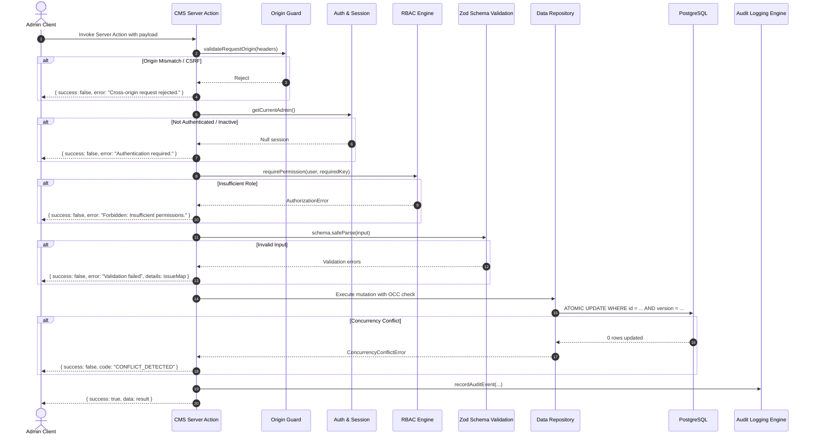

# CMS_API_DESIGN.md — Server Action & Route Contracts

**Project:** VOIDTECH SOLUTION  
**Milestone:** Phase 10.0 — CMS Discovery & Architecture  
**Document Status:** PROPOSED API CONTRACT SPECIFICATIONS (DO NOT IMPLEMENT IN PHASE 10.0)  
**Author:** Google DeepMind Assistant  
**Approved By:** Pending Owner Authorization  

---

## 1. API Architecture & Security Principles

All CMS mutations in VOIDTECH SOLUTION are implemented as typed **Next.js Server Actions** residing in `src/server/actions/cms/`. Public data retrieval is handled by React Server Components querying the repository tier directly with on-demand cache tags.

Every Server Action strictly adheres to the following execution sequence:



---

## 2. Standardized Response Envelope

All Server Actions return a uniform discriminated union type:

```typescript
export type ActionResult<T = unknown> =
  | { success: true; data: T; message?: string }
  | { success: false; error: string; code?: string; details?: Record<string, string[]> };
```

### Standard Error Codes:
- `UNAUTHENTICATED`: No active session cookie or session expired.
- `FORBIDDEN`: User lacks the requisite RBAC permission.
- `VALIDATION_FAILED`: Payload failed Zod schema constraints.
- `CONFLICT_DETECTED`: Optimistic concurrency check failed (version mismatch).
- `NOT_FOUND`: Target entity does not exist.
- `PRECONDITION_FAILED`: Business rule violation (e.g. publishing unverified testimonial).
- `INTERNAL_ERROR`: Unexpected database or system error (credentials masked).

---

## 3. Server Action Contracts

### 3.1 Services Management (`src/server/actions/cms/services.actions.ts`)

#### `createServiceAction`
- **Permission:** `services:create` (`SUPER_ADMIN`, `ADMIN`, `EDITOR`)
- **Input:**
  ```typescript
  interface CreateServiceInput {
    title: string;
    slug?: string; // Auto-generated if omitted
    shortDesc: string;
    fullDesc: string;
    icon: string;
    category: ServiceCategory;
    deliverables: string[];
    technologies: string[];
    startingPriceInr?: number;
    currency?: string; // Default: "INR"
    isFeatured?: boolean;
    orderIndex?: number;
  }
  ```
- **Output:** `ActionResult<Service>`
- **Behavior:** Creates new service in `DRAFT` status with `version = 1`.

#### `updateServiceAction`
- **Permission:** `services:edit` (`SUPER_ADMIN`, `ADMIN`, `EDITOR`)
- **Input:**
  ```typescript
  interface UpdateServiceInput {
    id: string;
    expectedVersion: number; // For atomic OCC
    title?: string;
    shortDesc?: string;
    fullDesc?: string;
    icon?: string;
    category?: ServiceCategory;
    deliverables?: string[];
    technologies?: string[];
    startingPriceInr?: number;
    isFeatured?: boolean;
    orderIndex?: number;
    seoTitle?: string;
    seoDescription?: string;
    canonicalUrl?: string;
    changeSummary?: string;
  }
  ```
- **Output:** `ActionResult<Service>`
- **Behavior:** Updates service, increments `version`, and snapshots state to `ContentRevision`.

#### `publishServiceAction`
- **Permission:** `services:publish` (`SUPER_ADMIN`, `ADMIN`; `EDITOR` DENIED)
- **Input:** `{ id: string; expectedVersion: number }`
- **Output:** `ActionResult<Service>`
- **Behavior:** Sets `status = "PUBLISHED"`, updates `publishedAt` and `publishedById`, triggers on-demand revalidation of `services-catalog` tag.

#### `archiveServiceAction`
- **Permission:** `services:archive` (`SUPER_ADMIN`, `ADMIN`; `EDITOR` DENIED)
- **Input:** `{ id: string; expectedVersion: number }`
- **Output:** `ActionResult<Service>`
- **Behavior:** Sets `status = "ARCHIVED"`, unlists from public catalog, invalidates cache tag.

#### `deleteServiceAction`
- **Permission:** `services:delete` (`SUPER_ADMIN` only)
- **Input:** `{ id: string }`
- **Output:** `ActionResult<{ deletedId: string }>`
- **Behavior:** Permanent removal. Permitted only if service has never been referenced in active contracts.

---

### 3.2 Pricing Management (`src/server/actions/cms/pricing.actions.ts`)

#### `createPricingPackageAction`
- **Permission:** `pricing:create` (`SUPER_ADMIN`, `ADMIN`; `EDITOR` DENIED)
- **Input:**
  ```typescript
  interface CreatePricingPackageInput {
    name: string;
    slug?: string;
    category: ServiceCategory;
    priceInr: number;
    currency?: string; // "INR"
    isStartingPrice?: boolean;
    billingPeriod?: string;
    features: string[];
    popular?: boolean;
    orderIndex?: number;
  }
  ```
- **Output:** `ActionResult<PricingPackage>`

#### `updatePricingPackageAction`
- **Permission:** `pricing:edit` (`SUPER_ADMIN`, `ADMIN`; `EDITOR` DENIED)
- **Input:**
  ```typescript
  interface UpdatePricingPackageInput {
    id: string;
    expectedVersion: number;
    name?: string;
    category?: ServiceCategory;
    priceInr?: number;
    isStartingPrice?: boolean;
    billingPeriod?: string;
    features?: string[];
    popular?: boolean;
    orderIndex?: number;
    changeSummary?: string;
  }
  ```
- **Output:** `ActionResult<PricingPackage>`
- **Behavior:** Enforces strict non-negative integer for `priceInr`. Revalidates `pricing-tiers` cache tag.

---

### 3.3 Portfolio & Case Studies (`src/server/actions/cms/portfolio.actions.ts`)

#### `createPortfolioProjectAction`
- **Permission:** `portfolio:create` (`SUPER_ADMIN`, `ADMIN`, `EDITOR`)
- **Input:**
  ```typescript
  interface CreatePortfolioProjectInput {
    title: string;
    slug?: string;
    clientName: string;
    industry: string;
    summary: string;
    challenge: string;
    solution: string;
    results: string;
    techStack: string[];
    metrics?: Array<{ label: string; value: string }>;
    heroImage?: string;
    galleryImages?: string[];
    liveUrl?: string;
    githubUrl?: string;
    projectType: "CONCEPT" | "INTERNAL_PROTOTYPE" | "PRODUCTION";
    isFeatured?: boolean;
    orderIndex?: number;
  }
  ```
- **Output:** `ActionResult<PortfolioProject>`
- **Behavior:** If `projectType === "CONCEPT"`, auto-injects anti-fabrication disclosure metadata.

#### `publishPortfolioProjectAction`
- **Permission:** `portfolio:publish` (`SUPER_ADMIN`, `ADMIN`; `EDITOR` DENIED)
- **Input:** `{ id: string; expectedVersion: number }`
- **Output:** `ActionResult<PortfolioProject>`
- **Behavior:** Validates that production projects have client verification consent on file. Sets `status = "PUBLISHED"`. Revalidates `portfolio-showcase` and `portfolio-[slug]`.

---

### 3.4 Page Sections & Editorial Copy (`src/server/actions/cms/sections.actions.ts`)

#### `savePageSectionDraftAction`
- **Permission:** `content:edit` (`SUPER_ADMIN`, `ADMIN`, `EDITOR`)
- **Input:**
  ```typescript
  interface SavePageSectionInput {
    key: string; // e.g., "home.hero", "about.values"
    expectedVersion: number;
    title: string;
    subtitle?: string;
    content?: string; // Markdown body
    metadata?: Record<string, unknown>; // CTAs, feature arrays
    mediaUrl?: string;
    changeSummary?: string;
  }
  ```
- **Output:** `ActionResult<PageSection>`
- **Behavior:** Sets `status = "DRAFT"`, increments `version`, logs revision snapshot.

#### `publishPageSectionAction`
- **Permission:** `content:publish` (`SUPER_ADMIN`, `ADMIN`; `EDITOR` DENIED)
- **Input:** `{ key: string; expectedVersion: number }`
- **Output:** `ActionResult<PageSection>`
- **Behavior:** Sets `status = "PUBLISHED"`, revalidates `page-section-[key]` and associated route path.

---

### 3.5 Revisions & Rollback (`src/server/actions/cms/revisions.actions.ts`)

#### `getRevisionsAction`
- **Permission:** `content:view` (All authenticated admin roles)
- **Input:** `{ entityType: string; entityId: string; limit?: number }`
- **Output:** `ActionResult<ContentRevision[]>`

#### `restoreRevisionAction`
- **Permission:** `content:restore` (`SUPER_ADMIN`, `ADMIN`; `EDITOR` DENIED)
- **Input:** `{ revisionId: string }`
- **Output:** `ActionResult<unknown>`
- **Behavior:** Deserializes snapshot from `ContentRevision`, creates a new `DRAFT` revision with incremented version counter, preserving full historical auditability.

---

### 3.6 Media Asset Management (`src/server/actions/cms/media.actions.ts`)

#### `uploadMediaAction`
- **Permission:** `media:upload` (`SUPER_ADMIN`, `ADMIN`, `EDITOR`)
- **Input:** `FormData` containing `file: File`, `altText: string`, `caption?: string`
- **Output:** `ActionResult<MediaAsset>`
- **Validation:**
  - File size <= 5 MB.
  - Allowed MIME: `image/jpeg`, `image/png`, `image/webp`, `image/avif`, `image/svg+xml`.
  - SVG payloads undergo mandatory DOMPurify sanitization.
- **Behavior:** Generates SHA-256 hash filename, stores asset via `StorageService`, registers record in `media_assets`.

#### `deleteMediaAction`
- **Permission:** `media:delete` (`SUPER_ADMIN` only)
- **Input:** `{ id: string }`
- **Output:** `ActionResult<{ deletedId: string }>`
- **Behavior:** Deletes file from storage provider and removes database record.

---

## 4. Next.js Draft Mode API Routes

### 4.1 Activate Draft Preview
- **Route:** `GET /api/draft/preview`
- **Query Parameters:**
  - `secret`: Cryptographic draft preview secret matching `DRAFT_PREVIEW_SECRET`.
  - `entity`: Entity type (`"service" | "portfolio" | "page"`).
  - `slug`: Target item slug.
- **Response:**
  - Sets HTTP-only `__prerender_bypass` cookie via Next.js `draftMode().enable()`.
  - Redirects user to canonical public page URL (e.g. `/services/[slug]`).
- **Security:** Rejects requests with invalid secrets with 401. Enforces strict relative URL validation on redirect destinations to defeat open redirect vulnerabilities.

### 4.2 Exit Draft Preview
- **Route:** `GET /api/draft/exit`
- **Response:**
  - Disables draft mode via `draftMode().disable()`.
  - Redirects back to public page in production published state.
