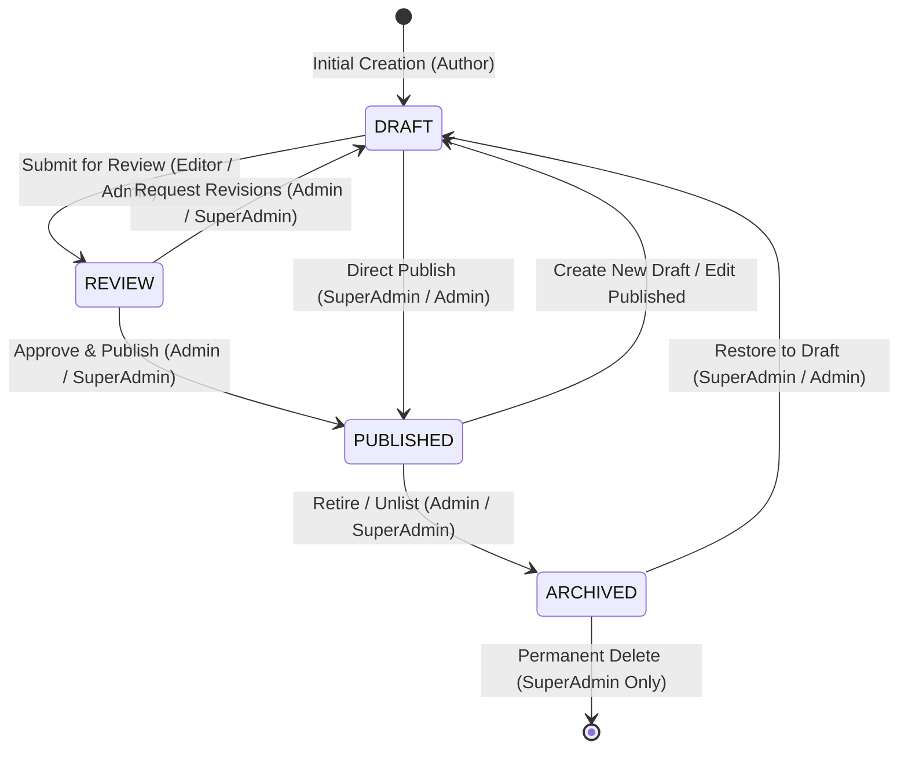
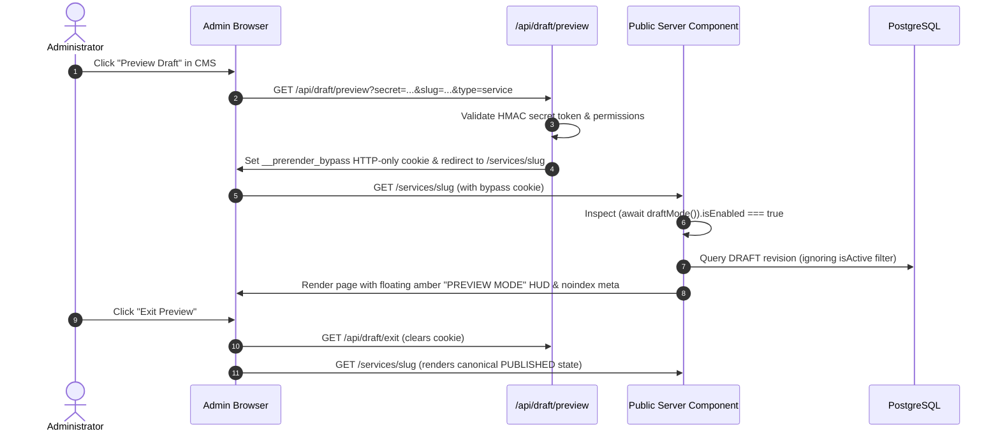

# CMS_ARCHITECTURE.md — System Architecture & Blueprint

**Project:** VOIDTECH SOLUTION  
**Milestone:** Phase 10.0 — CMS Discovery & Architecture  
**Document Status:** PROPOSED ARCHITECTURAL SPECIFICATION  
**Author:** Google DeepMind Assistant  
**Approved By:** Pending Owner Authorization  

---

## 1. System Overview

The **VOIDTECH Content Management System (CMS)** is engineered as a secure, headless, and integrated content administration tier within the Next.js App Router framework. It enables authorized administrators to manage services, pricing packages, portfolio case studies, FAQs, trust indicators, editorial page sections, and SEO metadata through an intuitive web interface at `/admin/*`.

The architecture separates content authoring from public content delivery, utilizing React Server Components (RSC) for zero-client-bundle rendering, Next.js Server Actions for authenticated transactional mutations, Optimistic Concurrency Control (OCC) for conflict-free drafting, and Next.js Draft Mode for secure editorial previews.

```mermaid
flowchart TD
    subgraph ClientLayer["Admin & Public Clients"]
        PublicVisitor["Public Website Visitor"]
        AdminUser["Authenticated Admin (Browser)"]
    end

    subgraph EdgeLayer["Next.js Edge & Security Boundary"]
        EdgeMiddleware["Edge Middleware (Session & Rate Limit)"]
        DraftGuard["Next.js Draft Mode Inspector"]
        OriginCheck["Origin & CSRF Verifier"]
    end

    subgraph ServerLayer["Next.js App Router Runtime"]
        RSC_Public["Public RSC Pages (/, /services, etc.)"]
        RSC_Admin["Admin CMS Routes (/admin/services, etc.)"]
        ServerActions["CMS Server Actions (src/server/actions/cms)"]
        PreviewRoute["Draft Mode Preview Handler (/api/draft/preview)"]
        StorageAdapter["Media Storage Adapter (Local / Cloudflare R2)"]
    end

    subgraph DataLayer["Persistence & Fallback Tier"]
        PrismaORM["Prisma ORM Client Singleton"]
        PostgresDB["PostgreSQL Database (Neon / Local)"]
        StaticConfig["Static Resilient Fallbacks (src/config/*)"]
        AuditEngine["Centralized Audit Logging Engine"]
    end

    PublicVisitor -->|HTTPS GET| EdgeMiddleware
    AdminUser -->|HTTPS GET / POST| EdgeMiddleware
    
    EdgeMiddleware -->|Public Page Request| RSC_Public
    EdgeMiddleware -->|Admin Route Request| RSC_Admin
    EdgeMiddleware -->|Action Invocation| OriginCheck
    
    OriginCheck --> ServerActions
    ServerActions --> PrismaORM
    ServerActions --> AuditEngine
    ServerActions --> StorageAdapter
    
    RSC_Public --> DraftGuard
    DraftGuard -->|Draft Disabled| PrismaORM
    DraftGuard -->|Draft Enabled (Preview Cookie)| PrismaORM
    
    PrismaORM --> PostgresDB
    PrismaORM -.->|Database Offline / Empty| StaticConfig
```

---

## 2. Content Architecture: The Hybrid Strategy

To strike the optimal balance between strict data integrity and editorial flexibility, VOIDTECH CMS adopts a **Hybrid Content Model**:

### 2.1 Structured Relational Entities (Domain Models)
Items with discrete business logic, structured foreign relations, filtering requirements, and high-frequency queries are modeled as normalized database entities:
- **`Service`**: 18 specialized disciplines, categories, icons, deliverables, pricing baselines.
- **`PricingPackage`**: 10 approved packages in INR, billing intervals, feature matrices, custom quotation tags.
- **`PortfolioProject`**: Architecture prototypes, concept lab experiments, tech stacks, live/repo links, verified client case studies.
- **`FAQ`**: Knowledgebase questions, answers, categorization, and display ordering.
- **`Testimonial`**: Client testimonials with mandatory verification records and approval gates.
- **`MediaAsset`**: Uploaded images, SVGs, documents with dimensions, MIME types, and alt text.

### 2.2 Flexible Content Blocks / Page Sections
Editorial content that forms the narrative structure of landing pages (such as hero headlines, brand introductions, 6 core values, 7-stage engineering process, commercial guarantees) is modeled via a normalized `PageSection` entity:
- Keyed by hierarchical section identifiers (e.g., `home.hero`, `home.brand_intro`, `about.values`, `pricing.guarantees`, `contact.availability`).
- Stores title, subtitle, markdown/richtext body, call-to-action configurations, and media references.
- Inherits the full draft, review, and publication lifecycle.

---

## 3. Content Lifecycle & State Machine

Every manageable CMS item follows an explicit, audited lifecycle state machine:



### Lifecycle Stage Definitions:
1. **`DRAFT` (Initial State):**
   - Content is work-in-progress.
   - Visible only to authenticated administrators within `/admin/*` and via authenticated Next.js Draft Mode.
   - Search engines are blocked from indexing draft states via `X-Robots-Tag: noindex, nofollow`.
2. **`REVIEW` (Editorial Review):**
   - `EDITOR` role submits completed drafts for formal review.
   - Alerts `ADMIN` and `SUPER_ADMIN` in the header notification feed.
   - Content is locked from further edits until approved or returned to draft with revision notes.
3. **`PUBLISHED` (Live State):**
   - Active canonical version served to public website visitors.
   - Cached at edge/CDN; triggers on-demand revalidation upon publication.
   - Timestamped with `publishedAt` and attributed to `publishedById`.
4. **`ARCHIVED` (Retired State):**
   - Soft-deleted / retired from public listings.
   - Returns 404 or redirects to canonical parent route on public pages.
   - Retained in PostgreSQL for audit compliance and one-click restoration.

---

## 4. Versioning, Revisions & Concurrency Engine

To prevent silent overwrites and provide enterprise-grade editorial recovery, the CMS implements a dedicated revision history system:

### 4.1 Immutable Revision Snapshots (`ContentRevision`)
Every meaningful mutation (or explicit "Save Draft" / "Publish" action) records an immutable snapshot in `content_revisions`:
- `entityType`: e.g., `"SERVICE"`, `"PORTFOLIO"`, `"PAGE_SECTION"`.
- `entityId`: Foreign key to target item.
- `versionNumber`: Monotonically increasing integer per entity.
- `snapshotData`: JSON serialization of all content fields, relations, and metadata.
- `authorId` / `authorName`: Attribution to modifying administrator.
- `changeSummary`: Optional editorial note (e.g., "Updated INR pricing tier for SaaS package").
- `createdAt`: Immutable timestamp.

### 4.2 Optimistic Concurrency Control (OCC)
- Every CMS edit form loads the current `versionNumber` (or `updatedAt` timestamp).
- When submitting changes, the Server Action executes an atomic condition:
  `WHERE id = entityId AND version = expectedVersion`
- If another administrator has modified and saved the entity in the interim, the mutation is aborted and returns `CONFLICT_DETECTED`.
- The user is alerted with a side-by-side diff modal showing incoming changes vs existing changes, preventing data loss.

### 4.3 Version Rollback & Restoration
- Administrators can browse historical revisions with side-by-side visual diffs.
- Executing "Restore Version" creates a new `DRAFT` revision matching the selected historical snapshot, preserving the audit trail without destructive history rewrites.

---

## 5. Media Management Subsystem

### 5.1 Storage Provider Abstraction
To avoid vendor lock-in and support both zero-cost local development and high-scale production, media operations are encapsulated by `StorageService`:

```typescript
export interface StorageProvider {
  upload(file: Buffer, path: string, mimeType: string): Promise<UploadResult>;
  delete(path: string): Promise<boolean>;
  getUrl(path: string): string;
}
```

- **`LocalStorageProvider` (Default):** Stores assets in `public/uploads/` with direct static URL serving (`/uploads/*`). Zero external configuration required.
- **`CloudflareR2StorageProvider` (Production Recommended):** S3-compatible, 10 GB free tier, 1M free operations/mo, **$0 egress fees**, backed by Cloudflare global CDN.

### 5.2 Upload Validation & Processing Pipeline
1. **Magic Number MIME Sniffing:** Verifies actual file header bytes (blocking disguised executable payloads). Supported: JPEG, PNG, WebP, AVIF, SVG.
2. **File Size Hard Limits:** Maximum 5 MB for images; 1 MB for SVGs.
3. **SVG Sanitization:** Automatically strips `<script>`, `<foreignObject>`, `onload`, and `javascript:` URIs via `DOMPurify` / `sanitize-html` to neutralize stored XSS vulnerabilities.
4. **Collision & Path Traversal Prevention:** Assets are renamed to cryptographic SHA-256 hashes (`/uploads/[hash].[ext]`), completely eliminating path traversal (`../`) and character injection attacks.
5. **Responsive Metadata:** Image dimensions (`width`, `height`), aspect ratio, and mandatory `altText` are saved in `media_assets` for automated Next.js `<Image>` optimization.

---

## 6. Next.js Draft Mode & Editorial Preview

Editorial previews allow administrators to see exact representations of drafts on live page layouts without publishing them or compromising SEO:



### Security & SEO Protections:
- Preview activation requires a cryptographically random `DRAFT_PREVIEW_SECRET` shared only via server environment.
- Any request rendering in Draft Mode automatically emits `<meta name="robots" content="noindex, nofollow" />` and `X-Robots-Tag: noindex, nofollow`, preventing draft content from being indexed by search engine crawlers.

---

## 7. Caching & On-Demand Revalidation

To maintain sub-100ms public response times while reflecting CMS updates instantaneously:

1. **Tag-Based Cache Invalidation:**
   Public route queries use Next.js `unstable_cache` with granular cache tags:
   - `services-catalog`, `service-[slug]`
   - `pricing-tiers`
   - `portfolio-showcase`, `portfolio-[slug]`
   - `faqs-list`
   - `page-section-[key]`
2. **Targeted Revalidation:**
   Upon successful publication (`content:publish`), Server Actions invoke `revalidateTag(tag)` and `revalidatePath(path)`.
3. **Edge CDN Purge:**
   Edge CDN caches are purged on-demand without rebuilding or redeploying the application.

---

## 8. Resilient Offline Fallback Pattern

If PostgreSQL experiences downtime or connection exhaustion during high-traffic events, the repository layer guarantees zero downtime:
- Repositories catch database connection errors and automatically fall back to static definitions in `src/config/site.ts`, `src/config/services.ts`, and `src/config/pricing.ts`.
- The public site continues serving 100% functional, styled HTML without throwing 500 errors.
- Errors are logged to system monitoring without exposing connection strings or internal database topology.
