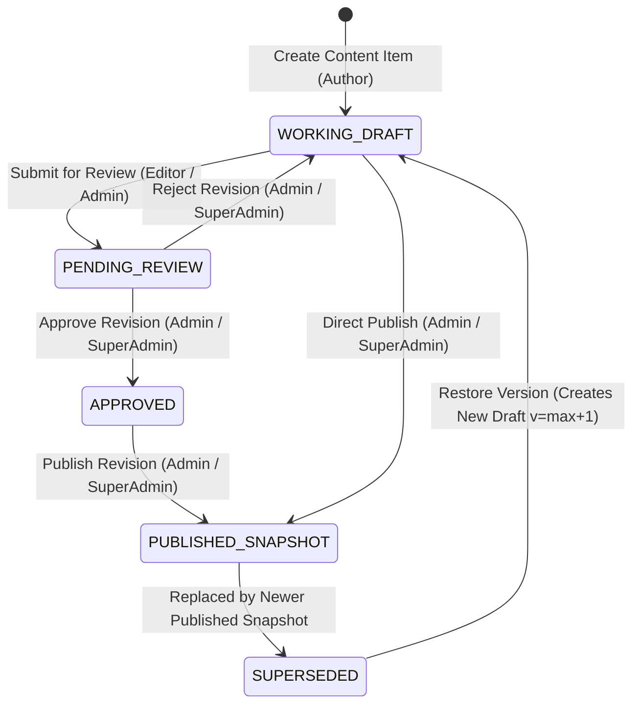
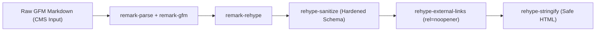

# CMS_ARCHITECTURE.md — System Architecture & Blueprint

**Project:** VOIDTECH SOLUTION  
**Milestone:** Phase 10.0.1 — CMS Architecture Refinement & Design Freeze  
**Document Status:** FROZEN ARCHITECTURAL SPECIFICATION [DESIGN FREEZE]  
**Author:** Google DeepMind Assistant  
**Approved By:** Project Owner  

---

## 1. Owner-Approved Architectural Foundation

The following core decisions have been explicitly approved by the project owner and form the non-negotiable requirements for Phase 10:

1. **[OWNER APPROVED] Decision 1 — Draft & Published Content Separation:** Absolute database and repository isolation between draft working revisions and published public records. Editing drafts never mutates live content. Public repositories query only published records.
2. **[OWNER APPROVED] Decision 2 — ContentItem & ContentRevision Architecture:** Canonical content identity with relational revision history and materialized published snapshots (Approach C), guaranteeing 100% database-enforced referential integrity.
3. **[OWNER APPROVED] Decision 3 — Revision Retention Policy:** Maximum 20 working draft revisions per content item. Published revisions and audit logs are permanently preserved. Restoring a version creates a new incremented revision.
4. **[OWNER APPROVED] Decision 4 — Testimonial Verification & Consent Controls:** Multi-stage verification workflow completely decoupled from publishing. Mandatory verifier attribution, consent timestamp, and evidence records before publication is allowed.
5. **[OWNER APPROVED] Decision 5 — Provider-Abstracted Media System:** Pluggable `StorageProvider` storing `provider` and `storageKey` as source of truth. Local filesystem default for dev; Cloudflare R2 production target. Raster image re-encoding and restricted SVG sanitization.
6. **[OWNER APPROVED] Decision 6 — GFM Markdown & Strict Server-Side Sanitization:** GitHub Flavored Markdown authoring with AST-based `rehype-sanitize` pipeline. Zero raw HTML pass-through, no inline scripts, and hardened external links.
7. **[OWNER APPROVED] Decision 7 — Pricing Publication Permissions:** Pricing publication, live price changes, archival, and restoration restricted strictly to `SUPER_ADMIN` and `ADMIN`. `EDITOR` can only prepare draft proposals.

---

## 2. System Architecture & Component Topology

```mermaid
flowchart TD
    subgraph ClientLayer["Admin & Public Clients"]
        PublicVisitor["Public Website Visitor"]
        AdminUser["Authenticated Admin (Browser)"]
    end

    subgraph EdgeLayer["Next.js Edge & Security Boundary"]
        EdgeMiddleware["Edge Middleware (Session & Rate Limit)"]
        DraftGuard["Next.js Draft Mode Inspector"]
        OriginCheck["Origin & CSRF Verifier (Server Actions)"]
    end

    subgraph ServerLayer["Next.js App Router Runtime"]
        RSC_Public["Public RSC Pages (/, /services, etc.)"]
        RSC_Admin["Admin CMS Routes (/admin/services, etc.)"]
        ServerActions["CMS Server Actions (src/server/actions/cms)"]
        PreviewRoute["Draft Mode Preview Handler (/api/draft/preview)"]
        SanitizerService["GFM Markdown Sanitizer (unified / rehype)"]
        StorageAdapter["StorageProvider Adapter (Local / R2)"]
    end

    subgraph DataLayer["Persistence & Fallback Tier"]
        PrismaORM["Prisma ORM Client Singleton"]
        
        subgraph PostgresDB["PostgreSQL Database Schema"]
            ContentItemTable["content_items (Canonical Identity)"]
            RevisionTable["content_revisions (Drafts & History)"]
            PublishedTables["Materialized Published Tables (services, pricing, etc.)"]
            AuditTable["audit_logs (Immutable WORM Audit)"]
            MediaTable["media_assets (Provider & Storage Keys)"]
        end
        
        StaticConfig["Static Resilient Fallbacks (src/config/*)"]
    end

    PublicVisitor -->|HTTPS GET| EdgeMiddleware
    AdminUser -->|HTTPS GET / POST| EdgeMiddleware
    
    EdgeMiddleware -->|Public Page Request| RSC_Public
    EdgeMiddleware -->|Admin Route Request| RSC_Admin
    EdgeMiddleware -->|Action Invocation| OriginCheck
    
    OriginCheck --> ServerActions
    ServerActions --> SanitizerService
    ServerActions --> StorageAdapter
    ServerActions --> PrismaORM
    
    RSC_Public --> DraftGuard
    DraftGuard -->|Draft Disabled| PublishedTables
    DraftGuard -->|Draft Enabled (Preview Cookie)| RevisionTable
    
    PrismaORM --> PostgresDB
    PrismaORM -.->|Database Offline / Empty| StaticConfig
```

---

## 3. Content Architecture Evaluation: Decision 2 Deep-Dive

We evaluated three potential architectural models for the VOIDTECH CMS content engine:

### Approach A: Pure Generic ContentItem + ContentRevision (JSON Data Blob)
- **Concept:** A single `ContentItem` table linked to `ContentRevision` records where all domain fields (deliverables, prices, technologies, etc.) reside in an untyped `data: Json` column.
- **Critical Flaws:**
  - **Weak Database Integrity:** Foreign key constraints cannot be enforced within JSON properties.
  - **Query & Index Degraded:** Searching, filtering by `category`, or ordering by `orderIndex` requires slow JSONB path operators.
  - **Prisma Friction:** Zero static TypeScript type-safety for Prisma query results; requires manual Zod parsing on every read.

### Approach B: Completely Separate Revision Tables per Entity
- **Concept:** `ServiceRevision`, `PricingPackageRevision`, `PortfolioProjectRevision`, `FAQRevision`, `PageSectionRevision`.
- **Critical Flaws:**
  - **Schema Duplication:** 5+ duplicate tables mimicking their parent models.
  - **Maintenance Overhead:** Five separate repository implementations for identical revision logic (pruning, restoration, review).

### Approach C: Materialized Published Snapshots + Relational ContentItem Identity (RECOMMENDED HYBRID) [OWNER APPROVED]
- **Concept:**
  1. **`ContentItem`**: The canonical identity, slug owner, and publication state coordinator (`DRAFT`, `REVIEW`, `PUBLISHED`, `ARCHIVED`). It holds a foreign key pointer `currentPublishedRevisionId` to `ContentRevision`.
  2. **`ContentRevision`**: The normalized revision history table storing working drafts, review submissions, and historical snapshots with author attribution and monotonically increasing `versionNumber`.
  3. **Materialized Domain Tables (`Service`, `PricingPackage`, etc.)**: Represent **strictly the currently published snapshot** with fully indexed relational columns.
- **Evaluation Matrix:**

| Evaluation Criteria | Approach A (Pure Generic) | Approach B (Separate Tables) | Approach C (Materialized Hybrid - APPROVED) |
|---|:---:|:---:|:---:|
| **Referential Integrity** | Low (untyped JSON) | High (fully typed) | **High (fully typed relational FKs)** |
| **Prisma Compatibility** | Poor (casts required) | Excellent | **Excellent (native relational types)** |
| **Public Query Speed** | Slow (JSON parsing) | Fast | **Maximum (direct indexed SQL reads)** |
| **Transactional Publishing**| Fair | Complex | **Optimal (single atomic PostgreSQL xact)** |
| **Revision Restoration** | Simple | Duplicate Code | **Unified (single revision engine)** |
| **Schema Complexity** | Low | High (10+ tables) | **Moderate (clean normalized design)** |
| **Long-Term Maintainability**| Poor | Moderate | **High (reusable lifecycle + typed domain)**|

---

## 4. Draft & Published Separation Model: Decision 1 Deep-Dive

To satisfy the owner's requirement that editing a draft must never alter published public content:

### 4.1 Boundary Enforcement Rules
1. **Public Read Boundary:** Public pages (`/services`, `/pricing`, `/portfolio`, `/`) query **only** the materialized published tables (`Service`, `PricingPackage`, etc.) where `isActive = true`. They never read `ContentRevision` working copies.
2. **Draft Authoring Boundary:** When an admin or editor edits content, mutations write **strictly** to a `ContentRevision` record in `revisionStatus: "WORKING_DRAFT"`. The materialized published record is untouched.
3. **Atomic Promotion Transaction:** Publishing executes a PostgreSQL transaction (`prisma.$transaction`):
   ```typescript
   await prisma.$transaction(async (tx) => {
     // 1. Verify revision is approved and belongs to item
     const rev = await tx.contentRevision.findUniqueOrThrow({ where: { id: revisionId } });
     
     // 2. Atomically update materialized domain table (e.g. Service)
     await tx.service.upsert({
       where: { contentItemId: rev.contentItemId },
       update: { ...rev.snapshotData, updatedAt: new Date() },
       create: { contentItemId: rev.contentItemId, ...rev.snapshotData },
     });
     
     // 3. Promote revision reference on ContentItem
     await tx.contentItem.update({
       where: { id: rev.contentItemId },
       data: {
         status: "PUBLISHED",
         currentPublishedRevisionId: rev.id,
         publishedAt: new Date(),
       },
     });
     
     // 4. Mark revision as published snapshot
     await tx.contentRevision.update({
       where: { id: rev.id },
       data: { revisionStatus: "PUBLISHED_SNAPSHOT", isPublishedSnapshot: true },
     });
     
     // 5. Record immutable audit log
     await tx.auditLog.create({ ... });
   });
   ```
4. **Failure Guarantee:** If any step within the transaction fails (e.g. database constraint violation, connection timeout), the transaction automatically aborts and rolls back. The public materialized table remains 100% identical to its pre-transaction state.
5. **Archiving as Explicit Publishing Operation:** Archiving an item sets `ContentItem.status = "ARCHIVED"` and deactivates the materialized record (`isActive = false`), atomically removing it from public queries.

---

## 5. Deterministic Lifecycle State Matrix

To eliminate ambiguity across all operational scenarios, every content transition has an explicit expected outcome:



### Detailed Scenario Outcomes:
1. **Admin Edits Published Item:** Creates a new `ContentRevision` with `versionNumber = current + 1` and `revisionStatus: "WORKING_DRAFT"`. The `ContentItem` remains `PUBLISHED`, and public visitors continue seeing the old published snapshot.
2. **Editor Submits Draft for Review:** `ContentRevision.revisionStatus` updates to `"PENDING_REVIEW"`. An in-app notification is dispatched to `ADMIN` and `SUPER_ADMIN`. Published site is unchanged.
3. **Admin Rejects Revision:** `ContentRevision.revisionStatus` returns to `"WORKING_DRAFT"` with `rejectionNote` recorded. Published site is unchanged.
4. **Admin Publishes Revision:** Atomic transaction executes (Section 4.1). Revision promoted to `PUBLISHED_SNAPSHOT`. `ContentItem.currentPublishedRevisionId` updated. Materialized table updated. Cache tag invalidated on-demand.
5. **Two Admins Edit Simultaneously (OCC Collision):** Both load version $V$. Admin A saves first, updating $V \to V+1$. Admin B submits save with expected version $V$. Server Action detects drift ($V \neq V+1$), aborts with `code: "CONFLICT_DETECTED"`, and displays a side-by-side diff modal to Admin B without overwriting Admin A's changes.
6. **Admin Restores Previous Revision:** Deserializes snapshot from historical `ContentRevision`. Creates a **NEW** revision with `versionNumber = max(versionNumber) + 1` and `revisionStatus: "WORKING_DRAFT"`. Historical records are never rewritten.
7. **Published Item is Archived:** `ContentItem.status` transitions to `"ARCHIVED"`. The materialized domain record sets `isActive = false`. Cache tags are invalidated. Public routes return 404 or redirect.
8. **Database Transaction Fails During Publishing:** PostgreSQL rolls back the transaction. Zero partial data is written. Error logged to monitoring. Admin notified with actionable retry banner.

---

## 6. Revision Retention Policy: Decision 3 Deep-Dive

To prevent unbounded database bloat while strictly preserving historical integrity:

### 6.1 Retention Invariants [OWNER APPROVED]
1. **Draft Retention Cap:** An item may hold a maximum of **20 working draft revisions** (`revisionStatus: "WORKING_DRAFT"` or `"SUPERSEDED"`).
2. **Exemption of Published Snapshots:** Any `ContentRevision` that is currently published (`currentPublishedRevisionId === revision.id`) or has ever served as a published milestone (`isPublishedSnapshot === true`) is **strictly exempt from pruning**.
3. **Audit Log Immunity:** Pruning draft revision rows does **never** delete or alter `audit_logs` entries. Audit trail records remain immutable.
4. **Atomic Pruning Boundary:** Pruning executes post-save or during background maintenance:
   ```sql
   DELETE FROM content_revisions
   WHERE id IN (
     SELECT id FROM content_revisions
     WHERE "contentItemId" = $1
       AND "isPublishedSnapshot" = false
       AND "revisionStatus" != 'PENDING_REVIEW'
     ORDER BY "versionNumber" DESC
     OFFSET 20
   );
   ```

---

## 7. Testimonial Verification & Consent Controls: Decision 4 Deep-Dive

To eliminate risk of fabricated claims, misleading results, or defamation:

### 7.1 Multi-Stage Verification Pipeline [OWNER APPROVED]
```
[DRAFT Testimonial Authored]
            │
            ▼
[Verification Audit by Admin] ──> Records verifiedById, verifiedAt, verificationRecord
            │
            ▼
[Client Consent Confirmation] ──> Records clientConsentConfirmed: true, consentEvidenceUrl, consentConfirmedAt
            │
            ▼
[Testimonial Enters VERIFIED State] ──> isVerified = true, approvalStatus = "VERIFIED"
            │
            ▼
[Separate Publishing Gate] ──> SUPER_ADMIN or ADMIN executes publishAction
            │
            ▼
[Public Visibility Active] ──> Displayed on live showcase
```

### 7.2 Strict Public Query Guard
Public queries strictly enforce:
```typescript
where: {
  status: "PUBLISHED",
  isActive: true,
  isVerified: true,
  approvalStatus: "VERIFIED",
  clientConsentConfirmed: true,
}
```
If client consent is ever revoked, the administrator updates `approvalStatus = "REVOKED"`, which instantly and atomically unlists the testimonial across all public pages.

---

## 8. Provider-Abstracted Media Subsystem: Decision 5 Deep-Dive

### 8.1 StorageProvider Interface [OWNER APPROVED]
```typescript
export interface StorageResult {
  storageKey: string;
  provider: "LOCAL" | "R2";
  publicUrl: string;
  sizeBytes: number;
  mimeType: string;
  sha256Hash: string;
}

export interface StorageProvider {
  upload(file: Buffer, storageKey: string, mimeType: string): Promise<StorageResult>;
  delete(storageKey: string): Promise<boolean>;
  getPublicUrl(storageKey: string): string;
}
```

### 8.2 Source of Truth: `provider` + `storageKey`
Database records in `media_assets` store the explicit storage coordinates:
- `provider`: `"LOCAL"` (development) or `"R2"` (production).
- `storageKey`: e.g., `uploads/2026/11/a3f5b8...webp`.
- Resolving public URLs dynamically ensures that migrating from local disk to Cloudflare R2 requires **zero database record updates**—the application simply maps `storageKey` through the active provider's CDN domain.

### 8.3 Hardened Media Pipeline:
1. **Raster Re-Encoding (Sharp):** Incoming JPEGs and PNGs are re-encoded on the server to modern WebP/AVIF, stripping unverified EXIF metadata, embedded scripts, and comment tags.
2. **SVG Upload Restriction:** SVG uploads are treated as a restricted security privilege (`media:upload_svg`). SVGs must pass strict XML parsing and DOMPurify sanitization to neutralize embedded JavaScript vectors before storage.
3. **Per-Placement Alt Text:** Content authors can provide placement-specific alt text in `ContentRevision.snapshotData` to ensure accurate semantic context across different page sections.

---

## 9. GFM Markdown & Strict HTML Sanitization: Decision 6 Deep-Dive

### 9.1 Processing Pipeline [OWNER APPROVED]


### 9.2 Approved Library Stack:
- `unified` (v11)
- `remark-parse` & `remark-gfm` (GFM tables, autolinks, strikethrough)
- `remark-rehype` (AST translation)
- `rehype-sanitize` (Strict whitelist based on GitHub default, disallowing `<script>`, `<iframe>`, `<object>`, `<embed>`, `<form>`, and event attributes)
- `rehype-external-links` (Injects `rel="noopener noreferrer"` and `target="_blank"`)
- `rehype-stringify` (Final serialization)

---

## 10. Public Website Integration, Caching & Failure Guarantees

### 10.1 Caching Strategy
- Public RSC queries use Next.js `unstable_cache` with granular tags (`services-catalog`, `service-[slug]`, `pricing-tiers`, etc.).
- When an approved revision is published or archived, Server Actions immediately call `revalidateTag(tag)` and `revalidatePath(path)`.

### 10.2 Explicit Failure & Fallback Invariants (Section 7 of Charter):
1. **Database Completely Unavailable:** Repositories catch the connection error and return static configurations from `src/config/site.ts` and `src/config/pricing.ts`. Public pages render without crashing. System logs an error without leaking DB connection strings.
2. **Database Available but No Published Content Exists:** If a table is empty, the repository returns the static fallback so the site is never blank.
3. **Content Item Unpublished / In Draft:** Public query filters (`status = PUBLISHED AND isActive = true`) exclude the item. Direct slug queries return `notFound()` (HTTP 404).
4. **Content Item Archived:** Returns `notFound()` or 301 permanent redirect to parent listing.
5. **Corrupted / Invalid Content Snapshot:** If snapshot JSON fails Zod validation during read, repository logs an alert and serves the static fallback item.
