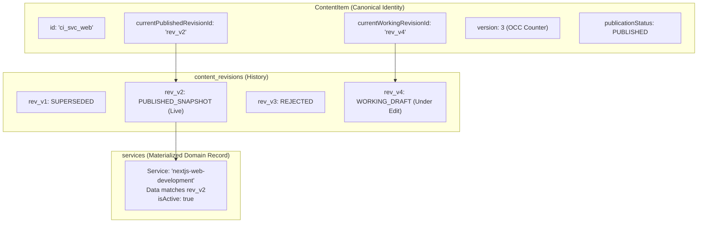
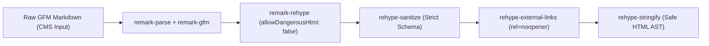

# CMS_ARCHITECTURE.md — System Architecture & Blueprint

**Project:** VOIDTECH SOLUTION  
**Milestone:** Phase 10.0.2 — Final CMS Implementation Safeguards  
**Document Status:** FROZEN ARCHITECTURAL SPECIFICATION & SAFEGUARDS [DESIGN FREEZE]  
**Author:** Google DeepMind Assistant  
**Approved By:** SHIVANSHU SATYAJEET (Project Owner) — Safeguards Authorized  

---

## 1. Owner-Approved Architectural Foundation & Implementation Safeguards

The following core decisions and safeguards have been explicitly approved by the project owner and form the non-negotiable requirements for Phase 10:

1. **[OWNER APPROVED] Safeguard 1 — Dual-Pointer Draft & Published Content Separation:** Every `ContentItem` maintains dual pointers (`currentPublishedRevisionId` and `currentWorkingRevisionId`). Working revisions have an independent lifecycle. Public reads strictly from the materialized published record (`isActive = true`). Editing drafts never alters live content. Simultaneous existence is guaranteed: a published item remains visible while a newer draft is actively edited.
2. **[OWNER APPROVED] Safeguard 2 — Database Referential Integrity & Prisma Compatibility:** Canonical content identity with relational revision history and materialized published snapshots (Approach C). Enforces database-level foreign keys (`ContentRevision.contentItemId -> ContentItem.id`, `Service.contentItemId -> ContentItem.id`) and unique revision numbering (`@@unique([contentItemId, versionNumber])`). Explicitly defines database-enforced constraints vs. application-enforced transactional validations.
3. **[OWNER APPROVED] Safeguard 3 — Atomic 9-Step Publishing Transaction:** Publishing executes an explicit 9-step atomic transaction (`prisma.$transaction`) validating authentication, permissions, OCC version check (`version === expectedVersion`), revision ownership, Zod constraints, domain upsert, pointer promotion, and audit logging. Concurrency conflicts trigger visual diff review with zero blind overwriting.
4. **[OWNER APPROVED] Safeguard 4 — Testimonial Verification & Legal Consent Integrity:** Resolves overlapping fields into one authoritative verification state (`TestimonialVerificationStatus`: `UNVERIFIED`, `VERIFIED`, `REJECTED`) and decoupled client consent state (`ClientConsentStatus`: `PENDING`, `GRANTED`, `REVOKED`). Publication strictly requires verified admin identity, completed verification, recorded consent, and no revocation. Consent revocation immediately unlists content at the SQL query level.
5. **[OWNER APPROVED] Safeguard 5 — Media Security Defaults:** Strictly allows JPEG, PNG, and WebP. SVG uploads are **disabled by default** until a dedicated sanitizer and test suite are completed. Validates file signatures (magic bytes), re-encodes rasters with Sharp, enforces 5MB limits, generates cryptographically safe keys, blocks path traversal, keeps local filesystem dev-only, and strictly forbids ephemeral serverless storage in production. Cloudflare R2 remains a deferred future production option with zero resources configured now.
6. **[OWNER APPROVED] Safeguard 6 — Comprehensive Static Fallback Behavior:** Distinct behaviors specified across 5 operational scenarios (DB unavailable, empty tables, archived items, invalid snapshots, unexpected repo exceptions). Stale static content is **never silently presented as live published CMS data**. Emits `X-Voidtech-Content-Source` header, `isFallback: true` flag, and sanitized structured logging.
7. **[OWNER APPROVED] Decision 6 — GFM Markdown & Strict Server-Side Sanitization:** GitHub Flavored Markdown authoring with AST-based `unified` + `rehype-sanitize` pipeline. Zero raw HTML pass-through, no inline scripts, and hardened external links.
8. **[OWNER APPROVED] Decision 7 — Pricing Publication Permissions:** Pricing publication, live price changes, archival, and restoration restricted strictly to `SUPER_ADMIN` and `ADMIN`. `EDITOR` can only prepare draft proposals (`pricing:edit_draft`).

---

## 2. System Architecture & Component Topology

```mermaid
flowchart TD
    subgraph ClientLayer["Admin & Public Clients"]
        PublicVisitor["Public Website Visitor"]
        AdminUser["Authenticated Admin (Browser)"]
    end

    subgraph EdgeLayer["Next.js Edge & Security Boundary"]
        EdgeMiddleware["Edge Middleware (Session & Rate Limit)"]
        DraftGuard["Next.js Draft Mode Inspector"]
        OriginCheck["Origin & CSRF Verifier (Server Actions)"]
    end

    subgraph ServerLayer["Next.js App Router Runtime"]
        RSC_Public["Public RSC Pages (/, /services, etc.)"]
        RSC_Admin["Admin CMS Routes (/admin/services, etc.)"]
        ServerActions["CMS Server Actions (src/server/actions/cms)"]
        PreviewRoute["Draft Mode Preview Handler (/api/draft/preview)"]
        SanitizerService["GFM Markdown Sanitizer (unified / rehype)"]
        StorageAdapter["StorageProvider Adapter (Local Filesystem Dev)"]
    end

    subgraph DataLayer["Persistence & Fallback Tier"]
        PrismaORM["Prisma ORM Client Singleton"]
        
        subgraph PostgresDB["PostgreSQL Database Schema"]
            ContentItemTable["content_items (Canonical Identity, Dual Pointers)"]
            RevisionTable["content_revisions (Append-Only Revisions & Snapshots)"]
            PublishedTables["Materialized Published Tables (services, pricing, etc.)"]
            AuditTable["audit_logs (Immutable WORM Audit)"]
            MediaTable["media_assets (Provider & Storage Keys)"]
        end
        
        StaticConfig["Static Resilient Fallbacks (src/config/*)"]
    end

    PublicVisitor -->|HTTPS GET| EdgeMiddleware
    AdminUser -->|HTTPS GET / POST| EdgeMiddleware
    
    EdgeMiddleware -->|Public Page Request| RSC_Public
    EdgeMiddleware -->|Admin Route Request| RSC_Admin
    EdgeMiddleware -->|Action Invocation| OriginCheck
    
    OriginCheck --> ServerActions
    ServerActions --> SanitizerService
    ServerActions --> StorageAdapter
    ServerActions --> PrismaORM
    
    RSC_Public --> DraftGuard
    DraftGuard -->|Draft Disabled (Public)| PublishedTables
    DraftGuard -->|Draft Enabled (Preview Cookie)| RevisionTable
    
    PrismaORM --> PostgresDB
    PrismaORM -.->|Database Offline / Empty| StaticConfig
```

---

## 3. Content Architecture Evaluation: Approach C (Materialized Hybrid)

We evaluated three potential architectural models for the VOIDTECH CMS content engine:

### Approach A: Pure Generic ContentItem + ContentRevision (JSON Data Blob)
- **Concept:** A single `ContentItem` table linked to `ContentRevision` records where all domain fields (deliverables, prices, technologies, etc.) reside in an untyped `data: Json` column.
- **Critical Flaws:**
  - **Weak Database Integrity:** Foreign key constraints cannot be enforced within JSON properties.
  - **Query & Index Degraded:** Searching, filtering by `category`, or ordering by `orderIndex` requires slow JSONB path operators.
  - **Prisma Friction:** Zero static TypeScript type-safety for Prisma query results; requires manual Zod parsing on every read.

### Approach B: Completely Separate Revision Tables per Entity
- **Concept:** `ServiceRevision`, `PricingPackageRevision`, `PortfolioProjectRevision`, `FAQRevision`, `PageSectionRevision`.
- **Critical Flaws:**
  - **Schema Duplication:** 5+ duplicate tables mimicking their parent models.
  - **Maintenance Overhead:** Five separate repository implementations for identical revision logic (pruning, restoration, review).

### Approach C: Materialized Published Snapshots + Canonical Identity (APPROVED HYBRID)
- **Concept:**
  1. **`ContentItem`**: The canonical identity and publication state coordinator. It holds dual pointers: `currentPublishedRevisionId` (live record) and `currentWorkingRevisionId` (draft under edit).
  2. **`ContentRevision`**: The normalized append-only revision table storing working drafts, review submissions, and historical snapshots with author attribution and monotonically increasing `versionNumber`.
  3. **Materialized Domain Tables (`Service`, `PricingPackage`, etc.)**: Represent **strictly the currently published snapshot** with fully indexed relational columns.
- **Evaluation Matrix:**

| Evaluation Criteria | Approach A (Pure Generic) | Approach B (Separate Tables) | Approach C (Materialized Hybrid - APPROVED) |
|---|:---:|:---:|:---:|
| **Referential Integrity** | Low (untyped JSON) | High (fully typed) | **High (fully typed relational FKs)** |
| **Prisma Compatibility** | Poor (casts required) | Excellent | **Excellent (native relational types)** |
| **Public Query Speed** | Slow (JSON parsing) | Fast | **Maximum (direct indexed SQL reads)** |
| **Transactional Publishing**| Fair | Complex | **Optimal (single atomic PostgreSQL xact)** |
| **Revision Restoration** | Simple | Duplicate Code | **Unified (single revision engine)** |
| **Schema Complexity** | Low | High (10+ tables) | **Moderate (clean normalized design)** |
| **Long-Term Maintainability**| Poor | Moderate | **High (reusable lifecycle + typed domain)**|

---

## 4. Draft & Published Revision Separation (Safeguard 1)

### 4.1 Dual-Pointer Architecture
Every `ContentItem` maintains two distinct revision pointers:
- `currentPublishedRevisionId`: References the immutable `ContentRevision` currently promoted and materialized for public traffic.
- `currentWorkingRevisionId`: References the active working `ContentRevision` undergoing drafting or review.



### 4.2 Boundary Enforcement Rules
1. **Public Read Boundary:** Public pages (`/services`, `/pricing`, `/portfolio`, `/`) query **only** the materialized published tables (`Service`, `PricingPackage`, etc.) where `isActive = true`. They never read `content_revisions`.
2. **Draft Authoring Boundary:** When an admin or editor edits content, mutations write **strictly** to a `ContentRevision` pointed to by `currentWorkingRevisionId`. The materialized published record is untouched.
3. **Simultaneous Existence Guarantee:** An item remains 100% publicly visible and accessible with its approved pricing, deliverables, and copy while an editor experiments with a new draft version.
4. **Authorized Draft Preview:** Next.js Draft Mode (`__prerender_bypass` cookie validated via preview secret) intercepts Server Component queries. The repository loads the revision specified by `currentWorkingRevisionId` (or a specific historical `revisionId`), emits `X-Robots-Tag: noindex, nofollow`, and renders the persistent amber preview HUD banner.
5. **Atomic Promotion on Publish:** Publishing promotes `currentWorkingRevisionId` to `currentPublishedRevisionId`, increments `ContentItem.version`, and updates the materialized domain table in a single database transaction.

---

## 5. Database Referential Integrity & Prisma Compatibility (Safeguard 2)

### 5.1 Enforcing Integrity Without False Claims
We explicitly declare what is database-enforced vs. what is application-enforced:

| Integrity Invariant | Database-Enforced Mechanism | Application-Enforced Mechanism |
|---|---|---|
| **Revision Parent Link** | `FOREIGN KEY (contentItemId) REFERENCES content_items(id) ON DELETE CASCADE`. No orphaned revisions can exist. | Verified on creation in repository. |
| **Monotonic Revision Numbers** | `@@unique([contentItemId, versionNumber])`. No duplicate revision numbers per item. | Repository increments `versionNumber = max + 1`. |
| **Domain Canonical Identity** | `FOREIGN KEY (contentItemId) REFERENCES content_items(id) ON DELETE RESTRICT` with `@unique`. Exactly one domain record per `ContentItem`. | Repository verifies 1-to-1 mapping. |
| **Valid Pointer Targets** | `currentPublishedRevisionId` and `currentWorkingRevisionId` have FKs to `ContentRevision.id` (`ON DELETE SET NULL`). No dangling pointers. | Checked on publish and edit. |
| **Cross-Item Pointer Ownership** | PostgreSQL `CHECK TRIGGER` in migration SQL: `verify_revision_ownership()`. | Step 4 of Publishing Transaction asserts `workingRevision.contentItemId === contentItem.id`. |

### 5.2 Composite Foreign Key Evaluation in Prisma
We evaluated defining a composite foreign key on `ContentItem`:
`FOREIGN KEY (currentPublishedRevisionId, id) REFERENCES ContentRevision(id, contentItemId)`.
- **Finding:** Circular composite foreign keys in Prisma schemas cause cyclic relation dependency errors during migration generation.
- **Resolution:** Prisma models use standard `@relation` with `onDelete: SetNull`. Step 4 of the atomic publishing transaction strictly verifies cross-record ownership, backed by a PostgreSQL trigger in the migration DDL.

---

## 6. Atomic Publishing Transaction (Safeguard 3)

### 6.1 Exact 9-Step Publishing Protocol
Every publication follows an explicit, unskippable 9-step atomic transaction (`prisma.$transaction`). Failure at any step aborts and rolls back the entire operation:

1. **Authenticate Administrator:** Verify session token, decode administrator identity, verify admin account is active (`isActive = true`).
2. **Check Server-Side Publishing Permission:** Verify caller has required role/permission for the specific domain (e.g., `services:publish`, `portfolio:publish`, or `pricing:publish` strictly requiring `SUPER_ADMIN` or `ADMIN`).
3. **Validate Expected Content Version:** Optimistic Concurrency Control check: `contentItem.version === expectedVersion`. If mismatched, abort with `409 Conflict` (`ConcurrencyConflictError`).
4. **Validate Working Revision Ownership:** Fetch `workingRevision` using `currentWorkingRevisionId`. Assert `workingRevision !== null`, `workingRevision.contentItemId === contentItem.id`, and `workingRevision.revisionStatus` is eligible for publication (`WORKING_DRAFT`, `PENDING_REVIEW`, or `APPROVED`).
5. **Validate Content-Specific Constraints:** Deserialize `workingRevision.snapshotData` and validate against domain Zod schema (e.g. `serviceSchema.parse(...)`, non-empty deliverables, priceInr > 0, required SEO fields). If validation fails, abort with `422 Unprocessable Entity`.
6. **Update Materialized Domain Record:** Upsert the materialized table (`Service`, `PricingPackage`, etc.) with validated snapshot fields, setting `isActive = true`, `updatedAt = now()`.
7. **Update Published Revision Pointer & Item State:** Update `ContentItem`:
   - `currentPublishedRevisionId = workingRevision.id`
   - `publicationStatus = PUBLISHED`
   - `version = version + 1`
   - `publishedAt = now()`
   - `publishedById = admin.id`
   - Update `ContentRevision`: `revisionStatus = PUBLISHED_SNAPSHOT`, `isPublishedSnapshot = true`.
8. **Record Publishing Audit Event:** Create immutable `AuditLog` entry with `actorId`, `action: "CONTENT_PUBLISHED"`, `targetId`, domain, previous version, new version, and revision ID.
9. **Commit the Transaction:** Complete `prisma.$transaction`. If any step (1–8) fails or throws an exception, PostgreSQL automatically rolls back the entire transaction.

### 6.2 Concurrency Conflict Behavior & Retry Policy
- **Conflict Trigger:** If another administrator publishes or modifies the item while an editor is drafting, `contentItem.version !== expectedVersion`.
- **System Action:** The transaction aborts immediately; zero records are written.
- **API Response:** Returns standard response envelope with `code: "CONFLICT_DETECTED"` (HTTP 409), the active database version number, and the conflicting editor's display name.
- **Retry Policy:**
  - **No Blind Overwrite:** The application never automatically retries or overwrites conflicting changes.
  - **Visual Diff Resolution:** The client UI displays a side-by-side visual diff showing the editor's pending changes against the currently live version.
  - **Explicit User Action:** The editor must review the diff, choose to re-apply their edits on top of the newer version, or discard their draft.

---

## 7. Testimonial Verification & Legal Consent Integrity (Safeguard 4)

### 7.1 Single Authoritative Verification State
We eliminate the redundant `isVerified: Boolean` flag in favor of two clean, decoupled state enumerations:

```prisma
enum TestimonialVerificationStatus {
  UNVERIFIED  // Default upon creation; claims unreviewed
  VERIFIED    // Formally audited by Administrator; claims confirmed
  REJECTED    // Claims inaccurate or unverified
}

enum ClientConsentStatus {
  PENDING     // Written consent not yet received
  GRANTED     // Formal client consent verified and recorded
  REVOKED     // Client requested removal; consent withdrawn
}
```

### 7.2 Mandatory Publication Preconditions
A testimonial can transition to `status = PUBLISHED` if and only if **all five preconditions** are satisfied:
1. **Verified Administrator Identity:** `verifiedByAdminId` is non-null and references an active administrator.
2. **Completed Verification:** `verificationStatus === "VERIFIED"`.
3. **Recorded Client Consent:** `clientConsentStatus === "GRANTED"`.
4. **Consent Timestamp & Evidence:** `clientConsentRecordedAt !== null` and `consentEvidenceUrl !== null`.
5. **No Active Revocation:** `clientConsentStatus !== "REVOKED"`.

### 7.3 Instant Consent Revocation
When `revokeTestimonialConsentAction(id)` is called, an atomic transaction immediately sets:
- `clientConsentStatus = "REVOKED"`
- `status = "ARCHIVED"`
- `isActive = false`
- Records an immutable audit log entry.

**Public Query Invariant:** All public queries enforce:
```prisma
where: {
  status: "PUBLISHED",
  isActive: true,
  verificationStatus: "VERIFIED",
  clientConsentStatus: "GRANTED",
}
```
Because the public query requires `clientConsentStatus = "GRANTED"`, **revoking consent immediately prevents public retrieval at the database query level**, completely independent of any downstream CDN or Next.js cache revalidation latency. Full audit history is preserved.

---

## 8. Media Security Defaults (Safeguard 5)

### 8.1 Initial Implementation Constraints
1. **Permitted Formats:** Strictly JPEG (`image/jpeg`), PNG (`image/png`), and WebP (`image/webp`).
2. **SVG Uploads Disabled by Default:** SVG uploads are **hard-disabled by default** in Phase 10.1. SVG upload support will require a dedicated DOMPurify XML sanitizer implementation and an automated penetration test suite in a future milestone before it can be activated.
3. **File Signature Validation:** The upload pipeline inspects the raw file buffer's magic bytes. File extensions and client `Content-Type` headers are never trusted:
   - JPEG: `FF D8 FF`
   - PNG: `89 50 4E 47`
   - WebP: `52 49 46 46 ... 57 45 42 50`
4. **Sharp Raster Normalization:** All uploaded raster images are passed through `sharp`:
   - Strips all EXIF metadata, GPS coordinates, and camera serial numbers.
   - Normalizes orientation based on EXIF before stripping.
   - Enforces maximum dimension bounds (max 2560px width/height).
   - Re-encodes into optimized WebP to neutralize polyglot file payloads.
5. **Enforced File Size Limit:** Max 5.0 MB for images.
6. **Cryptographically Generated Storage Keys:** Client filenames are never used for disk or storage keys. The system generates keys using UUID v4: `uploads/${year}/${month}/${crypto.randomUUID()}.webp`.
7. **Path Traversal Defense:** `path.basename()` and path normalization reject any keys containing `..`, null bytes, slashes, or non-alphanumeric characters. Writes are strictly confined to the designated storage root.
8. **Local Filesystem Development-Only:** Local filesystem storage (`public/uploads`) is restricted strictly to local development and integration tests.
9. **Zero Ephemeral Serverless Storage:** Ephemeral serverless filesystems (e.g., AWS Lambda `/tmp`, Vercel serverless disk) are **strictly forbidden** as persistent production media storage. Files stored in ephemeral containers are lost when instances spin down or recycle.
10. **Cloudflare R2 Deferred:** Cloudflare R2 remains a future production option. **No R2 buckets, S3 API clients, or credentials may be created or configured during Phase 10.0 or 10.1.**

---

## 9. Comprehensive Static Fallback Behavior Matrix (Safeguard 6)

To uphold the principle that **stale static content must never be silently presented as though it were the latest successfully published CMS content**, the system defines distinct behavior across five operational scenarios:

| Scenario | System State | Logging & Diagnostics | Public User Experience | Metadata / Response Header |
|---|---|---|---|---|
| **Scenario 1: Database Unavailable** | Network partition, DB timeout, pool exhaustion | `{ level: "WARN", event: "CMS_FALLBACK_TRIGGERED", reason: "DB_UNAVAILABLE", error: sanitizedMessage }` (no secrets/PII) | Page renders static baseline data from `src/config/*`. Prevents 500 downtime. | `X-Voidtech-Content-Source: static-fallback`<br/>`isFallback: true` |
| **Scenario 2: No Published Content** | DB connected, but table has 0 published records | `{ level: "INFO", event: "CMS_EMPTY_TABLE_FALLBACK", entity: "services", source: "STATIC_REGISTRY" }` | Page renders static baseline data from `src/config/*`. Prevents blank page. | `X-Voidtech-Content-Source: static-fallback`<br/>`isFallback: true` |
| **Scenario 3: Archived Content** | Specific slug requested, but item has `status = ARCHIVED` or `isActive = false` | `{ level: "INFO", event: "CMS_CONTENT_ARCHIVED", slug: requestedSlug }` | **Returns 404 Not Found.** Deliberately retired content is NEVER replaced by static fallbacks. | Standard 404 Response |
| **Scenario 4: Invalid Snapshot Data** | Corrupted JSON or schema deserialization failure | `{ level: "ERROR", event: "CMS_INVALID_SNAPSHOT", reason: "ZOD_VALIDATION_FAILED", entityId: id }` | Renders static fallback for that specific item. Diagnostic logged for admins. | `X-Voidtech-Content-Source: static-fallback`<br/>`isFallback: true` |
| **Scenario 5: Unexpected Repo Error** | Prisma query syntax error or driver crash | `{ level: "ERROR", event: "CMS_REPOSITORY_EXCEPTION", error: sanitizedMessage }` | Renders static baseline data. Prevents page crash. | `X-Voidtech-Content-Source: static-fallback`<br/>`isFallback: true` |

### 9.1 Diagnostic Invariants
1. **Administrative Transparency:** In administrative dashboards (`/admin/cms/*`) and Draft Mode previews, fallback data is **NEVER** silently substituted for database records. Administrators must see the true database state and any connection error alerts.
2. **Sanitized Structured Logging:** All fallback events emit structured JSON logs with event name, entity type, and sanitized error message. Database connection strings, credentials, and customer PII are strictly scrubbed.

---

## 10. GFM Markdown & Strict HTML Sanitization (Decision 6)

### 10.1 Processing Pipeline


### 10.2 Approved Library Stack
- `unified` (v11)
- `remark-parse` & `remark-gfm` (GFM tables, autolinks, strikethrough)
- `remark-rehype` (AST translation, `allowDangerousHtml: false`)
- `rehype-sanitize` (Strict whitelist disallowing `<script>`, `<iframe>`, `<object>`, `<embed>`, `<form>`, and event attributes)
- `rehype-external-links` (Injects `rel="noopener noreferrer"` and `target="_blank"`)
- `rehype-stringify` (Final serialization)

---

## 11. Revision Retention Policy (Decision 3)

### 11.1 Retention Invariants
1. **Draft Retention Cap:** An item may hold a maximum of **20 working draft revisions** (`revisionStatus: "WORKING_DRAFT"` or `"SUPERSEDED"`).
2. **Exemption of Published Snapshots:** Any `ContentRevision` that is currently published (`currentPublishedRevisionId === revision.id`) or has ever served as a published milestone (`isPublishedSnapshot === true`) is **strictly exempt from pruning**.
3. **Audit Log Immunity:** Pruning draft revision rows does **never** delete or alter `audit_logs` entries. Audit trail records remain immutable.
4. **Append-Only Rollback:** Restoring an earlier revision creates a new working draft with `versionNumber = max(versionNumber) + 1`. Historical revisions are never overwritten or deleted.
