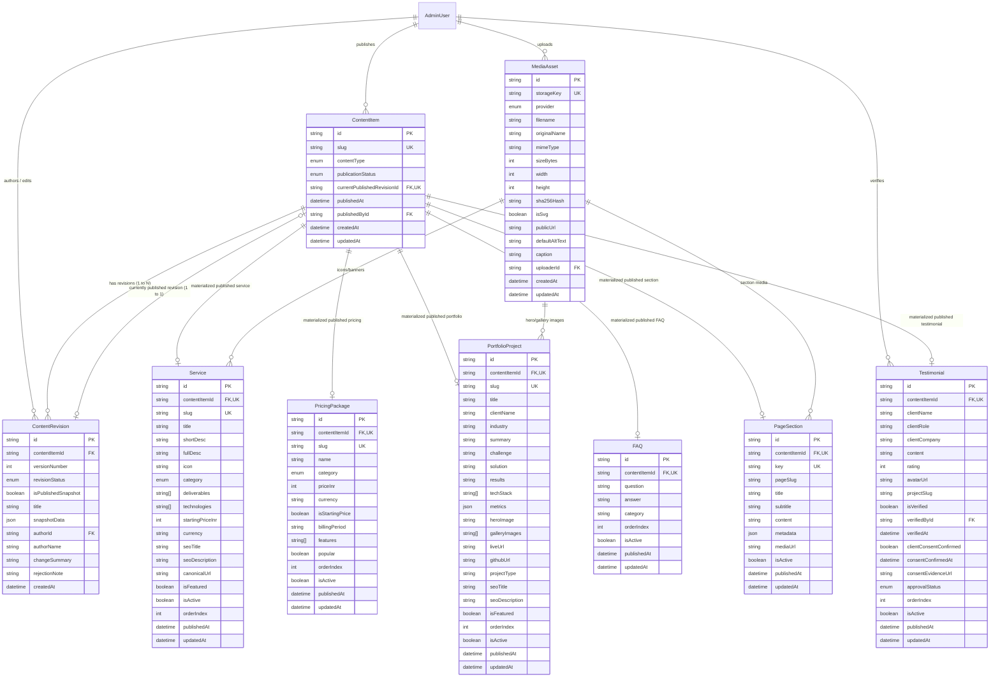

# CMS_DATABASE_DESIGN.md — Database Architecture & Entity Specifications

**Project:** VOIDTECH SOLUTION  
**Milestone:** Phase 10.0.1 — CMS Architecture Refinement & Design Freeze  
**Document Status:** FROZEN DATABASE SPECIFICATION [DESIGN FREEZE]  
**Author:** Google DeepMind Assistant  
**Approved By:** Project Owner  

---

## 1. Architectural Database Charter

This document formalizes the persistent data layer for the VOIDTECH Administrative Content Management System. It establishes:
1. **Materialized Published Tables + Relational Identity Model (Approach C [OWNER APPROVED]):** Real, database-enforced foreign key relations linking `ContentItem`, `ContentRevision`, and domain-specific models.
2. **Strict Draft / Published Separation [OWNER APPROVED]:** Domain models (`Service`, `PricingPackage`, etc.) store **strictly currently published content**, while draft revisions reside in `ContentRevision`.
3. **Atomic Publication Promotion [OWNER APPROVED]:** Publishing is executed inside a single PostgreSQL transaction (`prisma.$transaction`).
4. **Draft Revision Retention [OWNER APPROVED]:** Up to 20 working draft revisions are retained; published milestones are permanently preserved.
5. **Multi-Stage Testimonial Verification [OWNER APPROVED]:** Multi-signature verification and consent records decoupled from publication.
6. **Provider-Abstracted Media Metadata [OWNER APPROVED]:** Media records track `provider` and `storageKey` with SHA-256 deduplication.

---

## 2. Entity-Relationship Diagram (ERD)



---

## 3. Enumerations

```prisma
enum ContentType {
  SERVICE
  PRICING_PACKAGE
  PORTFOLIO_PROJECT
  FAQ
  PAGE_SECTION
  TESTIMONIAL
}

enum ContentPublicationStatus {
  DRAFT       // Working draft; unpublished
  REVIEW      // Submitted by Editor; awaiting Admin approval
  PUBLISHED   // Live on public website
  ARCHIVED    // Retired from public site
}

enum RevisionLifecycleStatus {
  WORKING_DRAFT       // Actively being authored
  PENDING_REVIEW      // Submitted for review
  APPROVED            // Approved by Admin; ready for promotion
  PUBLISHED_SNAPSHOT  // Currently promoted public snapshot
  SUPERSEDED          // Historical past version
  REJECTED            // Returned to author with notes
}

enum TestimonialApprovalStatus {
  PENDING_VERIFICATION   // Unaudited
  VERIFIED               // Fully verified with documented client consent
  REJECTED               // Unverified or invalid
  REVOKED                // Client consent revoked post-publication
}

enum StorageProviderType {
  LOCAL                  // Local filesystem (/public/uploads)
  R2                     // Cloudflare R2 / S3-compatible cloud
}
```

---

## 4. Model Specifications

### 4.1 `ContentItem` (Canonical Content Identity)
Serves as the central anchor for all manageable content, coordinating publication status, slugs, and currently published revisions:

| Field Name | Type | Modifiers | Description |
|---|---|---|---|
| `id` | `String` | `@id @default(cuid())` | Primary key |
| `slug` | `String` | `@unique` | Canonical route slug |
| `contentType` | `ContentType` | Required | Content type enum |
| `status` | `ContentPublicationStatus` | Default: `DRAFT` | Publication state |
| `currentPublishedRevisionId` | `String?` | `@unique` | Foreign key to currently active published `ContentRevision` |
| `publishedAt` | `DateTime?` | Optional | Timestamp of current publication |
| `publishedById` | `String?` | Optional | Foreign key to `AdminUser` publisher |
| `createdAt` | `DateTime` | Default: `now()` | Record creation timestamp |
| `updatedAt` | `DateTime` | `@updatedAt` | Last modification timestamp |

**Relations & Constraints:**
- `currentPublishedRevision`: Relation to `ContentRevision` on `currentPublishedRevisionId` (`onDelete: SetNull`).
- `revisions`: Relation to `ContentRevision[]` (`onDelete: Cascade`).
- One-to-one relations to domain models: `service`, `pricingPackage`, `portfolioProject`, `faq`, `pageSection`, `testimonial`.
- `@@index([contentType, status])`
- `@@index([slug])`

---

### 4.2 `ContentRevision` (Revision History & Draft Working Storage)
Stores all drafts, review proposals, and immutable published snapshots:

| Field Name | Type | Modifiers | Description |
|---|---|---|---|
| `id` | `String` | `@id @default(cuid())` | Primary key |
| `contentItemId` | `String` | Required | Foreign key to `ContentItem` |
| `versionNumber` | `Int` | Required | Monotonic sequential version counter (1, 2, 3...) |
| `revisionStatus` | `RevisionLifecycleStatus` | Default: `WORKING_DRAFT` | Workflow status of this revision |
| `isPublishedSnapshot` | `Boolean` | Default: `false` | Permanent immunity flag from draft pruning |
| `title` | `String` | Required | Human-readable title for CMS lists |
| `snapshotData` | `Json` | Required | Complete, validated JSON payload of the entity |
| `authorId` | `String?` | Optional | Foreign key to `AdminUser` author |
| `authorName` | `String` | Required | Cached admin name for zero-join audit display |
| `changeSummary` | `String?` | Optional | Author's editorial change summary |
| `rejectionNote` | `String?` | Optional | Reviewer's feedback when rejecting a revision |
| `createdAt` | `DateTime` | Default: `now()` | Timestamp of revision snapshot |

**Relations & Constraints:**
- `contentItem`: Relation to `ContentItem` (`fields: [contentItemId], references: [id], onDelete: Cascade`).
- `@@unique([contentItemId, versionNumber])`
- `@@index([contentItemId, revisionStatus])`
- `@@index([contentItemId, isPublishedSnapshot])`
- `@@index([authorId])`

---

### 4.3 `Testimonial` (Verified Client Endorsements) [OWNER APPROVED]
Strictly enforces the multi-signature verification workflow:

| Field Name | Type | Modifiers | Description |
|---|---|---|---|
| `id` | `String` | `@id @default(cuid())` | Primary key |
| `contentItemId` | `String` | `@unique` | Foreign key to `ContentItem` |
| `clientName` | `String` | Required | Full client name |
| `clientRole` | `String` | Required | Job title / position |
| `clientCompany` | `String` | Required | Organization name |
| `content` | `String` | `@db.Text`, Required | Approved quote text |
| `rating` | `Int` | Default: `5` | Star rating (1 to 5) |
| `avatarUrl` | `String?` | Optional | Verified avatar image URL |
| `projectSlug` | `String?` | Optional | Linked `PortfolioProject.slug` |
| `isVerified` | `Boolean` | Default: `false` | Verification gate flag |
| `verifiedById` | `String?` | Optional | Foreign key to `AdminUser` verifier |
| `verifiedAt` | `DateTime?` | Optional | Verification timestamp |
| `clientConsentConfirmed` | `Boolean` | Default: `false` | Mandatory client consent confirmation |
| `consentConfirmedAt` | `DateTime?` | Optional | Consent timestamp |
| `consentEvidenceUrl` | `String` | `@db.Text`, Required | Reference to signed consent form or email audit |
| `approvalStatus` | `TestimonialApprovalStatus` | Default: `PENDING_VERIFICATION` | Audit status |
| `orderIndex` | `Int` | Default: `0` | Display order |
| `isActive` | `Boolean` | Default: `true` | Public display toggle |
| `publishedAt` | `DateTime?` | Optional | Publication timestamp |
| `updatedAt` | `DateTime` | `@updatedAt` | Last modification timestamp |

**Indexes & Rules:**
- `@@index([isVerified, clientConsentConfirmed, approvalStatus, isActive])`
- **Integrity Rule:** Database triggers or Server Actions prevent `isActive = true` unless `isVerified === true` and `clientConsentConfirmed === true` and `approvalStatus === "VERIFIED"`.

---

### 4.4 `MediaAsset` (Digital Asset Registry) [OWNER APPROVED]
Decoupled storage coordinates with cryptographic deduplication:

| Field Name | Type | Modifiers | Description |
|---|---|---|---|
| `id` | `String` | `@id @default(cuid())` | Primary key |
| `storageKey` | `String` | `@unique` | Canonical path (e.g. `uploads/2026/11/hash.webp`) |
| `provider` | `StorageProviderType` | Default: `LOCAL` | Storage backend identifier |
| `filename` | `String` | Required | Unique storage filename |
| `originalName` | `String` | Required | Client original filename |
| `mimeType` | `String` | Required | Verified MIME type (`image/webp`, `image/avif`, etc.) |
| `sizeBytes` | `Int` | Required | File size in bytes (max 5 MB) |
| `width` | `Int?` | Optional | Pixel width |
| `height` | `Int?` | Optional | Pixel height |
| `sha256Hash` | `String` | Required | Content digest for deduplication |
| `isSvg` | `Boolean` | Default: `false` | Restricted format flag |
| `publicUrl` | `String` | Required | Cached public URL |
| `defaultAltText` | `String` | Required | Mandatory fallback accessibility text |
| `caption` | `String?` | Optional | Editorial caption |
| `uploaderId` | `String?` | Optional | Foreign key to `AdminUser` |
| `createdAt` | `DateTime` | Default: `now()` | Upload timestamp |
| `updatedAt` | `DateTime` | `@updatedAt` | Metadata update timestamp |

**Indexes:**
- `@@index([sha256Hash])`
- `@@index([provider, storageKey])`
- `@@index([uploaderId])`

---

## 5. Impact Analysis on Existing Models

1. **`Service`**: Enriched with `contentItemId: String? @unique` foreign key. Existing 18 service records are backfilled with matching `ContentItem` records. Existing columns remain untouched for zero public regression.
2. **`PricingPackage`**: Enriched with `contentItemId: String? @unique` foreign key. Existing 10 packages remain fully functional.
3. **`PortfolioProject`**: Enriched with `contentItemId: String? @unique` foreign key. Concept lab prototype disclaimers remain enforced.
4. **`FAQ`**: Enriched with `contentItemId: String? @unique` foreign key.
5. **`SiteSetting`**: Remains unversioned, direct key-value administrative configuration managed exclusively by `SUPER_ADMIN`.
6. **`Enquiry` & Phase 9 CRM**: **100% UNTOUCHED.** All CRM models (`LeadNote`, `LeadFollowUp`, `LeadActivity`, `LeadAssignment`, `AdminNotification`) maintain their existing relations with zero interference.
7. **`AdminUser`**: Adds inverse relations: `authoredRevisions: ContentRevision[]`, `publishedContentItems: ContentItem[]`, `verifiedTestimonials: Testimonial[]`, `uploadedMedia: MediaAsset[]`.
8. **`AuditLog`**: Existing immutable WORM audit log records all CMS actions without foreign-key constraints (ensuring audit preservation even if content items are deleted).
