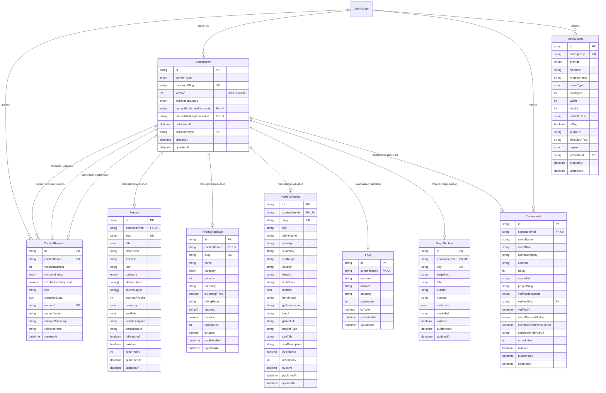

# CMS_DATABASE_DESIGN.md — Database Schema & Data Models

**Project:** VOIDTECH SOLUTION  
**Milestone:** Phase 10.0.2 — Final CMS Implementation Safeguards  
**Document Status:** FROZEN SCHEMA SPECIFICATION & SAFEGUARDS [DESIGN FREEZE]  
**Author:** Google DeepMind Assistant  
**Approved By:** SHIVANSHU SATYAJEET (Project Owner) — Safeguards Authorized  

---

## 1. Schema Design Philosophy: Approach C (Materialized Hybrid)

The CMS data tier implements **Approach C: Materialized Published Snapshots + Canonical Identity + Relational Revision History**:

1. **Dual Pointers for Draft/Published Separation:** `ContentItem` maintains two distinct revision pointers:
   - `currentPublishedRevisionId`: Points to the active published snapshot rendered to public visitors.
   - `currentWorkingRevisionId`: Points to the active working draft undergoing editing or review.
2. **Canonical Entity Identity:** `ContentItem` owns the canonical slug, publication state (`DRAFT`, `REVIEW`, `PUBLISHED`, `ARCHIVED`), and monotonic OCC integer `version` counter.
3. **Normalized Append-Only Revisions:** `ContentRevision` stores working copies, review proposals, and immutable historical milestones with author attribution and monotonically increasing `versionNumber`.
4. **Materialized Domain Tables:** `Service`, `PricingPackage`, `PortfolioProject`, `PageSection`, `FAQ`, and `Testimonial` store **strictly the currently active published snapshot** with fully indexed relational columns for sub-millisecond public query execution.
5. **WORM Audit Trail:** Every publishing, draft submission, revision rollback, and consent revocation event writes an immutable entry to `audit_logs`.

---

## 2. Entity-Relationship Diagram (ERD)



---

## 3. Enumerations

```prisma
enum ContentType {
  SERVICE
  PRICING_PACKAGE
  PORTFOLIO_PROJECT
  FAQ
  PAGE_SECTION
  TESTIMONIAL
}

enum ContentPublicationStatus {
  DRAFT       // Working draft; unpublished
  REVIEW      // Submitted by Editor; awaiting Admin approval
  PUBLISHED   // Live on public website
  ARCHIVED    // Retired from public site
}

enum RevisionLifecycleStatus {
  WORKING_DRAFT       // Actively being authored
  PENDING_REVIEW      // Submitted for review
  APPROVED            // Approved by Admin; ready for promotion
  PUBLISHED_SNAPSHOT  // Currently promoted public snapshot
  SUPERSEDED          // Historical past version
  REJECTED            // Returned to author with notes
}

enum TestimonialVerificationStatus {
  UNVERIFIED          // Default upon drafting; factual claims unreviewed
  VERIFIED            // Formally audited by Administrator; claims confirmed accurate
  REJECTED            // Factual claims inaccurate or unverified
}

enum ClientConsentStatus {
  PENDING             // Written consent not yet received
  GRANTED             // Formal client consent verified and recorded
  REVOKED             // Client requested removal; consent withdrawn
}

enum StorageProviderType {
  LOCAL               // Local filesystem (/public/uploads) - Development Only
  R2                  // Cloudflare R2 / S3-compatible cloud - Deferred Future Target
}
```

---

## 4. Model Specifications & Referential Integrity

### 4.1 Database-Enforced vs. Application-Enforced Guarantees
We explicitly delineate what is enforced natively by PostgreSQL/Prisma vs. what is enforced in transactional application logic:

| Constraint | Enforcement Mechanism | Technical Verification & Guarantees |
|---|:---:|---|
| **Revision Parent Link** | **Database-Enforced (FK)** | `ContentRevision.contentItemId -> ContentItem.id` with `ON DELETE CASCADE`. No orphaned revisions can exist. |
| **Monotonic Revision Numbers** | **Database-Enforced (Unique Index)** | `@@unique([contentItemId, versionNumber])` on `ContentRevision`. Two revisions of the same item can never share the same version number. |
| **Domain Canonical Identity** | **Database-Enforced (1-to-1 FK)** | `Service.contentItemId -> ContentItem.id` with `@unique` and `ON DELETE RESTRICT`. A domain record cannot exist without a canonical `ContentItem`, and duplicate domain records are impossible. |
| **Valid Pointer Targets** | **Database-Enforced (FK)** | `ContentItem.currentPublishedRevisionId` and `currentWorkingRevisionId` have FKs to `ContentRevision.id` with `ON DELETE SET NULL`. Pointers can never reference non-existent revision IDs. |
| **Cross-Item Pointer Ownership** | **Application-Enforced in Transaction** *(Evaluated below)* | Verifying that `revision.contentItemId === item.id` when assigning `currentPublishedRevisionId` or `currentWorkingRevisionId`. |

### 4.2 Composite Foreign Key & Circular Dependency Evaluation
We evaluated defining a composite foreign key on `ContentItem`:
`FOREIGN KEY (currentPublishedRevisionId, id) REFERENCES ContentRevision(id, contentItemId)`.
- **Finding:** Circular composite foreign keys in Prisma schemas cause cyclic relation dependency errors during migration generation.
- **Resolution:** Prisma models use standard `@relation` with `onDelete: SetNull`. Step 4 of the atomic publishing transaction strictly verifies cross-record ownership, backed by a PostgreSQL trigger in the migration DDL:
```sql
CREATE OR REPLACE FUNCTION verify_revision_ownership() RETURNS TRIGGER AS $$
BEGIN
  IF NEW."currentPublishedRevisionId" IS NOT NULL THEN
    IF NOT EXISTS (
      SELECT 1 FROM content_revisions
      WHERE id = NEW."currentPublishedRevisionId" AND "contentItemId" = NEW.id
    ) THEN
      RAISE EXCEPTION 'currentPublishedRevisionId must belong to ContentItem %', NEW.id;
    END IF;
  END IF;
  IF NEW."currentWorkingRevisionId" IS NOT NULL THEN
    IF NOT EXISTS (
      SELECT 1 FROM content_revisions
      WHERE id = NEW."currentWorkingRevisionId" AND "contentItemId" = NEW.id
    ) THEN
      RAISE EXCEPTION 'currentWorkingRevisionId must belong to ContentItem %', NEW.id;
    END IF;
  END IF;
  RETURN NEW;
END;
$$ LANGUAGE plpgsql;
```

---

### 4.3 `ContentItem` (Canonical Content Identity)
Serves as the central anchor for all manageable content, coordinating publication status, slugs, dual pointers, and OCC concurrency:

| Field Name | Type | Modifiers | Description |
|---|---|---|---|
| `id` | `String` | `@id @default(cuid())` | Primary key |
| `slug` | `String` | `@unique` | Canonical route slug |
| `contentType` | `ContentType` | Required | Content type enum |
| `version` | `Int` | Default: `1` | Monotonic Optimistic Concurrency Control counter |
| `publicationStatus` | `ContentPublicationStatus` | Default: `DRAFT` | Overall publication state |
| `currentPublishedRevisionId` | `String?` | `@unique` | Foreign key to currently active published `ContentRevision` |
| `currentWorkingRevisionId` | `String?` | `@unique` | Foreign key to active working `ContentRevision` under edit |
| `publishedAt` | `DateTime?` | Optional | Timestamp of current publication |
| `publishedById` | `String?` | Optional | Foreign key to `AdminUser` publisher |
| `createdAt` | `DateTime` | Default: `now()` | Record creation timestamp |
| `updatedAt` | `DateTime` | `@updatedAt` | Last modification timestamp |

**Relations & Constraints:**
- `currentPublishedRevision`: Relation to `ContentRevision` on `currentPublishedRevisionId` (`onDelete: SetNull`).
- `currentWorkingRevision`: Relation to `ContentRevision` on `currentWorkingRevisionId` (`onDelete: SetNull`).
- `revisions`: Relation to `ContentRevision[]` (`onDelete: Cascade`).
- One-to-one relations to domain models: `service`, `pricingPackage`, `portfolioProject`, `faq`, `pageSection`, `testimonial`.
- `@@index([contentType, publicationStatus])`
- `@@index([slug])`

---

### 4.4 `ContentRevision` (Revision History & Draft Working Storage)
Stores all drafts, review proposals, and immutable published snapshots:

| Field Name | Type | Modifiers | Description |
|---|---|---|---|
| `id` | `String` | `@id @default(cuid())` | Primary key |
| `contentItemId` | `String` | Required | Foreign key to `ContentItem` |
| `versionNumber` | `Int` | Required | Monotonic sequential version counter (1, 2, 3...) |
| `revisionStatus` | `RevisionLifecycleStatus` | Default: `WORKING_DRAFT` | Workflow status of this revision |
| `isPublishedSnapshot` | `Boolean` | Default: `false` | Permanent immunity flag from draft pruning |
| `title` | `String` | Required | Human-readable title for CMS lists |
| `snapshotData` | `Json` | Required | Complete, validated JSON payload of the entity |
| `authorId` | `String?` | Optional | Foreign key to `AdminUser` author |
| `authorName` | `String` | Required | Cached admin name for zero-join audit display |
| `changeSummary` | `String?` | Optional | Author's editorial change summary |
| `rejectionNote` | `String?` | Optional | Reviewer's feedback when rejecting a revision |
| `createdAt` | `DateTime` | Default: `now()` | Timestamp of revision snapshot |

**Relations & Constraints:**
- `contentItem`: Relation to `ContentItem` (`fields: [contentItemId], references: [id], onDelete: Cascade`).
- `@@unique([contentItemId, versionNumber])`
- `@@index([contentItemId, revisionStatus])`
- `@@index([contentItemId, isPublishedSnapshot])`
- `@@index([authorId])`

---

### 4.5 `Testimonial` (Verified Client Endorsements)
Enforces the dual verification and legal consent workflow:

| Field Name | Type | Modifiers | Description |
|---|---|---|---|
| `id` | `String` | `@id @default(cuid())` | Primary key |
| `contentItemId` | `String` | `@unique` | Foreign key to `ContentItem` |
| `clientName` | `String` | Required | Full client name |
| `clientRole` | `String` | Required | Job title / position |
| `clientCompany` | `String` | Required | Organization name |
| `content` | `String` | `@db.Text`, Required | Approved quote text |
| `rating` | `Int` | Default: `5` | Star rating (1 to 5) |
| `avatarUrl` | `String?` | Optional | Verified avatar image URL |
| `projectSlug` | `String?` | Optional | Linked `PortfolioProject.slug` |
| `verificationStatus` | `TestimonialVerificationStatus` | Default: `UNVERIFIED` | Authoritative verification state |
| `verifiedById` | `String?` | Optional | Foreign key to `AdminUser` verifier |
| `verifiedAt` | `DateTime?` | Optional | Verification timestamp |
| `clientConsentStatus` | `ClientConsentStatus` | Default: `PENDING` | Authoritative legal consent state |
| `clientConsentRecordedAt` | `DateTime?` | Optional | Consent timestamp |
| `consentEvidenceUrl` | `String?` | `@db.Text`, Optional | Reference to signed consent form or email audit |
| `orderIndex` | `Int` | Default: `0` | Display order |
| `isActive` | `Boolean` | Default: `true` | Public display toggle |
| `publishedAt` | `DateTime?` | Optional | Publication timestamp |
| `updatedAt` | `DateTime` | `@updatedAt` | Last modification timestamp |

**Indexes & Rules:**
- `@@index([verificationStatus, clientConsentStatus, isActive])`
- **Integrity Rule:** Public queries strictly require:
  `WHERE verificationStatus = 'VERIFIED' AND clientConsentStatus = 'GRANTED' AND isActive = true`.

---

### 4.6 `MediaAsset` (Digital Asset Registry)
Decoupled storage coordinates with cryptographic deduplication:

| Field Name | Type | Modifiers | Description |
|---|---|---|---|
| `id` | `String` | `@id @default(cuid())` | Primary key |
| `storageKey` | `String` | `@unique` | Canonical path (e.g. `uploads/2026/11/hash.webp`) |
| `provider` | `StorageProviderType` | Default: `LOCAL` | Storage backend identifier (Local for dev) |
| `filename` | `String` | Required | Unique storage filename |
| `originalName` | `String` | Required | Client original filename |
| `mimeType` | `String` | Required | Verified MIME type (`image/webp`, `image/jpeg`, `image/png`) |
| `sizeBytes` | `Int` | Required | File size in bytes (max 5 MB) |
| `width` | `Int?` | Optional | Pixel width |
| `height` | `Int?` | Optional | Pixel height |
| `sha256Hash` | `String` | Required | Content digest for deduplication |
| `isSvg` | `Boolean` | Default: `false` | Restricted format flag (disabled by default) |
| `publicUrl` | `String` | Required | Cached public URL |
| `defaultAltText` | `String` | Required | Mandatory fallback accessibility text |
| `caption` | `String?` | Optional | Editorial caption |
| `uploaderId` | `String?` | Optional | Foreign key to `AdminUser` |
| `createdAt` | `DateTime` | Default: `now()` | Upload timestamp |
| `updatedAt` | `DateTime` | `@updatedAt` | Metadata update timestamp |

**Indexes & Invariants:**
- `@@index([sha256Hash])`
- `@@index([provider, storageKey])`
- `@@index([uploaderId])`
- **Initial Security Invariants:** SVG uploads disabled by default; local filesystem storage dev-only; zero ephemeral serverless storage; Cloudflare R2 deferred.

---

## 5. Impact Analysis on Existing Models

1. **`Service`**: Enriched with `contentItemId: String? @unique` foreign key. Existing 18 service records backfilled.
2. **`PricingPackage`**: Enriched with `contentItemId: String? @unique` foreign key. Existing 10 packages remain functional.
3. **`PortfolioProject`**: Enriched with `contentItemId: String? @unique` foreign key. Concept lab prototype disclaimers remain enforced.
4. **`FAQ`**: Enriched with `contentItemId: String? @unique` foreign key.
5. **`PageSection`**: Newly added model for editorial landing page narratives.
6. **`SiteSetting`**: Remains unversioned, direct key-value administrative configuration managed exclusively by `SUPER_ADMIN`.
7. **`Enquiry` & Phase 9 CRM**: **100% UNTOUCHED.** All CRM models (`LeadNote`, `LeadFollowUp`, `LeadActivity`, `LeadAssignment`, `AdminNotification`) maintain their existing relations with zero interference.
8. **`AdminUser`**: Adds inverse relations: `authoredRevisions: ContentRevision[]`, `publishedContentItems: ContentItem[]`, `verifiedTestimonials: Testimonial[]`, `uploadedMedia: MediaAsset[]`.
9. **`AuditLog`**: Existing immutable WORM audit log records all CMS actions without foreign-key constraints (ensuring audit preservation even if content items are deleted).
