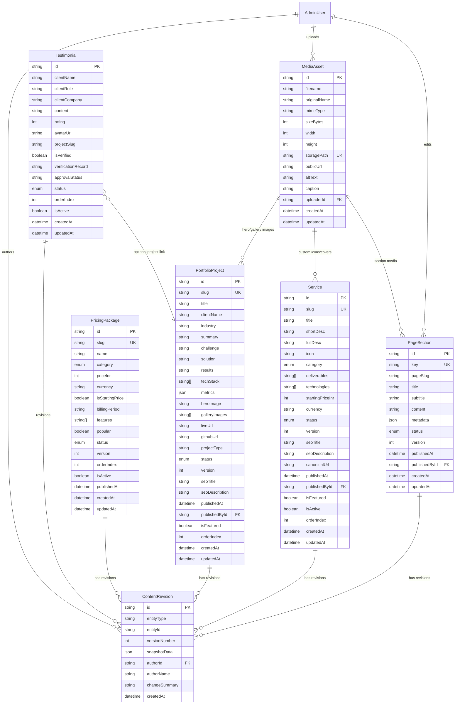

# CMS_DATABASE_DESIGN.md — Database Architecture & Entity Specifications

**Project:** VOIDTECH SOLUTION  
**Milestone:** Phase 10.0 — CMS Discovery & Architecture  
**Document Status:** PROPOSED DATABASE DESIGN (DO NOT IMPLEMENT IN PHASE 10.0)  
**Author:** Google DeepMind Assistant  
**Approved By:** Pending Owner Authorization  

---

## 1. Overview & Database Philosophy

The CMS database tier expands upon the foundational PostgreSQL schema established in Phase 3 and Phase 9.1. It is designed around four core principles:

1. **Non-Breaking Evolution:** Preserve existing Phase 3 models (`Service`, `PricingPackage`, `PortfolioProject`, `FAQ`, `SiteSetting`) while enriching them with publication lifecycles, SEO metadata, and revision pointers.
2. **Deterministic Optimistic Concurrency:** Incorporate integer `version` counters across all editable entities to provide atomic lost-update prevention.
3. **Immutable Revision History:** Centralize editorial version snapshots in a normalized `content_revisions` table.
4. **Zero Unverified Claims (Trust & Anti-Fabrication):** Enforce strict verification metadata on testimonials and clear separation of concept/benchmark prototypes.

---

## 2. Entity-Relationship Diagram (ERD)



---

## 3. Enumerations

### 3.1 Content Status (`ContentStatus`)
Represents the publication lifecycle state across all manageable entities:
```prisma
enum ContentStatus {
  DRAFT       // Initial authoring or work-in-progress
  REVIEW      // Submitted by Editor; awaiting Admin approval
  PUBLISHED   // Live on public website; indexed by search engines
  ARCHIVED    // Retired from public site; preserved in database
}
```

### 3.2 Testimonial Approval Status (`ApprovalStatus`)
Strict anti-fabrication governance gate:
```prisma
enum ApprovalStatus {
  PENDING_VERIFICATION   // Unconfirmed submission
  VERIFIED               // Audited and confirmed with client consent
  REJECTED               // Unverified or rejected
}
```

---

## 4. Entity Specifications

### 4.1 Enhanced Model: `Service`
Extends existing Phase 3 `Service` model with lifecycle, SEO, and optimistic locking:

| Field Name | Type | Modifiers | Description |
|---|---|---|---|
| `id` | `String` | `@id @default(cuid())` | Primary key |
| `slug` | `String` | `@unique` | URL slug (e.g. `website-development`) |
| `title` | `String` | Required | Full service title |
| `shortDesc` | `String` | Required | Condensed card summary (1–2 sentences) |
| `fullDesc` | `String` | `@db.Text`, Required | Detailed capability description / Markdown |
| `icon` | `String` | Default: `"Code"` | Lucide icon identifier or SVG path |
| `category` | `ServiceCategory` | Required | Classification category enum |
| `deliverables`| `String[]` | Array | Concrete deliverables list |
| `technologies`| `String[]` | Array | Technology tags |
| `startingPriceInr` | `Int?` | Optional | Baseline investment in INR |
| `currency` | `String` | Default: `"INR"` | Currency ISO code |
| `status` | `ContentStatus` | Default: `PUBLISHED` | Publication lifecycle stage |
| `version` | `Int` | Default: `1` | Monotonic OCC version counter |
| `seoTitle` | `String?` | Optional | Meta page title override |
| `seoDescription` | `String?` | Optional | Meta description override |
| `canonicalUrl` | `String?` | Optional | Canonical URL tag override |
| `publishedAt` | `DateTime?` | Optional | Timestamp of initial or latest publish |
| `publishedById` | `String?` | Optional | Foreign key to `AdminUser` who published |
| `isFeatured` | `Boolean` | Default: `false` | Highlighted on homepage |
| `isActive` | `Boolean` | Default: `true` | Visibility flag |
| `orderIndex` | `Int` | Default: `0` | Display sorting priority |
| `createdAt` | `DateTime` | Default: `now()` | Creation timestamp |
| `updatedAt` | `DateTime` | `@updatedAt` | Last modification timestamp |

**Indexes:**
- `@@index([category])`
- `@@index([status, isActive, orderIndex])`
- `@@index([slug])`

---

### 4.2 Enhanced Model: `PricingPackage`
Extends existing Phase 3 `PricingPackage` model:

| Field Name | Type | Modifiers | Description |
|---|---|---|---|
| `id` | `String` | `@id @default(cuid())` | Primary key |
| `slug` | `String` | `@unique` | Unique tier slug (e.g. `basic-static`) |
| `name` | `String` | Required | Tier display name |
| `category` | `ServiceCategory` | Default: `WEB_DEVELOPMENT` | Associated service category |
| `priceInr` | `Int` | Required | Price in Indian Rupees |
| `currency` | `String` | Default: `"INR"` | ISO currency code |
| `isStartingPrice` | `Boolean` | Default: `true` | Displays `+` suffix indicator |
| `billingPeriod` | `String?` | Optional | Billing interval description |
| `features` | `String[]` | Array | Deliverables checklist items |
| `popular` | `Boolean` | Default: `false` | Featured badge highlight |
| `status` | `ContentStatus` | Default: `PUBLISHED` | Publication lifecycle stage |
| `version` | `Int` | Default: `1` | Monotonic OCC version counter |
| `orderIndex` | `Int` | Default: `0` | Display sorting order |
| `isActive` | `Boolean` | Default: `true` | Public visibility toggle |
| `publishedAt` | `DateTime?` | Optional | Timestamp of publication |
| `createdAt` | `DateTime` | Default: `now()` | Creation timestamp |
| `updatedAt` | `DateTime` | `@updatedAt` | Last modification timestamp |

**Indexes:**
- `@@index([status, isActive, orderIndex])`
- `@@index([category])`

---

### 4.3 Enhanced Model: `PortfolioProject`
Extends existing Phase 3 `PortfolioProject` model with gallery, lifecycle, and SEO:

| Field Name | Type | Modifiers | Description |
|---|---|---|---|
| `id` | `String` | `@id @default(cuid())` | Primary key |
| `slug` | `String` | `@unique` | URL slug (e.g. `algorithmic-liquidity-engine`) |
| `title` | `String` | Required | Case study project title |
| `clientName` | `String` | Required | Client name or "Concept Lab Prototype" |
| `industry` | `String` | Required | Industry vertical (e.g. `FINTECH`) |
| `summary` | `String` | Required | Executive summary text |
| `challenge` | `String` | `@db.Text`, Required | Engineering challenge / problem statement |
| `solution` | `String` | `@db.Text`, Required | Architectural solution implemented |
| `results` | `String` | `@db.Text`, Required | Benchmark or production outcome metrics |
| `techStack` | `String[]` | Array | Frameworks, tools, and languages used |
| `metrics` | `Json?` | Optional | Array of structured metrics: `[{ label, value }]` |
| `heroImage` | `String?` | Optional | Cover image public URL / media reference |
| `galleryImages` | `String[]` | Array | Additional screenshot / architecture diagrams |
| `liveUrl` | `String?` | Optional | Production live URL (if applicable) |
| `githubUrl` | `String?` | Optional | Public or client repository URL |
| `projectType` | `String` | Default: `"CONCEPT"` | `"CONCEPT" \| "INTERNAL_PROTOTYPE" \| "PRODUCTION"` |
| `status` | `ContentStatus` | Default: `PUBLISHED` | Publication lifecycle stage |
| `version` | `Int` | Default: `1` | Monotonic OCC version counter |
| `seoTitle` | `String?` | Optional | Meta title override |
| `seoDescription` | `String?` | Optional | Meta description override |
| `isFeatured` | `Boolean` | Default: `false` | Highlighted on homepage & showcase |
| `orderIndex` | `Int` | Default: `0` | Display sorting priority |
| `publishedAt` | `DateTime?` | Optional | Publication timestamp |
| `publishedById` | `String?` | Optional | Foreign key to `AdminUser` publisher |
| `createdAt` | `DateTime` | Default: `now()` | Creation timestamp |
| `updatedAt` | `DateTime` | `@updatedAt` | Last modification timestamp |

**Indexes:**
- `@@index([status, isFeatured, orderIndex])`
- `@@index([projectType])`
- `@@index([slug])`

---

### 4.4 New Model: `PageSection` (Editorial Block Engine)
Stores narrative marketing copy across all public landing pages:

| Field Name | Type | Modifiers | Description |
|---|---|---|---|
| `id` | `String` | `@id @default(cuid())` | Primary key |
| `key` | `String` | `@unique` | Hierarchical identifier (e.g. `home.hero`, `about.values`) |
| `pageSlug` | `String` | Required | Target route (e.g. `"home"`, `"about"`, `"contact"`) |
| `title` | `String` | Required | Section headline |
| `subtitle` | `String?` | Optional | Section supporting lead / eyebrow |
| `content` | `String?` | `@db.Text` | Main editorial body in Markdown |
| `metadata` | `Json?` | Optional | Structured configuration (CTAs, badge text, item arrays) |
| `mediaUrl` | `String?` | Optional | Background or feature image URL |
| `status` | `ContentStatus` | Default: `PUBLISHED` | Publication lifecycle stage |
| `version` | `Int` | Default: `1` | Monotonic OCC version counter |
| `publishedAt` | `DateTime?` | Optional | Publication timestamp |
| `publishedById` | `String?` | Optional | Publisher admin ID |
| `createdAt` | `DateTime` | Default: `now()` | Creation timestamp |
| `updatedAt` | `DateTime` | `@updatedAt` | Last modification timestamp |

**Indexes:**
- `@@index([pageSlug, status])`
- `@@index([key])`

---

### 4.5 New Model: `Testimonial` (Verified Trust Engine)
Strict anti-fabrication controls for client endorsements:

| Field Name | Type | Modifiers | Description |
|---|---|---|---|
| `id` | `String` | `@id @default(cuid())` | Primary key |
| `clientName` | `String` | Required | Author name |
| `clientRole` | `String` | Required | Job title / position |
| `clientCompany` | `String` | Required | Company / brand name |
| `content` | `String` | `@db.Text`, Required | Testimonial quote text |
| `rating` | `Int` | Default: `5` | Star rating (1 to 5) |
| `avatarUrl` | `String?` | Optional | Client headshot or avatar image URL |
| `projectSlug` | `String?` | Optional | Linked `PortfolioProject.slug` |
| `isVerified` | `Boolean` | Default: `false` | Verification status flag |
| `verificationRecord`| `String` | `@db.Text`, Required | Reference to signed consent, email proof, or contract |
| `approvalStatus` | `ApprovalStatus`| Default: `PENDING_VERIFICATION` | Audit gate status |
| `status` | `ContentStatus` | Default: `DRAFT` | Lifecycle state (Cannot be PUBLISHED unless VERIFIED) |
| `orderIndex` | `Int` | Default: `0` | Display sorting priority |
| `isActive` | `Boolean` | Default: `true` | Public display toggle |
| `createdAt` | `DateTime` | Default: `now()` | Creation timestamp |
| `updatedAt` | `DateTime` | `@updatedAt` | Last modification timestamp |

**Indexes:**
- `@@index([status, isVerified, approvalStatus])`
- `@@index([orderIndex])`

---

### 4.6 New Model: `ContentRevision` (Historical Snapshots)
Immutable revision tracking for all editable content:

| Field Name | Type | Modifiers | Description |
|---|---|---|---|
| `id` | `String` | `@id @default(cuid())` | Primary key |
| `entityType` | `String` | Required | `"SERVICE" \| "PRICING" \| "PORTFOLIO" \| "FAQ" \| "SECTION"` |
| `entityId` | `String` | Required | ID of target entity |
| `versionNumber`| `Int` | Required | Sequential version (1, 2, 3...) |
| `snapshotData` | `Json` | Required | Complete JSON dump of entity state at revision |
| `authorId` | `String?` | Optional | Foreign key to `AdminUser` |
| `authorName` | `String` | Required | Cached admin name for fast display |
| `changeSummary`| `String?` | Optional | Editorial note describing the change |
| `createdAt` | `DateTime` | Default: `now()` | Timestamp of snapshot creation |

**Indexes:**
- `@@index([entityType, entityId, versionNumber(sort: Desc)])`
- `@@index([authorId])`
- `@@index([createdAt])`

---

### 4.7 New Model: `MediaAsset` (Digital Asset Registry)
Tracks uploaded assets with metadata and safety checks:

| Field Name | Type | Modifiers | Description |
|---|---|---|---|
| `id` | `String` | `@id @default(cuid())` | Primary key |
| `filename` | `String` | Required | Sanitized unique storage filename (hash.ext) |
| `originalName` | `String` | Required | Original filename provided by user |
| `mimeType` | `String` | Required | Verified MIME type (`image/webp`, `image/svg+xml`, etc.) |
| `sizeBytes` | `Int` | Required | File size in bytes (max: 5,242,880) |
| `width` | `Int?` | Optional | Image pixel width |
| `height` | `Int?` | Optional | Image pixel height |
| `storagePath` | `String` | `@unique` | Storage bucket key or relative path |
| `publicUrl` | `String` | Required | Public CDN or static URL |
| `altText` | `String` | Required | Mandatory accessibility alternative text |
| `caption` | `String?` | Optional | Optional editorial caption |
| `uploaderId` | `String?` | Optional | Foreign key to `AdminUser` uploader |
| `createdAt` | `DateTime` | Default: `now()` | Upload timestamp |
| `updatedAt` | `DateTime` | `@updatedAt` | Last metadata edit timestamp |

**Indexes:**
- `@@index([mimeType])`
- `@@index([uploaderId])`
- `@@index([createdAt])`

---

## 5. Audit Logging Action Mapping

CMS events map directly into the existing `AuditLog` engine (`src/server/security/audit.ts`):

| CMS Mutation | Audit Action Key | Entity | Recorded Details |
|---|---|---|---|
| Create Item | `CMS_ITEM_CREATED` | Service / Portfolio / FAQ / Section | `{ entityType, id, title, slug }` |
| Save Draft | `CMS_DRAFT_SAVED` | Service / Portfolio / FAQ / Section | `{ id, version, changeSummary }` |
| Submit for Review | `CMS_SUBMITTED_FOR_REVIEW`| Service / Portfolio / FAQ / Section | `{ id, version, submittedBy }` |
| Publish Item | `CMS_ITEM_PUBLISHED` | Service / Portfolio / FAQ / Section | `{ id, version, publishedAt, slug }` |
| Archive Item | `CMS_ITEM_ARCHIVED` | Service / Portfolio / FAQ / Section | `{ id, archivedAt }` |
| Restore Revision | `CMS_VERSION_RESTORED`| Service / Portfolio / FAQ / Section | `{ id, restoredFromVersion, newVersion }` |
| Delete Item | `CMS_ITEM_DELETED` | Service / Portfolio / FAQ / Section | `{ id, entityType, title }` |
| Upload Media | `CMS_MEDIA_UPLOADED` | MediaAsset | `{ id, filename, sizeBytes, mimeType }` |
| Delete Media | `CMS_MEDIA_DELETED` | MediaAsset | `{ id, filename, storagePath }` |
| Update Settings | `SETTINGS_UPDATED` | SiteSetting | `{ key, value }` |

---

## 6. Migration & Rollback Strategy

When implementing this schema in Phase 10.1:
1. **Additive Migration:** All new fields on existing tables will be optional (`?`) or carry safe defaults (`default: PUBLISHED`, `default: 1`), ensuring zero breaking changes to existing production data.
2. **Backfill Step:** A post-migration script will set `version = 1`, `status = "PUBLISHED"`, and initialize `PageSection` records from the static content currently in `src/config/site.ts`.
3. **Rollback Script:** A tested, reversible down-migration script will be authored and verified prior to applying changes.
