# CMS_TESTING_STRATEGY.md — Quality Assurance & Testing Blueprint

**Project:** VOIDTECH SOLUTION  
**Milestone:** Phase 10.0.1 — CMS Architecture Refinement & Design Freeze  
**Document Status:** FROZEN TESTING ARCHITECTURE & SPECIFICATION (FOR PHASES 10.1–10.4)  
**Author:** Google DeepMind Assistant  
**Approved By:** SHIVANSHU SATYAJEET (Project Owner) — Design Freeze Authorized  

---

## 1. Testing Philosophy & Empirical Validation Principle

VOIDTECH SOLUTION strictly enforces the **Empirical Validation Principle**:
> *No "trust me, it works." Every architectural capability, security boundary, concurrent state transition, and UI interaction requires captured, repeatable proof from automated test runners, compilers, or browser automation.*

The Phase 10 CMS testing framework spans five distinct verification tiers with zero tolerance for skipped, unasserted, or flaky tests:
1. **Tier 1 — Unit & Schema Validation:** Sub-millisecond testing of Zod schemas, GFM Markdown HTML pipeline (`unified` + `rehype-sanitize`), SVG DOMPurify sanitization, magic-byte MIME detectors, and deterministic slug generators.
2. **Tier 2 — Repository & Concurrency Integration:** Real PostgreSQL verification on isolated test database (`voidtech_test_concurrency`) testing Approach C (Canonical `ContentItem` + `ContentRevision` + Materialized Snapshots), atomic OCC version counters, draft retention pruning (20 working drafts limit, published exempt), and offline static fallbacks.
3. **Tier 3 — Server Action & RBAC Security Suites:** Full matrix testing across all three administrative roles (`SUPER_ADMIN`, `ADMIN`, `EDITOR`), validating permission gates, pricing publication restrictions, testimonial consent/verification gates, SVG upload restrictions, and unauthorized mutation rejections.
4. **Tier 4 — Public Integration & Draft Mode Regression:** Verifying that public routes consume exclusively published records, Draft Mode preview securely serves draft revisions with `X-Robots-Tag: noindex, nofollow`, on-demand cache tag revalidation executes, and Phase 9 CRM lead pipeline workflows remain 100% regression-free.
5. **Tier 5 — Playwright End-to-End (E2E) Browser Journeys:** Multi-viewport browser validation covering content drafting, admin approval/publishing, media uploads, pricing updates, testimonial verification, and responsive layout acceptance across 10 distinct viewports.

---

## 2. Test Execution Hierarchy & Architecture

```mermaid
flowchart TD
    subgraph L1["Tier 1: Unit & Validation (Vitest)"]
        ZodTests["Zod Schema Constraints & Invariants"]
        MarkdownTests["GFM Pipeline & rehype-sanitize HTML AST"]
        SvgTests["DOMPurify & Magic-Byte MIME Validation"]
        SlugTests["Deterministic Slug & Currency Formatters"]
    end

    subgraph L2["Tier 2: Repository Integration (Real PostgreSQL)"]
        ApproachCTest["Approach C: ContentItem + ContentRevision Sync"]
        DraftIsolation["Public Queries Read Materialized Published Only"]
        OCCDrift["Atomic OCC Version Counter Locking"]
        RetentionPrune["Draft Retention Pruning (Max 20 Drafts, Pubs Exempt)"]
        RollbackTest["Version Rollback Creates New Draft (v = max + 1)"]
        FallbackTest["Offline Static Fallback Resilience on Disconnect"]
    end

    subgraph L3["Tier 3: Server Actions & RBAC (Vitest + Auth)"]
        RBACMatrix["3-Role Permission Enforcement Matrix"]
        PricingGate["Pricing Publish Restricted (SUPER_ADMIN / ADMIN Only)"]
        TestimonialGate["Testimonial Verification & Consent Dual Gate"]
        SvgUploadGate["SVG Upload Privilege (media:upload_svg)"]
        CSRFOrigin["Host/Origin Header Validation"]
        AuditEmit["Audit Log Event Dispatch & Structured Metadata"]
    end

    subgraph L4["Tier 4: Public Integration & Regression"]
        RSCFetch["Public RSC Data Hydration (Materialized Tables)"]
        DraftMode["Next.js Draft Mode Preview & Bypass Cookie"]
        RobotsNoIndex["X-Robots-Tag: noindex, nofollow on Draft Previews"]
        RevalidateTags["revalidatePath & revalidateTag Cache Invalidation"]
        CrmRegression["CRM Leads, Notes, Tasks & Auth Parity (0 Regression)"]
    end

    subgraph L5["Tier 5: Playwright E2E & Visual Acceptance"]
        EditorJourney["Editor Drafting Flow (Pricing Publish Blocked)"]
        AdminPublishJourney["Admin Preview HUD & Atomic Publish Flow"]
        TestimonialJourney["Testimonial Verification & Consent Workflow"]
        MediaUploads["File Upload, Sharp WebP & Gallery Selection"]
        Responsive10["10-Viewport Visual Screenshots (320px–1920px)"]
    end

    L1 --> L2
    L2 --> L3
    L3 --> L4
    L4 --> L5
```

---

## 3. Comprehensive Test Suites Breakdown

### 3.1 Tier 1: Unit & Validation Suites (`tests/unit/cms-validation.test.ts`)
- **Execution Harness:** Vitest (In-Memory, Sub-Millisecond).
- **Target Suite Coverage:** 35+ Unit Tests.
- **Key Scenarios & Assertions:**
  1. `serviceSchema` validation: slug regex (`^[a-z0-9]+(?:-[a-z0-9]+)*$`), minimum title length (3 chars), non-empty deliverables array, positive INR starting price.
  2. `pricingPackageSchema` validation: strictly positive integer for `priceInr`, INR currency default, non-empty features array, billing cadence enum check.
  3. `portfolioProjectSchema` validation: required challenge/solution/results fields, valid `projectType` enum, concept lab disclosure check.
  4. `testimonialSchema` validation: quote length (10–1000 chars), valid client rating (1–5), client consent confirmation boolean check.
  5. `gfmMarkdownParser` validation:
     - Converts standard Markdown `# Heading`, `**bold**`, `*italics*`, `~~strike~~` into semantic HTML.
     - Supports GFM tables (`| Col 1 | Col 2 |`), task lists (`- [x] Done`), and autolinks.
     - Adds `rel="noopener noreferrer"` and `target="_blank"` to all external hyperlinks via `rehype-external-links`.
     - Strips dangerous tags: `` and ``. `unified` parser produces sanitized HTML with scripts and handlers stripped. |
| **SEC-03** | SVG Embedded Script & Entity Defense | XSS / XXE via SVG Upload | Upload SVG containing `<script>` or external entity. `DOMPurify` XML profile strips script and XXE; malicious payload defanged. |
| **SEC-04** | OCC Stale Version Collision | Race Condition / Overwrite | Two concurrent requests update same item with `version = 1`. One succeeds (becomes `v = 2`), second aborts with `409 ConcurrencyConflictError`. |
| **SEC-05** | Public Leakage of Unpromoted Draft | Unauthorized Information Disclosure | Create draft service. Public query `getActiveServices()` returns 0 items. Direct REST query to published endpoint returns 404. |
| **SEC-06** | Draft Mode Preview Cookie Tampering | Unauthorized Content Preview | Send request to `/api/draft/preview` with invalid secret. Endpoint returns `401 Unauthorized`. Cookie is NOT set. |
| **SEC-07** | Search Engine Indexing of Drafts | SEO Degradation / Leaked Info | Fetch draft page in Draft Mode. Inspect response headers: `X-Robots-Tag: noindex, nofollow` must be present. |
| **SEC-08** | Unverified Testimonial Publication | Misrepresentation / Legal Liability | Attempt to publish testimonial where `isVerified = false` or `clientConsentConfirmed = false`. Action throws `412 Precondition Failed`. |
| **SEC-09** | Magic-Byte MIME Spoofing | Malicious Executable Upload | Upload executable binary renamed to `invoice.png`. File detector inspects magic bytes, detects mismatch, rejects upload with `400 Bad Request`. |
| **SEC-10** | Path Traversal via Media Filename | Local Filesystem Traversal | Upload file with filename `../../../../etc/passwd.png`. Storage provider sanitizes filename to `passwd.png` and confines storage to designated folder. |
| **SEC-11** | Cross-Origin Server Action Invocation | CSRF / Cross-Origin Action Abuse | Invoke mutating Server Action with `Origin: https://evil-attacker.com`. Action inspects headers, rejects request with `403 Forbidden`. |
| **SEC-12** | Database Disconnection Fallback | Application Outage / Denial of Service | Disconnect PostgreSQL pool. Public route calls `getActiveServices()` and returns static code fallback data within 50ms without crashing. |
| **SEC-13** | Editor Commercial Price Tampering | Commercial Sabotage / Pricing Fraud | `EDITOR` attempts to call `updatePricingPackageAction` with `priceInr = 1`. Action rejects with `403 Forbidden` (`pricing:publish` required). |
| **SEC-14** | Revision Pruning Memory Exhaustion | DoS via Infinite Revisions | Create 35 draft revisions for single item. Verify that only 20 working draft revisions remain in DB. Verify all published snapshots are preserved. |
| **SEC-15** | SSRF Defense in Remote Media Fetch | Server-Side Request Forgery | Attempt to register media asset from internal URL (`http://169.254.169.254/`). Ingestion validator blocks private and loopback IP ranges. |

---

## 5. Quality Gate Acceptance Thresholds

For any Phase 10 implementation milestone to be approved, the following strict exit criteria must be met:
- **TypeScript:** `npm.cmd run typecheck` reports 0 errors across all files.
- **ESLint:** `npm.cmd run lint` reports 0 warnings and 0 errors.
- **Automated Tests:** 100% test pass rate across all Vitest suites (0 skipped, 0 failing).
- **Playwright E2E:** 100% test pass rate across all browser journeys and viewports.
- **Production Build:** `npm.cmd run build` successfully compiles all routes with 0 errors.
- **Security Tests:** All 15 security verification tests (SEC-01 through SEC-15) verified passing.
- **CRM Regression:** All 462 existing tests and 21 Playwright CRM tests verified passing.
