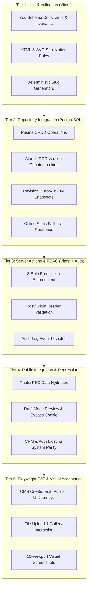

# CMS_TESTING_STRATEGY.md — Quality Assurance & Testing Blueprint

**Project:** VOIDTECH SOLUTION  
**Milestone:** Phase 10.0 — CMS Discovery & Architecture  
**Document Status:** PROPOSED TESTING STRATEGY (FOR PHASES 10.1–10.4)  
**Author:** Google DeepMind Assistant  
**Approved By:** Pending Owner Authorization  

---

## 1. Testing Philosophy & Empirical Validation Principle

VOIDTECH SOLUTION enforces the **Empirical Validation Principle**:
> *No "trust me, it works." Every architectural capability, security boundary, and UI interaction requires captured proof from automated test runners, compilers, or browser automation.*

The CMS testing framework spans five distinct verification tiers:
1. **Unit & Schema Validation:** Sub-millisecond testing of Zod schemas, input sanitizers, slug generators, and currency formatters.
2. **Repository & Concurrency Integration:** Real PostgreSQL verification on isolated test database (`voidtech_test_concurrency`) testing CRUD, OCC version counters, and revision snapshots.
3. **Server Action & RBAC Security Suites:** Full matrix testing across all three administrative roles (`SUPER_ADMIN`, `ADMIN`, `EDITOR`), validating permission gates and unauthorized mutation rejections.
4. **Public Integration & Regression Testing:** Verifying that public routes (`/`, `/about`, `/services`, `/pricing`, `/portfolio`, `/contact`) consume CMS data seamlessly while preserving offline fallbacks.
5. **Playwright End-to-End (E2E) Browser Journeys:** Multi-viewport browser validation covering content creation, draft review, publishing, media upload, and responsive layout acceptance across 10 viewports.

---

## 2. Test Execution Hierarchy & Matrix

---

## 3. Planned Test Suites Breakdown

### 3.1 Tier 1: Unit & Validation Suites (`tests/unit/cms-validation.test.ts`)
- **Estimated Tests:** 25+
- **Key Scenarios:**
  - `serviceSchema` validation: slug format regex, minimum title length, non-empty deliverables array, positive INR starting price.
  - `pricingPackageSchema` validation: strictly positive integer for `priceInr`, INR currency default, non-empty features array.
  - `portfolioProjectSchema` validation: required challenge/solution/results fields, valid `projectType` enum, concept lab disclosure check.
  - `svgSanitizer`: strips `<script>`, `<foreignObject>`, and event handlers while preserving valid SVG vector paths.
  - `slugify`: handles unicode, trims whitespace, collapses multiple dashes, removes special characters.

### 3.2 Tier 2: Repository Integration Suites (`tests/integration/cms-repositories.integration.test.ts`)
- **Harness:** Real PostgreSQL instance on `voidtech_test_concurrency`.
- **Estimated Tests:** 20+
- **Key Scenarios:**
  - Create and retrieve `Service` with `status: DRAFT` and `version = 1`.
  - Atomic OCC version locking: Verify that `updateService` with mismatched `expectedVersion` aborts and throws `ConcurrencyConflictError`.
  - Revision history: Verify that updating an item writes an immutable JSON snapshot to `content_revisions` with incremented `versionNumber`.
  - Rollback restoration: Verify that restoring version 1 from version 3 creates a new draft version 4 matching version 1's state.
  - Fallback resilience: Simulate database disconnection and verify that `getActiveServices()` returns static `servicesRegistry` without crashing.

### 3.3 Tier 3: Server Action & RBAC Security Suites (`tests/integration/cms-rbac-security.integration.test.ts`)
- **Harness:** Vitest with mocked HTTP headers and real PostgreSQL sessions.
- **Estimated Tests:** 28+
- **Key Scenarios:**
  - `SUPER_ADMIN`: Allowed to create, edit, publish, archive, delete, and restore all content types.
  - `ADMIN`: Allowed to create, edit, publish, archive, restore, and upload media. Explicitly denied from permanent deletion (`services:delete`, `pricing:delete`).
  - `EDITOR`: Allowed to create and edit drafts, and upload media. Explicitly denied from publishing (`services:publish`), archiving, deleting, modifying pricing in INR, or modifying SEO metadata.
  - Cross-Origin Defense: Mutating actions reject requests where `origin !== host`.
  - Audit logging: Verify that every mutating Server Action creates an `AuditLog` record with actor ID, IP, user-agent, and structured JSON details.

### 3.4 Tier 4: Public Integration & Regression Suites (`tests/integration/cms-public-integration.integration.test.ts`)
- **Estimated Tests:** 15+
- **Key Scenarios:**
  - Verify `/services` renders all active published services from PostgreSQL.
  - Verify `/pricing` renders all active pricing tiers and passes INR packages to `<PricingTable />`.
  - Verify `/portfolio` displays only `PUBLISHED` case studies, correctly rendering `"CONCEPT LAB"` disclaimer badges.
  - Verify Draft Mode activation: `GET /api/draft/preview` with valid secret sets `__prerender_bypass` cookie and renders unpublished draft content with `noindex` header.
  - Verify CRM regression: Verify that all Phase 9 CRM lead pipeline workflows, notifications, and Kanban boards remain 100% operational with zero regressions.

### 3.5 Tier 5: Playwright E2E Browser Acceptance (`tests/e2e/cms-acceptance.spec.ts`)
- **Browser:** Microsoft Edge (`msedge`).
- **Estimated Tests:** 20+
- **Key Journeys:**
  1. **Editor Drafting Journey:** Log in as `EDITOR`, create a new draft service, verify cannot click "Publish" (disabled with tooltip), submit for review.
  2. **Admin Publishing Journey:** Log in as `ADMIN`, inspect review item, click "Preview in Draft Mode", inspect live layout with amber preview HUD, return to CMS and click "Publish". Verify item appears on public `/services` page.
  3. **Media Upload & Alt Text:** Upload a PNG image, verify client-side thumbnail rendering, provide mandatory alt text, verify saved to media gallery.
  4. **Pricing Adjustment & Revalidation:** Admin updates "Basic Static" price from ₹999 to ₹1,499. Verify immediate reflection on public `/pricing` page without redeploy.
  5. **10-Viewport Visual Acceptance:** Capture screenshot proofs of the CMS administrative dashboard across all standard viewports: 320px, 360px, 375px, 390px, 430px, 768px, 1024px, 1280px, 1440px, 1920px.

---

## 4. Quality Gate Acceptance Thresholds

For any Phase 10 implementation milestone to be approved, the following exit criteria must be met:
- **TypeScript:** `npm.cmd run typecheck` reports 0 errors.
- **ESLint:** `npm.cmd run lint` reports 0 warnings and 0 errors.
- **Automated Tests:** 100% test pass rate across all Vitest suites (zero skipped/failing tests).
- **Playwright E2E:** 100% test pass rate across browser journeys.
- **Production Build:** `npm.cmd run build` successfully compiles all routes with 0 errors.
- **Documentation:** Updated test register and acceptance reports authored and approved.
