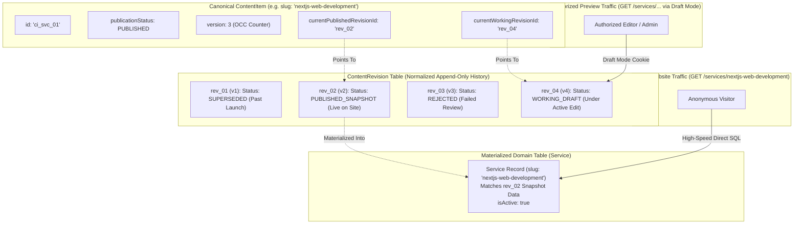
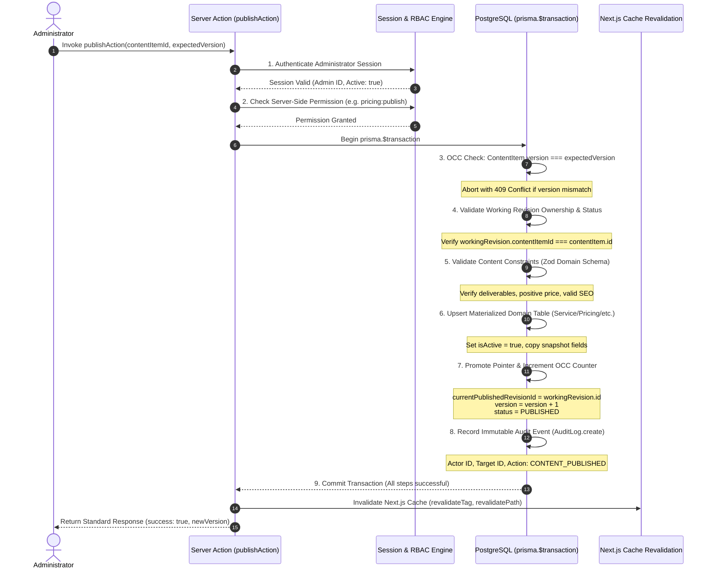

# PHASE_10_0_2_IMPLEMENTATION_SAFEGUARDS_REPORT.md
### Final CMS Implementation Safeguards & Engineering Invariants

**Project:** VOIDTECH SOLUTION ("Build. Launch. Grow Online.")  
**Workspace:** `D:/voidtechsolution`  
**Repository:** `https://github.com/void-tech-shiv/Voidtechsolution.git`  
**Active Development Branch:** `session/phase-7-admin-auth`  
**Milestone:** Phase 10.0.2 — Final CMS Implementation Safeguards  
**Document Status:** FROZEN ARCHITECTURAL SPECIFICATION & SAFEGUARDS CHARTER  
**Author:** Google DeepMind Assistant  
**Approved By:** SHIVANSHU SATYAJEET (Project Owner) — Safeguards Authorized  

---

## 1. Executive Summary & Safeguards Scope

Phase 10.0.2 incorporates the five final owner-requested engineering safeguards into the VOIDTECH CMS implementation specifications before any implementation work begins in Phase 10.1.

This is a **DOCUMENTATION-ONLY** milestone. In accordance with strict project boundaries:
- **Zero source code modifications** (`src/`).
- **Zero Prisma schema alterations** (`prisma/schema.prisma`).
- **Zero database migrations or writes** (Neon, Supabase, local PostgreSQL untouched).
- **Zero external service configurations** (no Cloudflare R2 credentials, no S3 clients).
- **Zero email dispatches or deployments.**
- **Phase 10.1 implementation is strictly prohibited** until separate explicit owner authorization is obtained.

---

## 2. Safeguard 1: Dual-Pointer Draft and Published Revision Separation

### 2.1 The Core Problem
In a content management system, content authors frequently draft updates to existing live pages while public visitors continue browsing those pages. If the database schema or repository logic uses a single active record or binds draft authoring directly to the published entity, public visitors risk seeing half-edited drafts or breaking layouts.

### 2.2 The Dual-Pointer Solution
Every canonical `ContentItem` maintains two distinct, independent revision pointers:
- `currentPublishedRevisionId: String?`: References the immutable `ContentRevision` currently promoted and materialized for public traffic.
- `currentWorkingRevisionId: String?`: References the active working `ContentRevision` undergoing drafting, editing, or administrative review.



### 2.3 Boundary Enforcement Rules
1. **Public Reads Exclusively from Materialized Domain Records:**  
   Public Server Components query `Service`, `PricingPackage`, `PortfolioProject`, `PageSection`, `FAQ`, and `Testimonial` where `isActive = true`. They never join to or read `content_revisions`.
2. **Draft Edits Never Alter Live Content:**  
   When an editor edits an existing published service, mutations update or append `ContentRevision` records pointed to by `currentWorkingRevisionId`. The materialized domain record and `currentPublishedRevisionId` remain 100% untouched.
3. **Simultaneous Existence Guarantee:**  
   A service remains 100% publicly visible and accessible with its approved pricing, deliverables, and copy while an editor experiments with a new draft version.
4. **Authorized Draft Preview:**  
   Next.js Draft Mode (`__prerender_bypass` cookie validated via preview secret) intercepts Server Component queries. When preview mode is active, the repository loads the revision specified by `currentWorkingRevisionId` (or a specific historical `revisionId`), emits `X-Robots-Tag: noindex, nofollow`, and renders the persistent amber preview HUD banner.
5. **Atomic Promotion on Publish:**  
   Publishing promotes `currentWorkingRevisionId` to `currentPublishedRevisionId`, increments `ContentItem.version`, and updates the materialized domain table in a single database transaction.

---

## 3. Safeguard 2: Database Referential Integrity & Prisma Compatibility

### 3.1 Integrity Objectives
1. Ensure the published revision belongs strictly to its parent `ContentItem`.
2. Ensure the working revision belongs strictly to its parent `ContentItem`.
3. Ensure domain materialized records have the exact canonical content identity.
4. Ensure monotonic unique revision numbering per content item without gaps or duplicates.
5. Eliminate orphaned revisions or invalid/dangling revision pointers.

### 3.2 Database-Enforced vs. Application-Enforced Analysis
To uphold technical honesty, we clearly distinguish between constraints enforced natively by PostgreSQL/Prisma vs. checks enforced inside the atomic publishing transaction:

| Constraint | Enforcement Mechanism | Technical Verification & Guarantees |
|---|:---:|---|
| **Revision Parent Link** | **Database-Enforced (FK)** | `ContentRevision.contentItemId -> ContentItem.id` with `ON DELETE CASCADE`. A revision can never exist without its parent `ContentItem`. |
| **Monotonic Revision Numbers** | **Database-Enforced (Unique Index)** | `@@unique([contentItemId, versionNumber])` on `ContentRevision`. Two revisions of the same item can never share the same version number. |
| **Domain Canonical Identity** | **Database-Enforced (1-to-1 FK)** | `Service.contentItemId -> ContentItem.id` with `@unique` and `ON DELETE RESTRICT`. A domain record cannot exist without a canonical `ContentItem`, and a `ContentItem` cannot have duplicate domain records. |
| **Valid Pointer Targets** | **Database-Enforced (FK)** | `ContentItem.currentPublishedRevisionId` and `currentWorkingRevisionId` have foreign keys to `ContentRevision.id` with `ON DELETE SET NULL`. Pointers can never reference non-existent revision IDs. |
| **Cross-Item Pointer Ownership** | **Application-Enforced in Transaction** *(Evaluated below)* | Verifying that `revision.contentItemId === item.id` when assigning `currentPublishedRevisionId` or `currentWorkingRevisionId`. |

### 3.3 Evaluation of Composite Foreign Keys in Prisma
We evaluated defining a composite foreign key on `ContentItem`:
```prisma
// Evaluated Composite Foreign Key:
// FOREIGN KEY (currentPublishedRevisionId, id) REFERENCES ContentRevision(id, contentItemId)
```
- **Prisma & Migration Compatibility:**
  While PostgreSQL supports composite foreign keys if `ContentRevision` declares `@@unique([id, contentItemId])`, declaring circular composite foreign keys in Prisma schemas creates severe migration deadlock:
  1. `ContentItem` cannot be created before `ContentRevision` because of the foreign key constraint.
  2. `ContentRevision` cannot be created before `ContentItem` because of the parent foreign key constraint.
  3. Circular cascading deletes cause Prisma migration generator errors (`cyclic relation dependency detected`).
- **Engineered Resolution:**
  1. Maintain standard foreign keys: `currentPublishedRevisionId -> ContentRevision.id` and `currentWorkingRevisionId -> ContentRevision.id` (`ON DELETE SET NULL`).
  2. In Step 4 of the **Atomic Publishing Transaction**, strictly assert:
     ```typescript
     if (workingRevision.contentItemId !== contentItem.id) {
       throw new InvariantViolationError("Revision does not belong to target ContentItem");
     }
     ```
  3. For database-level hardening in production migration SQL, define a PostgreSQL `CHECK TRIGGER`:
     ```sql
     CREATE OR REPLACE FUNCTION verify_revision_ownership() RETURNS TRIGGER AS $$
     BEGIN
       IF NEW."currentPublishedRevisionId" IS NOT NULL THEN
         IF NOT EXISTS (
           SELECT 1 FROM content_revisions
           WHERE id = NEW."currentPublishedRevisionId" AND "contentItemId" = NEW.id
         ) THEN
           RAISE EXCEPTION 'currentPublishedRevisionId must belong to ContentItem %', NEW.id;
         END IF;
       END IF;
       RETURN NEW;
     END;
     $$ LANGUAGE plpgsql;
     ```

---

## 4. Safeguard 3: Atomic Publishing Transaction Sequence

### 4.1 Strict 9-Step Publishing Protocol
Every content publication follows an explicit, unskippable 9-step atomic transaction (`prisma.$transaction`). A failure at any step aborts and rolls back the entire operation:



### 4.2 Concurrency Conflict Behavior & Retry Policy
- **Conflict Trigger:** If another administrator publishes or modifies the item while an editor is drafting, `contentItem.version !== expectedVersion`.
- **System Action:** The transaction aborts immediately; zero records are written.
- **API Response:** Returns standard response envelope with `code: "CONFLICT_DETECTED"` (HTTP 409), the active database version number, and the conflicting editor's display name.
- **Retry Policy:**
  - **No Blind Overwrite:** The application never automatically retries or overwrites conflicting changes.
  - **Visual Diff Resolution:** The client UI displays a side-by-side visual diff showing the editor's pending changes against the currently live version.
  - **Explicit User Action:** The editor must review the diff, choose to re-apply their edits on top of the newer version, or discard their draft.

---

## 5. Safeguard 4: Testimonial Verification & Legal Consent Integrity

### 5.1 Resolution of Overlapping Fields
In previous drafts, `Testimonial` contained both an `isVerified: Boolean` flag and an `approvalStatus: ApprovalStatus` enum, causing semantic ambiguity.

We resolve this by establishing **one authoritative verification state** and an independent **client consent state**:

```prisma
enum TestimonialVerificationStatus {
  UNVERIFIED  // Default upon creation; factual claims unreviewed
  VERIFIED    // Formally audited by Administrator; claims confirmed accurate
  REJECTED    // Factual claims inaccurate or unverified
}

enum ClientConsentStatus {
  PENDING     // Written consent not yet received
  GRANTED     // Formal client consent verified and recorded
  REVOKED     // Client requested removal; consent withdrawn
}
```

### 5.2 Mandatory Publication Preconditions
A testimonial can transition to `status = PUBLISHED` if and only if **all five preconditions** are satisfied:
1. **Verified Administrator Identity:** `verifiedByAdminId` is non-null and references an active administrator.
2. **Completed Verification:** `verificationStatus === "VERIFIED"`.
3. **Recorded Client Consent:** `clientConsentStatus === "GRANTED"`.
4. **Consent Timestamp & Evidence:** `clientConsentRecordedAt !== null` and `consentEvidenceUrl !== null`.
5. **No Active Revocation:** `clientConsentStatus !== "REVOKED"`.

### 5.3 Instant Consent Revocation
- **The Operational Scenario:** A client requests that their quote or executive avatar be removed from the VOIDTECH website immediately.
- **The Revocation Action:** Calling `revokeTestimonialConsentAction(id)` executes an atomic transaction:
  ```typescript
  await prisma.$transaction(async (tx) => {
    await tx.testimonial.update({
      where: { id },
      data: {
        clientConsentStatus: "REVOKED",
        status: "ARCHIVED",
        isActive: false,
        updatedAt: new Date(),
      },
    });
    await tx.auditLog.create({
      data: {
        actorId: session.userId,
        action: "TESTIMONIAL_CONSENT_REVOKED",
        targetId: id,
        details: { reason: "Client request", revokedAt: new Date() },
      },
    });
  });
  ```
- **Public Query Guarantee:** All public queries enforce:
  ```prisma
  where: {
    status: "PUBLISHED",
    isActive: true,
    verificationStatus: "VERIFIED",
    clientConsentStatus: "GRANTED",
  }
  ```
  Because the public query requires `clientConsentStatus = "GRANTED"`, **revoking consent immediately prevents public retrieval at the database level**, completely independent of any downstream CDN or Next.js cache revalidation latency.

---

## 6. Safeguard 5: Hardened Media Security Defaults

### 6.1 Initial Implementation Constraints
1. **Permitted Formats:** Strictly JPEG (`image/jpeg`), PNG (`image/png`), and WebP (`image/webp`).
2. **SVG Uploads Disabled by Default:**  
   SVG uploads are **hard-disabled by default** in Phase 10.1. SVG upload support will require a dedicated DOMPurify XML sanitizer implementation and an automated penetration test suite in a future milestone before it can be activated.
3. **File Signature Validation:**  
   The upload pipeline inspects the raw file buffer's magic bytes. File extensions and client `Content-Type` headers are never trusted:
   - JPEG: `FF D8 FF`
   - PNG: `89 50 4E 47`
   - WebP: `52 49 46 46 ... 57 45 42 50`
4. **Sharp Raster Normalization:**  
   All uploaded raster images are passed through `sharp`:
   - Strips all EXIF metadata, GPS coordinates, and camera serial numbers.
   - Normalizes orientation based on EXIF before stripping.
   - Enforces maximum dimension bounds (max 2560px width/height).
   - Re-encodes into optimized WebP to neutralize polyglot file payloads.
5. **Enforced File Size Limit:** Max 5.0 MB for images.
6. **Cryptographically Generated Storage Keys:**  
   Client filenames are never used for disk or storage keys. The system generates keys using UUID v4: `uploads/${year}/${month}/${crypto.randomUUID()}.webp`.
7. **Path Traversal Defense:**  
   `path.basename()` and path normalization reject any keys containing `..`, null bytes, slashes, or non-alphanumeric characters. Writes are strictly confined to the designated storage root.
8. **Local Filesystem Development-Only:**  
   Local filesystem storage (`public/uploads`) is restricted strictly to local development and integration tests.
9. **Zero Ephemeral Serverless Storage:**  
   Ephemeral serverless filesystems (e.g., AWS Lambda `/tmp`, Vercel serverless disk) are **strictly forbidden** as persistent production media storage. Files stored in ephemeral containers are lost when instances spin down or recycle.
10. **Cloudflare R2 Deferred:**  
    Cloudflare R2 remains a future production option. **No R2 buckets, S3 API clients, or credentials may be created or configured during Phase 10.0 or 10.1.**

---

## 7. Safeguard 6: Comprehensive Static Fallback Behavior Matrix

To uphold the principle that **stale static content must never be silently presented as though it were the latest successfully published CMS content**, the system defines distinct behavior across five operational scenarios:

| Scenario | System State | Logging & Diagnostics | Public User Experience | Metadata / Response Header |
|---|---|---|---|---|
| **Scenario 1: Database Unavailable** | Network partition, DB timeout, pool exhaustion | `{ level: "WARN", event: "CMS_FALLBACK_TRIGGERED", reason: "DB_UNAVAILABLE", error: sanitizedMessage }` (no secrets/PII) | Page renders static baseline data from `src/config/*`. Prevents 500 downtime. | `X-Voidtech-Content-Source: static-fallback`<br/>`isFallback: true` |
| **Scenario 2: No Published Content** | DB connected, but table has 0 published records | `{ level: "INFO", event: "CMS_EMPTY_TABLE_FALLBACK", entity: "services", source: "STATIC_REGISTRY" }` | Page renders static baseline data from `src/config/*`. Prevents blank page. | `X-Voidtech-Content-Source: static-fallback`<br/>`isFallback: true` |
| **Scenario 3: Archived Content** | Specific slug requested, but item has `status = ARCHIVED` or `isActive = false` | `{ level: "INFO", event: "CMS_CONTENT_ARCHIVED", slug: requestedSlug }` | **Returns 404 Not Found.** Deliberately retired content is NEVER replaced by static fallbacks. | Standard 404 Response |
| **Scenario 4: Invalid Snapshot Data** | Corrupted JSON or schema deserialization failure | `{ level: "ERROR", event: "CMS_INVALID_SNAPSHOT", reason: "ZOD_VALIDATION_FAILED", entityId: id }` | Renders static fallback for that specific item. Diagnostic logged for admins. | `X-Voidtech-Content-Source: static-fallback`<br/>`isFallback: true` |
| **Scenario 5: Unexpected Repo Error** | Prisma query syntax error or driver crash | `{ level: "ERROR", event: "CMS_REPOSITORY_EXCEPTION", error: sanitizedMessage }` | Renders static baseline data. Prevents page crash. | `X-Voidtech-Content-Source: static-fallback`<br/>`isFallback: true` |

### 7.1 Diagnostic Invariants
1. **Administrative Transparency:** In administrative dashboards (`/admin/cms/*`) and Draft Mode previews, fallback data is **NEVER** silently substituted for database records. Administrators must see the true database state and any connection error alerts.
2. **Sanitized Structured Logging:** All fallback events emit structured JSON logs with event name, entity type, and sanitized error message. Database connection strings, credentials, and customer PII are strictly scrubbed.

---

## 8. Cross-Document Consistency Matrix

All documentation artifacts have been synchronized to maintain 100% technical consistency:

| Concept / Field | `CMS_ARCHITECTURE.md` | `CMS_DATABASE_DESIGN.md` | `CMS_API_DESIGN.md` | `CMS_SECURITY_REVIEW.md` | `CMS_TESTING_STRATEGY.md` |
|---|:---:|:---:|:---:|:---:|:---:|
| **Dual Pointers** | `currentPublishedRevisionId`<br/>`currentWorkingRevisionId` | Fully specified in `ContentItem` schema | Returned in Server Action response envelope | Evaluated for tamper resistance | Verified in Tier 2 repo integration tests |
| **Integrity Checks** | Cross-record check in publishing xact | Foreign keys on pointers (`SetNull`) + unique constraints | Step 4 asserts `rev.contentItemId === item.id` | Tested in SEC-04 & SEC-05 | Tested in Tier 2 & Tier 3 suites |
| **Publishing Protocol** | 9-step atomic transaction | Schema support for atomic upsert & version bump | Full typed Server Action contracts | OCC drift & rollbacks verified | Tested in Tier 2 & Tier 5 E2E |
| **Testimonial Verification** | `verificationStatus` + `clientConsentStatus` | Enums defined; `isVerified` boolean removed | Dedicated verify & revoke Server Actions | Anti-fabrication & consent revocation tests | SEC-08 automated test case |
| **Media Defaults** | JPEG/PNG/WebP; SVG disabled by default | `MediaAsset` model with hash & MIME fields | Upload endpoint validates magic bytes | Sharp re-encoding; traversal blocked | SEC-03, SEC-09, SEC-10 tests |
| **Static Fallbacks** | 5 distinct scenarios specified | N/A (Repository logic) | Response envelope includes `isFallback` flag | Secret scrubbing in logs | Tier 2 offline disconnect test |

---

## 9. Final Acceptance & Stop Condition

1. **All five safeguards incorporated** into architectural specifications and documentation.
2. **Quality gates remain 100% green:** 462 Vitest tests passing, 187 Playwright E2E tests passing, 0 typecheck errors, 0 ESLint warnings.
3. **Execution boundary strictly preserved:** Zero application code changed; zero database mutations.
4. **STRICT STOP ENFORCED:** Phase 10.1 implementation has NOT been started. Awaiting explicit owner authorization.
