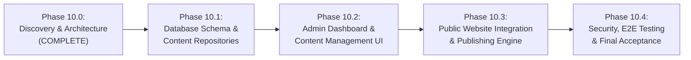

# PHASE_10_ROADMAP.md — Admin CMS Implementation Roadmap

**Project:** VOIDTECH SOLUTION ("Build. Launch. Grow Online.")  
**Milestone:** Phase 10 — Admin CMS  
**Document Status:** APPROVED EXECUTION BLUEPRINT  
**Author:** Google DeepMind Assistant  
**Approved By:** Pending Owner Authorization  

---

## 1. Executive Summary & Phased Strategy

Phase 10 delivers a production-grade, headless administrative Content Management System (CMS) enabling authorized VOIDTECH administrators (`SUPER_ADMIN`, `ADMIN`, `EDITOR`) to manage the agency's public digital presence without code deployments or developer intervention.

To eliminate risk, prevent regressions with the existing Phase 9 CRM and Phase 7 authentication systems, and ensure strict architectural discipline, Phase 10 is decomposed into **5 sequential, independently verifiable milestones**:

---

## 2. Milestone Breakdown & Scope

### Phase 10.0: CMS Discovery & Architecture (COMPLETE)
- **Status:** **COMPLETE** (Read-Only Audit & Specification Authoring)
- **Key Deliverables:**
  - Complete discovery report (`PHASE_10_0_CMS_DISCOVERY_REPORT.md`).
  - Architecture blueprint (`CMS_ARCHITECTURE.md`).
  - Database design & schema (`CMS_DATABASE_DESIGN.md`).
  - Server Action & API contracts (`CMS_API_DESIGN.md`).
  - RBAC permission matrix (`CMS_RBAC_PERMISSION_MATRIX.md`).
  - Security review & threat analysis (`CMS_SECURITY_REVIEW.md`).
  - Quality assurance & testing blueprint (`CMS_TESTING_STRATEGY.md`).
  - Execution roadmap (`PHASE_10_ROADMAP.md`).
- **Exit Criteria:** Owner approval of discovery findings and open decisions.

---

### Phase 10.1: CMS Database Schema & Content Repositories
- **Objective:** Establish the persistent database and repository foundation for all CMS content models.
- **Scope of Implementation:**
  1. **Prisma Schema Additions:**
     - Add `ContentStatus` (`DRAFT`, `REVIEW`, `PUBLISHED`, `ARCHIVED`) and `ApprovalStatus` enums.
     - Enhance `Service`, `PricingPackage`, `PortfolioProject`, and `FAQ` models with `status`, `version`, `publishedAt`, `publishedById`, and SEO fields.
     - Create new models: `PageSection`, `ContentRevision`, `Testimonial`, and `MediaAsset`.
     - Generate and apply PostgreSQL migration `20261114000000_admin_cms_foundation`.
  2. **Hydrated Domain Repositories:**
     - Enhance `services.repo.ts`, `pricing.repo.ts`, `portfolio.repo.ts`, `faq.repo.ts`, and `settings.repo.ts`.
     - Implement `page-sections.repo.ts`, `revisions.repo.ts`, `testimonials.repo.ts`, and `media.repo.ts`.
     - Implement atomic Optimistic Concurrency Control (OCC) version locking.
     - Implement automatic revision snapshot recording on save.
     - Implement resilient offline static fallback guarantees across all repositories.
  3. **Database Seeding & Migration Verification:**
     - Update `prisma/seed.ts` to backfill `version = 1`, `status = PUBLISHED`, and seed baseline `PageSection` records from `src/config/site.ts`.
     - Author rollback migration script.
  4. **Automated Unit & Integration Testing:**
     - Unit tests for Zod validation schemas (`tests/unit/cms-validation.test.ts`).
     - Real PostgreSQL repository integration tests (`tests/integration/cms-repositories.integration.test.ts`).
- **Exit Criteria:** 100% test pass rate on real PostgreSQL test database; zero regression on CRM tests.

---

### Phase 10.2: CMS Admin Dashboard & Content Management UI
- **Objective:** Build the interactive, responsive administration interfaces inside the existing `/admin/*` dashboard.
- **Scope of Implementation:**
  1. **CMS Overview Dashboard (`/admin` / `/admin/cms`):**
     - Summary KPI cards: Published Services, Active Pricing Tiers, Case Studies, Drafts Pending Review, Total Media Assets.
     - Quick-action shortcuts and recent editorial activity feed.
  2. **Services Management UI (`/admin/services`):**
     - Paginated list with category filtering, search, status badges (`DRAFT`, `REVIEW`, `PUBLISHED`, `ARCHIVED`).
     - Create / Edit service modal or drawer with Markdown full-description editor, deliverable builder, and icon selector.
     - Publish, archive, and delete actions with confirmation dialogs.
  3. **Pricing Tiers Management UI (`/admin/pricing`):**
     - Full CRUD table for 10 approved packages and custom tiers.
     - INR price editor, starting-price toggle (`+`), feature list management, and display reordering.
     - Restricted to `SUPER_ADMIN` and `ADMIN` (hidden / disabled for `EDITOR`).
  4. **Portfolio & Case Studies UI (`/admin/portfolio`):**
     - Showcase list with industry filters and prototype badges (`CONCEPT`, `PROTOTYPE`, `PRODUCTION`).
     - Case study editor with challenge/solution/results inputs, tech stack tagger, and metrics builder.
  5. **Knowledgebase & FAQs UI (`/admin/faqs`):**
     - Categorized FAQ management with drag/arrow display reordering and rich answer editor.
  6. **Editorial Page Sections UI (`/admin/sections`):**
     - Tabbed page-by-page editor (Homepage, About, Services, Pricing, Contact).
     - Headline, subtitle, and markdown body editing with real-time word count.
  7. **Media Library & Asset Manager (`/admin/media`):**
     - Grid/list view of uploaded assets with thumbnail preview, size, and MIME badges.
     - Drag-and-drop file upload zone with client-side magic-byte verification and mandatory alt text input.
  8. **Revision History & Rollback Modal:**
     - Slide-over sheet displaying chronological revision snapshots with visual text diff and "Restore This Version" button.
- **Exit Criteria:** All forms validated with Zod, accessible keyboard focus and ARIA labels, responsive across desktop and tablet.

---

### Phase 10.3: Public Website CMS Integration & Publishing Engine
- **Objective:** Connect public routes to CMS repositories with instant on-demand revalidation and Draft Mode previews.
- **Scope of Implementation:**
  1. **Public Route Refactoring:**
     - Refactor `src/app/page.tsx` to read section headlines and copy from `PageSectionsRepo`.
     - Refactor `src/components/sections/pricing-table.tsx` to receive server-fetched packages as props from `PricingRepo.getActivePricingPackages()`.
     - Refactor `src/app/about/page.tsx`, `src/app/services/page.tsx`, `src/app/pricing/page.tsx`, and `src/app/portfolio/page.tsx` to consume dynamic CMS content.
  2. **Next.js Draft Mode Preview Subsystem:**
     - Implement `/api/draft/preview` and `/api/draft/exit` route handlers.
     - Support secret validation, cookie issuance, and relative redirect guards.
     - Render persistent floating amber "PREVIEW MODE" HUD banner when previewing.
     - Enforce `noindex, nofollow` headers on all draft preview views.
  3. **On-Demand Cache Revalidation:**
     - Tag-based invalidation (`revalidateTag`) invoked upon publishing services, pricing, portfolio, FAQs, or sections.
     - Edge CDN cache purging.
  4. **Resilient Static Fallback Verification:**
     - Verify zero downtime: simulate database offline and prove all public pages render static fallback content cleanly.
- **Exit Criteria:** Public site displays dynamic CMS content; Draft Mode previews work seamlessly; cache updates instantly upon publishing.

---

### Phase 10.4: Security, E2E Testing & Final Acceptance
- **Objective:** Exhaustive quality assurance, security penetration audit, visual proofs across 10 viewports, and formal sign-off.
- **Scope of Implementation:**
  1. **Full Playwright E2E Browser Suite (`tests/e2e/cms-acceptance.spec.ts`):**
     - Test complete multi-role journeys (Editor drafting -> Admin review -> Publishing -> Public reflection).
     - Test media upload, alt-text assignment, and asset replacement.
     - Test revision restoration and version rollbacks.
  2. **10-Viewport Visual Acceptance:**
     - Capture screenshot proofs of CMS admin pages and updated public routes across 320px, 360px, 375px, 390px, 430px, 768px, 1024px, 1280px, 1440px, and 1920px.
  3. **Security Penetration & Vulnerability Testing:**
     - Stored XSS injection test on Markdown and SVG inputs.
     - CSRF / Origin mismatch rejection tests.
     - File upload exploit tests (disguised `.php`/`.exe`, oversized files).
     - RBAC privilege escalation tests (Editor attempting to publish or modify pricing).
  4. **Performance Benchmarking:**
     - Verify sub-100ms response times for public page loads and CMS catalog filters.
  5. **Final Acceptance Report:**
     - Author `docs/phases/PHASE_10_4_CMS_ACCEPTANCE_REPORT.md` with full test evidence, defect register, and owner sign-off.
- **Exit Criteria:** All 6 quality gates green; zero defects; owner authorization.

---

## 3. Dependency Graph & Risk Mitigation

| Identified Risk | Impact | Mitigation Strategy |
|---|:---:|---|
| **Public Site Layout Regression** | High | CMS data feeds into existing, hardened layout components (`<CinematicHero />`, `<PricingTable />`). Fallback configs guarantee zero visual degradation. |
| **Pricing Table Client Discrepancy** | High | Refactor `PricingTable` in Phase 10.3 to accept server-fetched `packages` as a prop while preserving static `@/config/pricing` as the default fallback. |
| **Unpublished Draft Search Indexing** | Critical | Mandatory `<meta name="robots" content="noindex, nofollow" />` and `X-Robots-Tag` emitted whenever Draft Mode is active. |
| **Concurrent Editorial Overwrites** | Medium | Monotonic integer `version` OCC locking aborts conflicting saves and triggers side-by-side visual diff resolution. |
| **Serverless Ephemeral Storage** | Medium | Implement abstracted `StorageProvider` interface supporting Cloudflare R2 / S3 for persistent cloud storage with local filesystem fallback for development. |
