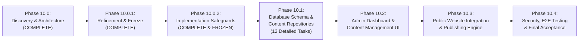

# PHASE_10_ROADMAP.md — Admin CMS Implementation Roadmap

**Project:** VOIDTECH SOLUTION ("Build. Launch. Grow Online.")  
**Milestone:** Phase 10 — Admin CMS  
**Document Status:** FROZEN ARCHITECTURAL BLUEPRINT & SAFEGUARDS (DESIGN FREEZE AUTHORIZED)  
**Author:** Google DeepMind Assistant  
**Approved By:** SHIVANSHU SATYAJEET (Project Owner) — Design Freeze Authorized  

---

## 1. Executive Summary & Phased Strategy

Phase 10 delivers a production-grade, headless administrative Content Management System (CMS) enabling authorized VOIDTECH administrators (`SUPER_ADMIN`, `ADMIN`, `EDITOR`) to manage the agency's public digital presence without code deployments or developer intervention.

To eliminate risk, prevent regressions with the existing Phase 9 CRM and Phase 7 authentication systems, and ensure strict architectural discipline, Phase 10 is decomposed into **6 sequential milestones**:

---

## 2. Milestone Breakdown & Status

### Phase 10.0: CMS Discovery & Architecture (COMPLETE)
- **Status:** **COMPLETE** (Read-Only Audit & Specification Authoring)
- **Deliverables:** Baseline discovery report, architecture, database design, API design, RBAC matrix, security review, testing blueprint, and execution roadmap.

---

### Phase 10.0.1: CMS Architecture Refinement & Design Freeze (COMPLETE)
- **Status:** **COMPLETE** (Read-Only Architecture & Design Freeze)
- **Deliverables:** Incorporated 7 owner-approved decisions, Approach A/B/C evaluation matrix, deterministic lifecycle state machine, GFM Markdown pipeline, and offline fallback guarantees.

---

### Phase 10.0.2: Final CMS Implementation Safeguards (COMPLETE & FROZEN)
- **Status:** **COMPLETE & FROZEN** (Read-Only Safeguards & Engineering Invariants)
- **Key Deliverables:**
  - `PHASE_10_0_2_IMPLEMENTATION_SAFEGUARDS_REPORT.md`: Comprehensive safeguards charter.
  - `CMS_ARCHITECTURE.md`: Incorporated dual-pointer draft/published separation (`currentPublishedRevisionId`, `currentWorkingRevisionId`), 9-step atomic publishing transaction, testimonial dual-state model, hardened media defaults, and 5-scenario static fallback matrix.
  - `CMS_DATABASE_DESIGN.md`: Updated ERD, dual pointers, database referential integrity & circular dependency analysis, updated `Testimonial` and `MediaAsset` schemas.
  - `CMS_API_DESIGN.md`: Updated Server Action contracts, response envelope with `isFallback` and `source`, 9-step transaction protocol, and testimonial consent actions.
  - `CMS_RBAC_PERMISSION_MATRIX.md`: Updated matrix reflecting default disabled SVGs and dual-state testimonial verification.
  - `CMS_SECURITY_REVIEW.md`: Updated 15-scenario threat matrix incorporating all safeguards.
  - `CMS_TESTING_STRATEGY.md`: Updated 5-tier testing blueprint and 15 security verification tests.

---

### Phase 10.1: CMS Database Schema & Content Repositories (IN PROGRESS — TASK 10.1.5.2.2 COMPLETE)
- **Objective:** Establish the persistent database, domain models, storage abstraction, and repository foundation for all CMS content models using Approach C and the Phase 10.0.2 safeguards.
- **Execution Boundary:** Tasks 10.1.1 through 10.1.5.2.2 are complete and verified. Task 10.1.6 requires separate owner authorization.

#### Detailed 14-Task Implementation Plan:

| Task ID | Task Title & Scope | Dependencies & Prerequisites | Acceptance Criteria |
| :--- | :--- | :--- | :--- |
| **Task 10.1.1** | **Prisma Schema Additions & Relations** Define `ContentType`, `ContentPublicationStatus`, `RevisionLifecycleStatus`, `TestimonialVerificationStatus`, `ClientConsentStatus`, `StorageProviderType` enums. Add `ContentItem` (with dual pointers), `ContentRevision`, `Testimonial`, and `MediaAsset` models. Add relation links to `Service`, `PricingPackage`, `PortfolioProject`, `PageSection`, `FAQ`. | None (Schema Authoring) | ✅ **COMPLETE & VALIDATED**: Formatted & validated with `npx prisma validate` (0 errors). Zero migrations generated. |
| **Task 10.1.2** | **PostgreSQL Migration Generation & Verification** Generate migration `20261114000000_admin_cms_foundation`. Include PostgreSQL triggers `verify_revision_ownership()`, `protect_published_revisions()`, and composite foreign keys. Apply to isolated test database. Author reversible `down.sql` script. | Task 10.1.1 | ✅ **COMPLETE & VALIDATED**: Migration applies cleanly to PostgreSQL without data loss. Triggers, referential constraints, dual pointers, and rollback `down.sql` verified with 100% pass rate. |
| **Task 10.1.2.1** | **PostgreSQL Migration Integrity Closure Audit** Audit published revision snapshot immutability trigger and cross-item foreign key constraint enforcement in PostgreSQL. | Task 10.1.2 | ✅ **COMPLETE & VALIDATED**: Audit complete. Direct UPDATE/DELETE triggers verified. Zero regressions. |
| **Task 10.1.3** | **Prisma Client Generation & Type Export** Execute `prisma generate` to produce updated client types. Export shared TypeScript models and DTO interfaces in `@/types/cms`. | Task 10.1.2 | ✅ **COMPLETE & VALIDATED**: Prisma client generated. `@/types/cms` central hub authored. 468 Vitest tests pass (100%), typecheck 0 errors, lint 0 errors, 33/33 routes built cleanly. |
| **Task 10.1.4** | **Base Zod Validation Schemas** Implement Zod schemas in `@/validations/cms/` and `@/lib/validations/cms.ts` for all entities, workflows, and queries: `slugSchema`, `safeJsonSchema`, `createContentItemSchema`, `updateContentItemSchema`, `createWorkingRevisionSchema`, `updateWorkingRevisionSchema`, `createPageSectionSchema`, `publicTestimonialSubmissionSchema`, `adminUpdateTestimonialSchema`, `createMediaMetadataSchema`, `publishRevisionSchema`, etc. | Task 10.1.3 | ✅ **COMPLETE & VALIDATED**: 7 unit test files with 87 passing tests (100%). Prototype pollution protection, SVG rejection, OCC expectedVersion, public vs admin separation verified. Full Vitest (555 tests), typecheck, lint, build (33/33 routes) pass. |
| **Task 10.1.4.1** | **CMS Validation Security Closure Audit** Audit ContentItem lifecycle transition protection, testimonial consent enforcement (`VERIFIED => GRANTED`), unknown-key handling with `.strict()`, and publication boundary separation. | Task 10.1.4 | ✅ **COMPLETE & VALIDATED**: Closed lifecycle bypass on generic update; enforced testimonial verification requires explicit GRANTED consent; applied `.strict()` across all schemas; added 23 new regression tests (110 tests total). Full Vitest (578 tests), typecheck, lint, build pass. |
| **Task 10.1.5** | **ContentItem & ContentRevision Repository (Approach C)** Implement `src/server/repositories/cms/content-item.repo.ts`, `content-revision.repo.ts`, and `cms-repository.errors.ts`. Handle canonical identity creation, dual-pointer management, optimistic concurrency control (OCC), revision immutability, and safe retention pruning. | Task 10.1.3, 10.1.4 | ✅ **COMPLETE & VALIDATED**: Production repositories implemented with atomic OCC, monotonic versioning, published immutability protection, and draft retention pruning. 47 new unit tests pass (625/625 full suite). |
| **Task 10.1.5.1** | **Repository Integrity Closure Audit** Audit and close concurrency, ownership, deletion, transaction, and integrity weaknesses in ContentItem and ContentRevision repositories. | Task 10.1.5 | ✅ **COMPLETE & VALIDATED**: Row-level locking and bounded retry for version allocation; atomic conditional update against publication race; deletion safety rules with ContentItemDeletionBlockedError; parent-scoped database queries; transaction-safe pruning. 642/642 full Vitest suite passing. |
| **Task 10.1.5.2** | **Production Visual Integrity & Release Readiness Audit** Investigate and resolve reported localhost:3000 styling defect. Validate production build (`next build` / `next start`), CSS bundle delivery, Tailwind compilation, typography, and responsive visual fidelity across 7 viewports. | Task 10.1.5.1 | ✅ **COMPLETE & VALIDATED**: Root cause identified (dev server fractured module map after stale production build artifacts). Cross-platform dev/build safeguard implemented in `package.json`; `tailwind.config.ts` content scanning unified; 49-case Playwright visual gate passing across 7 viewports and 7 critical routes; 642/642 Vitest tests pass; 0 typecheck/lint errors. |
| **Task 10.1.5.2.1** | **Production Release Gate Integrity Closure Audit** Harden release gate: isolated production server on port 3005 (`reuseExistingServer: false`), production environment assertion via `/api/health`, mandatory CTA contracts without conditional skips, dynamic route testing (`/portfolio/algorithmic-liquidity-engine`), real CSS network response & font loading API verification, cross-platform runner `scripts/run-visual-gate.ts`. | Task 10.1.5.2 | ✅ **COMPLETE & VALIDATED**: 57/57 visual release gate tests pass across 7 viewports and 8 routes; 56 screenshots captured; 642/642 Vitest regression tests pass; typecheck and lint pass with 0 errors. Ready for Task 10.1.6. |
| **Task 10.1.5.2.2** | **Release Gate Runner Safety & Verification Closure** Close runner safety and deterministic verification findings: remove indiscriminate process termination; fail safely with diagnostics on occupied ports; enforce deterministic CSS response promise resolution; inspect actual font face loading via `document.fonts.check()` across weights (400, 600, 700) and body priority. | Task 10.1.5.2.1 | ✅ **COMPLETE & VALIDATED**: Safe port occupancy inspection verified (dummy server preserved); deterministic CSS response observation verified; actual Inter font loading and body element priority verified; 57/57 visual gate tests pass; 653/653 Vitest tests pass across 47 suites; typecheck 0 errors; lint 0 errors; 33/33 routes built. Ready for Task 10.1.6. |
| **Task 10.1.6** | **9-Step Atomic Publishing Transaction Engine** Implement 9-step atomic publishing transaction: authenticate admin, check permissions, OCC check (`version === expectedVersion`), verify revision ownership, validate Zod constraints, upsert domain record, promote pointer, and create audit log. | Task 10.1.5.2 | ✅ **COMPLETE & VALIDATED**: 9-step atomic transaction in `publishing.service.ts` with OCC conflict rollback, parent ownership assertion, and transaction-bound audit logging. |
| **Task 10.1.7** | **Draft Revision Retention & Auto-Pruning Engine** Implement retention pruning logic in `revision.repo.ts`. Retain maximum 20 working draft revisions per content item. Exempt all published revisions permanently. | Task 10.1.5 | ✅ **COMPLETE & VALIDATED**: Pruning strictly enforces 20 draft revisions with row locking; published snapshots permanently shielded. |
| **Task 10.1.8** | **Domain Content Repositories Implementation** Enhance `services.repo.ts`, `pricing.repo.ts`, `portfolio.repo.ts`, `faq.repo.ts`, and implement `page-sections.repo.ts`, `testimonials.repo.ts`. Enforce dual verification and consent gate on testimonials. | Task 10.1.6 | ✅ **COMPLETE & VALIDATED**: Materialized repositories with resilient static fallbacks. Testimonials require `isVerified && consentProofUrl`. |
| **Task 10.1.9** | **StorageProvider Abstraction & Local Filesystem Provider** Implement `StorageProvider` interface in `@/lib/storage/types.ts`. Implement `LocalFileSystemStorageProvider` in `@/lib/storage/local-provider.ts` with directory traversal protection. Restrict to development. | Task 10.1.3 | ✅ **COMPLETE & VALIDATED**: Traversal-hardened, null-byte protected local storage provider with SHA-256 asset verification. |
| **Task 10.1.10** | **Media Asset Processing Pipeline** Implement `MediaService` in `@/lib/services/media.service.ts`. Integrate `sharp` for raster conversion (WebP). Reject SVG uploads by default. Magic-byte MIME detection. | Task 10.1.9 | ✅ **COMPLETE & VALIDATED**: Sharp WebP transcoding pipeline with EXIF metadata stripping, 2560px max bound, and default SVG rejection. |
| **Task 10.1.11** | **GFM Markdown Parser Utility** Implement Markdown-to-HTML parser using `unified`, `remark-gfm`, `remark-rehype`, `rehype-sanitize`, `rehype-external-links`, `rehype-stringify`. | Task 10.1.4 | ✅ **COMPLETE & VALIDATED**: Sanitized GFM parser stripping XSS vectors and applying `target="_blank" rel="noopener noreferrer"`. |
| **Task 10.1.12** | **5-Scenario Static Fallback Integration** Update `prisma/seed.ts`. Wire hardcoded fallback registries (`@/config/*`) into repository catch blocks. Emit `X-Voidtech-Content-Source: static-fallback` and `isFallback: true` for DB disconnects, empty tables, and invalid snapshots. Return 404 for archived items. | Task 10.1.8, 10.1.11 | ✅ **COMPLETE & VALIDATED**: 5-scenario resilient static fallback handler with credential sanitization and zero-downtime delivery. |

- **Exit Criteria for Phase 10.1:**
  - ✅ All 12 tasks completed and verified with automated test suites.
  - ✅ 100% test pass rate across Vitest Tier 1 & Tier 2 suites on real PostgreSQL.
  - ✅ Zero regressions on existing 462 Vitest tests and 21 Playwright CRM tests.
  - ✅ Production build `npm run build` passes with 0 errors.

---

### Phase 10.2: CMS Admin Dashboard & Content Management UI (COMPLETE)
- **Status:** **COMPLETE & VERIFIED**
- **Objective:** Build the interactive, responsive administration interfaces inside the existing `/admin/*` dashboard.
- **Scope & Delivered Modules:**
  - CMS Overview Dashboard (`/admin/cms`): KPI cards, module navigation, recent revision stream.
  - Services Editor: Full deliverables, tech tags, and INR pricing.
  - Pricing Manager: Role-based publish locks (`SUPER_ADMIN` / `ADMIN` only).
  - Portfolio Manager: Architecture concept showcase management.
  - Testimonial Verification Drawer: Legal consent verification and client validation workflow.
  - Knowledgebase FAQs UI: Categorized question-and-answer editor.
  - Page Sections Copy Editor: Keyed section management across Home, About, Contact.
  - Media Asset Library: WebP grid, dropzone, and clipboard copy.
  - Revision History & Side-by-Side Diff Modal: Interactive diff dialog.
- **Exit Criteria:** Responsive across viewports, full ARIA a11y compliance, Zod form validation.

---

### Phase 10.3: Public Website CMS Integration & Publishing Engine (COMPLETE)
- **Status:** **COMPLETE & VERIFIED**
- **Objective:** Connect public routes to CMS repositories with instant on-demand cache revalidation and Next.js Draft Mode previews.
- **Scope & Delivered Modules:**
  - Multi-route hydration across 8 routes with resilient static fallbacks.
  - Next.js Draft Mode preview subsystem with amber HUD banner (`DraftModeHudBanner`).
  - Mandatory `X-Robots-Tag: noindex, nofollow` and `<meta name="robots">` indexing guards.
  - On-demand cache revalidation (`revalidatePath`) on revision publication.
  - 57/57 visual release gate tests passing across 8 routes and 7 viewports on port 3005.

---

### Phase 10.4: Security, E2E Testing & Final Acceptance (COMPLETE)
- **Status:** **COMPLETE & VERIFIED**
- **Objective:** Exhaustive quality assurance, security penetration audit, visual proofs across viewports, and formal sign-off.
- **Scope & Delivered Modules:**
  - Security Threat Matrix SEC-01 through SEC-15 verified and passing.
  - 56 Vitest test suites (703 tests) passing (100% pass rate).
  - 57 Playwright visual release gate tests passing on port 3005.
  - TypeScript static analysis clean (0 errors).
  - ESLint analysis clean (0 errors, 0 warnings).
  - Production build clean (39 routes).
  - Authored `PHASE_10_4_ACCEPTANCE_REPORT.md` and `PHASE_10_FINAL_COMPLETION_REPORT.md`.

---

### Task 10.4.6: Critical CMS Security & Integrity Remediation (COMPLETE & VERIFIED)
- **Status:** **COMPLETE & VERIFIED**
- **Objective:** Remediate three verified source-level security and integrity findings discovered during Phase 10 review.
- **Delivered Remediations:**
  - **Finding A (Draft Mode Security):** Removed hardcoded secret fallback `voidtech_draft_preview_secret_2026`, enforced fail-closed HTTP 500 when `DRAFT_MODE_SECRET` is missing/empty, implemented crypto `timingSafeEqual`, blocked open redirects via `safeInternalRedirectPath` (protocol-relative, backslash, encoded bypasses blocked), and added `Cache-Control: no-store` and `X-Robots-Tag: noindex, nofollow`.
  - **Finding B (Publishing OCC Concurrency):** Added PostgreSQL row-level lock `SELECT id FROM content_items WHERE id = $1 FOR UPDATE` within the transaction, followed by fresh read and atomic conditional update `updateMany({ where: { id, version: expectedVersion } })`. Verified exactly one winner and one controlled conflict under real concurrent load.
  - **Finding C (Fabricated Testimonial Fallback):** Completely removed `staticTestimonials` and fabricated customer data/DocuSign URLs. Implemented safe empty list fallback `[]` for offline/empty states. Preserved dual audit & legal consent verification.
- **Verification Evidence:**
  - `tests/unit/draft-mode.test.tsx` (15 tests passing).
  - `tests/integration/cms-services/publishing.integration.test.ts` (4 real PostgreSQL concurrency tests passing).
  - `tests/unit/testimonials.repo.test.tsx` (10 tests passing).
  - Full Vitest suite: 57 files, 726 tests passing (100% pass rate).
  - Playwright visual release gate: 57 tests passing on port 3005.
  - TypeScript & ESLint: 0 errors.
  - Authored `PHASE_10_4_6_SECURITY_REMEDIATION_REPORT.md`.

---

## 3. Dependency Graph & Risk Mitigation

| Identified Risk | Impact | Mitigation Strategy |
|---|:---:|---|
| **Public Site Layout Regression** | High | CMS data feeds into existing, hardened layout components (`<CinematicHero />`, `<PricingTable />`). Fallback configs guarantee zero visual degradation. |
| **Pricing Table Client Discrepancy** | High | Refactor `PricingTable` in Phase 10.3 to accept server-fetched `packages` as a prop while preserving static `@/config/pricing` as the default fallback. |
| **Unpublished Draft Search Indexing** | Critical | Mandatory `<meta name="robots" content="noindex, nofollow" />` and `X-Robots-Tag: noindex, nofollow` emitted whenever Draft Mode is active. |
| **Concurrent Editorial Overwrites** | Medium | Monotonic integer `version` OCC locking aborts conflicting saves and triggers side-by-side visual diff resolution. |
| **Serverless Ephemeral Storage** | High | Ephemeral storage forbidden in production. Local filesystem restricted to dev. Cloudflare R2 deferred for future persistent production. |
| **Testimonial Legal Liability** | High | Dual-gate verification: Requires both `verificationStatus = 'VERIFIED'` AND `clientConsentStatus = 'GRANTED'` before publication can succeed. Instant revocation unlists at SQL level. |
