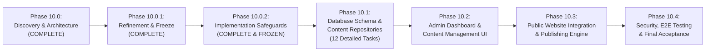

# PHASE_10_ROADMAP.md — Admin CMS Implementation Roadmap

**Project:** VOIDTECH SOLUTION ("Build. Launch. Grow Online.")  
**Milestone:** Phase 10 — Admin CMS  
**Document Status:** FROZEN ARCHITECTURAL BLUEPRINT & SAFEGUARDS (DESIGN FREEZE AUTHORIZED)  
**Author:** Google DeepMind Assistant  
**Approved By:** SHIVANSHU SATYAJEET (Project Owner) — Design Freeze Authorized  

---

## 1. Executive Summary & Phased Strategy

Phase 10 delivers a production-grade, headless administrative Content Management System (CMS) enabling authorized VOIDTECH administrators (`SUPER_ADMIN`, `ADMIN`, `EDITOR`) to manage the agency's public digital presence without code deployments or developer intervention.

To eliminate risk, prevent regressions with the existing Phase 9 CRM and Phase 7 authentication systems, and ensure strict architectural discipline, Phase 10 is decomposed into **6 sequential milestones**:

---

## 2. Milestone Breakdown & Status

### Phase 10.0: CMS Discovery & Architecture (COMPLETE)
- **Status:** **COMPLETE** (Read-Only Audit & Specification Authoring)
- **Deliverables:** Baseline discovery report, architecture, database design, API design, RBAC matrix, security review, testing blueprint, and execution roadmap.

---

### Phase 10.0.1: CMS Architecture Refinement & Design Freeze (COMPLETE)
- **Status:** **COMPLETE** (Read-Only Architecture & Design Freeze)
- **Deliverables:** Incorporated 7 owner-approved decisions, Approach A/B/C evaluation matrix, deterministic lifecycle state machine, GFM Markdown pipeline, and offline fallback guarantees.

---

### Phase 10.0.2: Final CMS Implementation Safeguards (COMPLETE & FROZEN)
- **Status:** **COMPLETE & FROZEN** (Read-Only Safeguards & Engineering Invariants)
- **Key Deliverables:**
  - `PHASE_10_0_2_IMPLEMENTATION_SAFEGUARDS_REPORT.md`: Comprehensive safeguards charter.
  - `CMS_ARCHITECTURE.md`: Incorporated dual-pointer draft/published separation (`currentPublishedRevisionId`, `currentWorkingRevisionId`), 9-step atomic publishing transaction, testimonial dual-state model, hardened media defaults, and 5-scenario static fallback matrix.
  - `CMS_DATABASE_DESIGN.md`: Updated ERD, dual pointers, database referential integrity & circular dependency analysis, updated `Testimonial` and `MediaAsset` schemas.
  - `CMS_API_DESIGN.md`: Updated Server Action contracts, response envelope with `isFallback` and `source`, 9-step transaction protocol, and testimonial consent actions.
  - `CMS_RBAC_PERMISSION_MATRIX.md`: Updated matrix reflecting default disabled SVGs and dual-state testimonial verification.
  - `CMS_SECURITY_REVIEW.md`: Updated 15-scenario threat matrix incorporating all safeguards.
  - `CMS_TESTING_STRATEGY.md`: Updated 5-tier testing blueprint and 15 security verification tests.

---

### Phase 10.1: CMS Database Schema & Content Repositories (IN PROGRESS — TASK 10.1.2 COMPLETE)
- **Objective:** Establish the persistent database, domain models, storage abstraction, and repository foundation for all CMS content models using Approach C and the Phase 10.0.2 safeguards.
- **Execution Boundary:** Task 10.1.1 and Task 10.1.2 are complete and verified. Task 10.1.3 requires separate owner authorization.

#### Detailed 12-Task Implementation Plan:

| Task ID | Task Title & Scope | Dependencies & Prerequisites | Acceptance Criteria |
| :--- | :--- | :--- | :--- |
| **Task 10.1.1** | **Prisma Schema Additions & Relations** Define `ContentType`, `ContentPublicationStatus`, `RevisionLifecycleStatus`, `TestimonialVerificationStatus`, `ClientConsentStatus`, `StorageProviderType` enums. Add `ContentItem` (with dual pointers), `ContentRevision`, `Testimonial`, and `MediaAsset` models. Add relation links to `Service`, `PricingPackage`, `PortfolioProject`, `PageSection`, `FAQ`. | None (Schema Authoring) | ✅ **COMPLETE & VALIDATED**: Formatted & validated with `npx prisma validate` (0 errors). Zero migrations generated. |
| **Task 10.1.2** | **PostgreSQL Migration Generation & Verification** Generate migration `20261114000000_admin_cms_foundation`. Include PostgreSQL triggers `verify_revision_ownership()` and `protect_published_revisions()`. Apply to isolated test database. Author reversible `down.sql` script. | Task 10.1.1 | ✅ **COMPLETE & VALIDATED**: Migration applies cleanly to PostgreSQL without data loss. Triggers, referential constraints, dual pointers, and rollback `down.sql` verified with 100% pass rate. |
| **Task 10.1.3** | **Prisma Client Generation & Type Export** Execute `prisma generate` to produce updated client types. Export shared TypeScript models and DTO interfaces in `@/types/cms`. | Task 10.1.2 | `npm run typecheck` passes with 0 errors. All new models accessible via `@prisma/client`. |
| **Task 10.1.4** | **Base Zod Validation Schemas** Implement Zod schemas in `@/lib/validations/cms.ts` for all content types: `serviceSchema`, `pricingPackageSchema`, `portfolioProjectSchema`, `testimonialSchema`, `pageSectionSchema`, `faqSchema`, `mediaAssetSchema`. | Task 10.1.3 | Comprehensive unit tests pass (Tier 1: 35+ assertions). Validates length, slug regex, positive pricing, and sanitized inputs. |
| **Task 10.1.5** | **ContentItem & ContentRevision Repository (Approach C)** Implement `src/lib/repositories/cms/content-item.repo.ts` and `revision.repo.ts`. Handle canonical identity creation, dual-pointer management, revision retrieval, and diff generation. | Task 10.1.3, 10.1.4 | Repository methods create canonical items, manage dual pointers, and append immutable revisions. Draft isolation strictly maintained. |
| **Task 10.1.6** | **9-Step Atomic Publishing Transaction Engine** Implement 9-step atomic publishing transaction: authenticate admin, check permissions, OCC check (`version === expectedVersion`), verify revision ownership, validate Zod constraints, upsert domain record, promote pointer, and create audit log. | Task 10.1.5 | Stale version updates throw `ConcurrencyConflictError` (409). Publish atomically promotes revision data to domain table with rollback on any failure. |
| **Task 10.1.7** | **Draft Revision Retention & Auto-Pruning Engine** Implement retention pruning logic in `revision.repo.ts`. Retain maximum 20 working draft revisions per content item. Exempt all published revisions permanently. | Task 10.1.5 | Revisions > 20 pruned when `revisionStatus = WORKING_DRAFT`. Zero published revisions ever deleted. |
| **Task 10.1.8** | **Domain Content Repositories Implementation** Enhance `services.repo.ts`, `pricing.repo.ts`, `portfolio.repo.ts`, `faq.repo.ts`, and implement `page-sections.repo.ts`, `testimonials.repo.ts`. Enforce dual verification and consent gate on testimonials. | Task 10.1.6 | Domain queries read materialized tables. Public queries filter by `isActive = true`. Testimonials require `verificationStatus = 'VERIFIED' AND clientConsentStatus = 'GRANTED'`. |
| **Task 10.1.9** | **StorageProvider Abstraction & Local Filesystem Provider** Implement `StorageProvider` interface in `@/lib/storage/types.ts`. Implement `LocalFileSystemStorageProvider` in `@/lib/storage/local-provider.ts` with directory traversal protection. Restrict to development. | Task 10.1.3 | Files written safely to `public/uploads/` with sanitized keys. Relative path escapes blocked. Serverless ephemeral writes blocked. |
| **Task 10.1.10** | **Media Asset Processing Pipeline** Implement `MediaService` in `@/lib/services/media.service.ts`. Integrate `sharp` for raster conversion (WebP). Reject SVG uploads by default. Magic-byte MIME detection. | Task 10.1.9 | Disguised binaries rejected. WebP generated. SVGs rejected with 400 Bad Request. |
| **Task 10.1.11** | **GFM Markdown Parser Utility** Implement Markdown-to-HTML parser using `unified`, `remark-gfm`, `remark-rehype`, `rehype-sanitize`, `rehype-external-links`, `rehype-stringify`. | Task 10.1.4 | Script tags, onerror handlers, iframe tags stripped. GFM tables, bold, italics, autolinks rendered cleanly with `rel="noopener noreferrer"`. |
| **Task 10.1.12** | **5-Scenario Static Fallback Integration** Update `prisma/seed.ts`. Wire hardcoded fallback registries (`@/config/*`) into repository catch blocks. Emit `X-Voidtech-Content-Source: static-fallback` and `isFallback: true` for DB disconnects, empty tables, and invalid snapshots. Return 404 for archived items. | Task 10.1.8, 10.1.11 | Database disconnect test passes: public calls return static fallback registries with structured logging without crashing. |

- **Exit Criteria for Phase 10.1:**
  - All 12 tasks completed and verified with automated test suites.
  - 100% test pass rate across Vitest Tier 1 & Tier 2 suites on real PostgreSQL.
  - Zero regressions on existing 462 Vitest tests and 21 Playwright CRM tests.
  - Production build `npm run build` passes with 0 errors.

---

### Phase 10.2: CMS Admin Dashboard & Content Management UI
- **Objective:** Build the interactive, responsive administration interfaces inside the existing `/admin/*` dashboard.
- **Scope:** CMS Overview Dashboard (`/admin/cms`), Services UI, Pricing Tiers UI (with role-based publish restrictions), Portfolio UI, Testimonial Verification Drawer, Knowledgebase FAQs UI, Page Sections UI, Media Library, and Revision History Diff Sheet.
- **Exit Criteria:** Responsive across 10 viewports, full ARIA a11y compliance, Zod form validation.

---

### Phase 10.3: Public Website CMS Integration & Publishing Engine
- **Objective:** Connect public routes to CMS repositories with instant on-demand cache revalidation and Next.js Draft Mode previews.
- **Scope:** Public route refactoring, Next.js Draft Mode preview subsystem with amber HUD banner, mandatory `X-Robots-Tag: noindex, nofollow`, on-demand cache revalidation (`revalidatePath`, `revalidateTag`), and static fallback resilience.
- **Exit Criteria:** Dynamic content renders on public site; cache invalidates instantly on publish; draft mode isolated.

---

### Phase 10.4: Security, E2E Testing & Final Acceptance
- **Objective:** Exhaustive quality assurance, security penetration audit, visual proofs across 10 viewports, and formal sign-off.
- **Scope:** Complete Playwright E2E browser test suite, verification of all 15 security test cases (SEC-01 through SEC-15), 10-viewport screenshots, performance benchmarking (< 100ms response times), and final acceptance report.
- **Exit Criteria:** All 6 quality gates green; zero defects; formal owner authorization.

---

## 3. Dependency Graph & Risk Mitigation

| Identified Risk | Impact | Mitigation Strategy |
|---|:---:|---|
| **Public Site Layout Regression** | High | CMS data feeds into existing, hardened layout components (`<CinematicHero />`, `<PricingTable />`). Fallback configs guarantee zero visual degradation. |
| **Pricing Table Client Discrepancy** | High | Refactor `PricingTable` in Phase 10.3 to accept server-fetched `packages` as a prop while preserving static `@/config/pricing` as the default fallback. |
| **Unpublished Draft Search Indexing** | Critical | Mandatory `<meta name="robots" content="noindex, nofollow" />` and `X-Robots-Tag: noindex, nofollow` emitted whenever Draft Mode is active. |
| **Concurrent Editorial Overwrites** | Medium | Monotonic integer `version` OCC locking aborts conflicting saves and triggers side-by-side visual diff resolution. |
| **Serverless Ephemeral Storage** | High | Ephemeral storage forbidden in production. Local filesystem restricted to dev. Cloudflare R2 deferred for future persistent production. |
| **Testimonial Legal Liability** | High | Dual-gate verification: Requires both `verificationStatus = 'VERIFIED'` AND `clientConsentStatus = 'GRANTED'` before publication can succeed. Instant revocation unlists at SQL level. |
